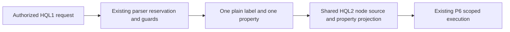

# RCA: D7 labeled property projection remained outside main

## Symptom and evidence

At main `5eb2fa4`, actor-scoped `hql.v1` rejects
`MATCH (n:Person) RETURN n.prop.score`, although the archived HQL2 branch
contains a bounded differential-tested implementation in `3f2e66b0`.
The current adapter already supports unlabeled zero-hop single-property
projection and labeled zero-hop ID projection.

## Root cause

The labeled single-property extension remained on a divergent branch while
later mainline changes added resource and ordering guards. Whole-file recovery
would lose those later guards. The narrow property arm unnecessarily rejects
every label rather than validating one plain identifier.

## Why detection failed

The existing negative-shape test expected labeled property projection to fail;
it did not exercise the archived extension's approved differential contract.
Branch presence and historical tests did not establish mainline integration.

## Remediation and prevention

Allow one validated plain label only in the existing zero-hop property arm.
Keep pre-parse authorization/reservation, P6 lease, namespace, ordering, limit,
temporal and unsupported-shape guards. Compare labeled property bags through
legacy HQL, canonical HQL2 and actor-scoped HQL1, including duplicate values,
missing/explicit-null properties and a label with no matching nodes. Retain
negative tests for filters, multiple columns, ordering, limits and temporal
clauses; reject labels outside the plain-identifier subset.

## Validation

The recovery PR records fresh current-head tests, builds, strict lint and
documentation checks, including pending or failed states. Historical branch
results are not counted as fresh acceptance evidence.

Scoped architecture review (implementer, not independent): label text reaches
the existing canonical node source only after plain-identifier validation.
Property keys keep their existing JSON escaping and output-column mapping.
The zero-hop ordering guard, pre-parse authorization/reservation and shared
P6 snapshot execution path are retained. Broader independent qualification is
not claimed.
