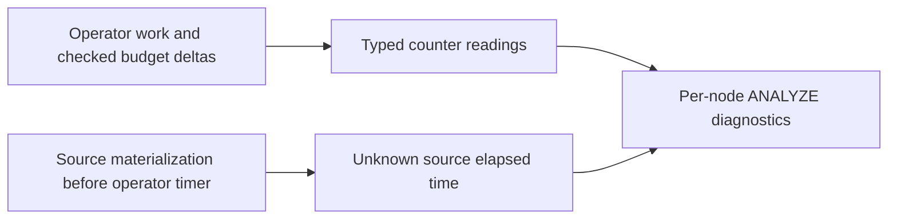

# RCA: G4 typed diagnostics absent after partial integration

## Symptom and evidence

At main 5eb2fa4, ActualCountersV2 exposed preliminary optional numeric fields
and the G4 contract test checked only output_rows presence. The active G4 ADR
requires typed units, measured/unknown reasons, provenance and overflow state.
The archive contains the missing implementation in ed75e16d and regression
strengthening in d385c608. Branch audit found these residual source changes.

## Root cause

The plan-identity integration reached main, while the later typed-counter
implementation remained on the divergent HQL2 branch. A shared ADR did not
prove that its full diagnostic schema had been implemented in main.

## Why detection failed

Existing main tests accepted any present output_rows value, without asserting
the closed diagnostic vocabulary, unknown reasons or SourceScan elapsed scope.
Historical branch evidence and partial integration evidence described different
revisions.

## Remediation and prevention

Selectively port typed result readings and operator accounting onto current
main. Keep current restore, P6 and security code. Pin the serialized contract,
measured-zero/unknown/overflow distinction, source timing attribution and
budget failure without successful partial rows in current tests. Update peer
contracts to distinguish unknown counter readings from absent frontiers.

## Validation

The initial recovered counter patch passes 42 library unit tests and all 40
root HQL2 targets (411 passed, 0 failed, 1 existing ignored case). Formatting
and documentation validation pass (244 files, 0 violations). Strict core
all-target Clippy passes after the separately documented baseline lint cleanup.
The final expanded G4 regression passes 547 tests with zero failures and one
existing ignored parser child entrypoint exercised by its parent, across
46 test executables (library and 45 integration targets). Strict default/NAPI
all-target Clippy and both default and standalone-server builds also pass.
Hosted results are recorded with the PR; broader G4 qualification remains
open. No archived test result is counted as a fresh run.
