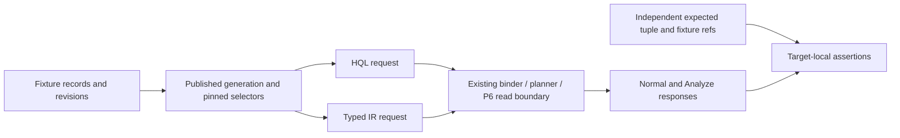
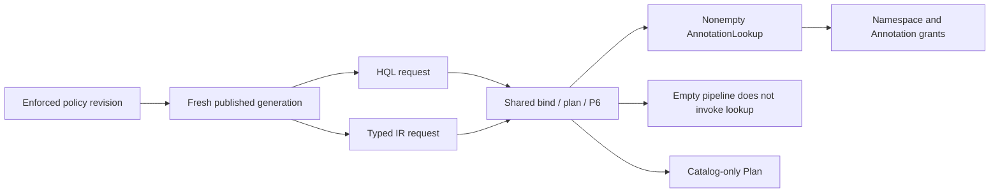
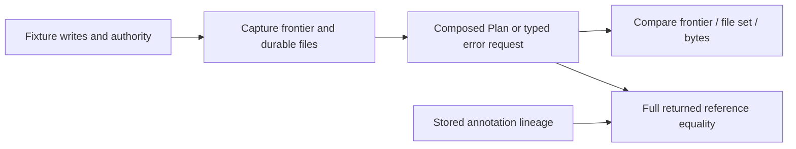
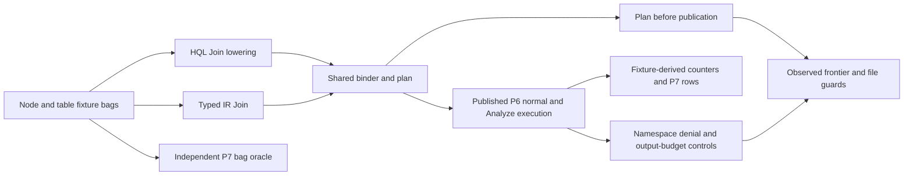
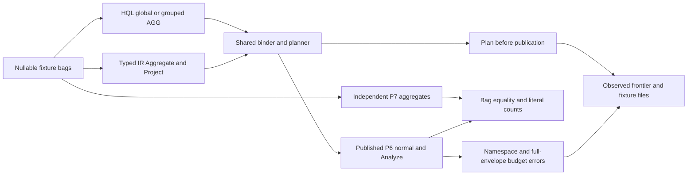
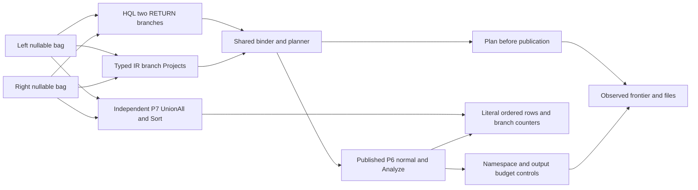

## Post-PR271 Phase B1 scalar type-admissibility status (2026-10-26)

Authority: fetched `origin/main` `6bd493e7d8cc58d38b27a4c916b0d16237aeceb0`
(tree `0f9480e3badf0137841e2e7aa3f05789d7bf1f2a`) after PR #271, together with
the G4 ADR, P8 addendum, typed boundary, C4/Master, implementation plan and
P6/H2-D11 peer contracts. The Phase B1 owner-approved branch is a local
tests/docs candidate only. Its repo-wide `cargo test --locked --offline
--no-default-features --jobs 1 --tests` completed with exit 0: 158 target
result blocks, 1,297 passed, 0 failed, and 6 ignored. The subset of 44 root
HQL2 targets had 466 passed, 0 failed, and 1 ignored; the parser probe child
is exercised by its passing parent and is not added as a second target result.
The focused scalar target passed 17/17 after the final test-name clarification.
Core/default all-target Clippy, formatting, docs validation (0 violations in
244 files), version check (0.2.10) and diff checks passed. Final independent
review, hosted review and exact-head CI have not yet been recorded here.

Phase B1 qualifies scalar type admissibility for `Values`, `Filter`, `Project`,
`Distinct`, Sort key type, `Take`, and HQL `SKIP`/typed-IR `Offset`. Six tests
were appended to the existing scalar counter target:
`scalar_type_admissibility_matrix_accepts_row_shaping_kernels`,
`scalar_type_admissibility_matrix_filters_and_compares`,
`scalar_type_admissibility_matrix_functions_and_checked_arithmetic`,
`scalar_type_admissibility_matrix_rejects_unsupported_cells`,
`decimal_u64_structural_pagination_accepts_boundary_parameters`, and
`finite_float_boundary_and_checked_result_fail_closed`. The focused target
passed 17/17 with zero failures or ignored tests on this candidate.

The paired HQL2/typed-IR cases use literal output schemas and rows, with the
unchanged P7 oracle only for independently representable cells. They cover the
selected Bool/I64/DecimalU64/F64Finite/Utf8, nullable, nested-list and
structural Vector cases; Boolean filters/logic, same-type comparisons,
registered scalar functions, ordinary I64/F64 arithmetic results, and HQL
DecimalU64 pagination boundary acceptance at zero and `u64::MAX`. The existing
paired checked-I64 overflow/division test remains unchanged in this target; the
B1 finite-float test adds a non-finite-result guard. The two-row pagination
fixture verifies accepted boundary parameters and bounded output, not exact
downstream count semantics. Rejected cells pin existing categories/reasons.
Sort uses at most one row (or an empty input), so this is key-type admission
evidence only; it does not assert order, tie, multi-key, or composition rules.

This is finite `TESTED` evidence, not complete type-space qualification or G4/P8
closure. JSON/domain source values, Aggregate/UnionAll/Join, source provenance,
Plan/Analyze metadata, P6 authority, complete ordering/composition, broad
type-space, independent runtime/new-machine, performance, physical-device and
release gates remain outside this phase or open. P7 is unchanged. Preserve
P8 -> P9-P12 -> P13/P14 -> P15 -> P16. The prior PR269 SourceScan record below
is a historical snapshot; this section is the current base and B1 candidate
status.

Current source anchors: `src/query/hql2/value.rs::QueryTypeV2` and its
parameter decoder define accepted spellings and fail-closed representations;
`src/query/hql2/bind.rs::Kernel` plus `ordered`, `equality_comparable`, and
`numeric` define the selected admission predicates. The typed-boundary
contract and P6/P7 peer specifications remain the authority; tests do not
change them.

## Historical post-PR269 type, order, composition and provenance snapshot (2026-10-26)

This section preserves the earlier snapshot taken before PR #271. Its recorded
base `b4372dc347cc265f405b94aea38bc453d51565a7` and tree
`0db1f62d3b1e0b1c8faf13f400164d5606c0aade` are historical, not current main.
PR #269 was merged and its recorded host qualification was 460/0/1 across 44
HQL2 targets plus 145/0/0 across 11 compatibility targets (605 distinct
passing target/test-name pairs). Its hosted checks were 15 SUCCESS and one
conditional schedule-only security advisory SKIPPED, including Rust Ubuntu,
Windows and macOS SUCCESS. The merge record contains no formal GitHub review
event; its independent reviewer runtime is NOT_RUN. Those selected SourceScan
results remain historical evidence, not broad closure or B1 results.

| Dimension | Contract/source universe | Current evidence | Remaining status |
|---|---|---|---|
| Types | `QueryTypeV2`: Null, Bool, I64, DecimalU64, F64Finite, Utf8, Json, Entity, HistoryRevision, ChangeEvent, Path, Score, Context, Vector; Nullable and List are recursive wrappers. P8 input constructors and operator admissibility are narrower (typed-boundary lines 606-668). | Selected scalar I64, nullable, source/domain, Join/UnionAll/Aggregate and metadata fixtures. | MISSING_EVIDENCE: contract-derived `(kernel, type, nullability/nesting, frontend, mode)` matrix for every supported and explicitly unsupported cell. Engine-issued domain values are not implied valid user parameters. |
| Ordering/equality | P8 exact comparator and NULL rules; binder `ordered`, `equality_comparable` and numeric predicates (`bind.rs` lines 315-325). | Selected NULL regressions, literal ordered rows, selected UnionAll edge order and bounded HQL1 D7 ordering. | MISSING_EVIDENCE: all declared key types × ASC/DESC × explicit/default NULL order × ties/multi-key and preserving/destroying composition edges. Mixed/domain ordering is unsupported unless explicitly named. |
| Composition | 19 `Kernel` variants (`bind.rs` lines 192-264), six `BoundSourceV2` alternatives and KNN/Rerank modes. | Selected scalar pipeline and storage-backed UnionAll, Aggregate, Join, graph, vector, annotation and text compositions named in the matrix below. | MISSING_EVIDENCE: complete contract-derived legal composition graph and every legal edge plus selected longer paths across HQL/typed IR and Normal/Plan/Analyze. Do not turn an undocumented edge into accepted behavior. |
| Provenance | `QueryResultV2` fields: request ID, selected snapshot, ordered columns/rows, semantics, completeness, frontiers/cursor, optional Explain (`result.rs` lines 140-221). P6/H2-D11 remain authority for lease, ACL and durable revision lineage. | Independent literal/P7 assertions for selected #266/#267/#269 output families and existing provenance fixtures. | MISSING_EVIDENCE: full source × kernel × type × mode provenance matrix, all direct literal identities/revisions, and independent complete P6 authority proof. Metadata equality is consistency only. |
| Plan/Analyze state | G4 plan-only EXPLAIN and read-only measured ANALYZE; selected no-effect and typed counter rules. | Selected fixture frontier/files/counter guards and Plan-before-publication cases. | MISSING_EVIDENCE: universal transient/internal-write absence, ordinary nonempty-success state effects and general performance thresholds. Lock/shm size-only observations are not byte identity. |

The 19-kernel inventory and test anchors remain in “All 19 executable kernel
variants” above. Selected coverage includes every named family, but cells listed
as residual there remain open. The registry is not a complete cross-product.

### Downstream gate status

| Gate | Classification | Closure evidence still required |
|---|---|---|
| P6 / H2-D11 | IMPLEMENTED contracts; selected TESTED | Fresh exact-main lease/generation/ACL/temporal/retention/revocation/recovery matrix. Keep the P6 contract fixed; R6 RCA and separate approval before any defect correction. |
| P9 | First deterministic `plan_v2` IMPLEMENTED; later optimizer/index-path/pushdown work is planned | Define accepted planner behavior and baseline before implementation or performance claims. |
| P10 | Kernels IMPLEMENTED; selected composition TESTED | Contract-derived legal composition edges with exact bags/order/errors/counters/provenance and resource checks. |
| P11-P12 | Selected lexical profile and budgets IMPLEMENTED/TESTED | Durable index lifecycle is later planned behavior; fresh resource boundary, cancellation, cleanup and no-partial-result qualification remain. |
| P13-P14 | Core and additive NAPI v2 exist; broad surface mapping/recovery rehearsal NOT_RUN | Freeze each surface and clean-consumer mapping; separately rehearse fixture recovery/migration. No endpoint or user-database migration is authorized here. |
| P15-P16 | Broad current-main security/release NOT_RUN; physical-device gate unavailable | Fresh security review, build/release traceability and device evidence. No release/tag/publication is included. |

`request.rs::normalize` explicitly rejects v2 streaming/partial results;
enabling them is MISSING_BEHAVIOR/new contract scope, not a test-only gap.
Persisted analyzer/index lifecycle and P9 optimizer features are planned work,
not defects inferred from absence. Historical `AUDIT--P9` through `AUDIT--P16`
reports are baselines, not current gate passes. Physical iPhone/Android devices
are unavailable and remain NOT_RUN.

The root `AGENT.md` still contains a legacy HQL pipeline description that
predates the current `src/query/hql2/plan.rs` path. It is outside the approved
eight-file documentation phase; preserve it here as a separately scoped docs
reconciliation finding rather than expanding this change.

Current execution order: finite G4/P8 matrix and source-linked evidence ->
independent whole-scope source/evidence/architecture review -> separately
approved missing-evidence scopes -> P9 -> P10 -> P11 -> P12 -> P13/P14 -> P15
-> P16. Passing docs validation or host CI alone never marks the later gates
complete.
## Approved G4/P8 SourceScan result metadata qualification - 2026-10-26

Owner approved tests/docs-only seven existing files (LOW, C-3): one appended
SourceScan test with local helpers and these six governing documents. No
production/runtime/API/P6/WAL/hash/schema/ACL/planner/index/grammar/shared-P7 or
error-contract change. Baseline fetched `origin/main`
`c9fbc27f657e89e75f77d415d195a59311fd9d31`, tree
`9d530693b10177ba2facd8e2ba4dd811adfa7c10`.

The selected matrix has 48 requests: 16 pre-execution Plan controls and 32
Normal/Analyze results across Node, Edge, Row and Annotation; populated/empty
fixtures; and paired HQL/typed-IR frontends. Each fixture's Plan requests run
before its Normal/Analyze requests. The appended test is
`tests/hql2_g4_source_counter_tests.rs::source_result_metadata_has_independent_fixture_expectations_in_hql_and_ir`.

Expected metadata is derived from independent literals and fixture setup:
ordered root schema and source lineage, request ID, fixture-key/domain-derived
database ID, explicit publication receipt and selected snapshot fields, one
fixed fixture `valid_at`, four semantics fields, completeness, empty index
frontiers and a cursor key explicitly present with JSON null. Node/Edge/
Annotation identities are checked against fixture literals. Row IDs are UUIDv4
values assigned during fixture publication; the test reads `record_id` from the
fixture revision table before query execution to seed P7. The RowScan comparison
is therefore fixture-bound P7 evidence, not a precomputed literal UUID oracle.
Actual result order is not normalized. Plan asserts
the physical SourceScan, root schema, catalog policy revision/frontier and
absence of actuals/estimates. Analyze checks selected source counters and keeps
elapsed time typed unknown where uninstrumented. Metadata equality across modes
or frontends is not used as the expected oracle.

Host regression for candidate test source blob `cc1fa5dcd35b83424240272c0055124818fd03ab`: 460 passed/0 failed/1 top-level ignored across 44
HQL2 targets, plus 145/0/0 across 11 compatibility targets; 605 unique passing
target/test pairs, with the focused SourceScan test included once. Ignored parser
child invocations are excluded from that unique top-level count. Strict core/default all-target Clippy, formatting, documentation validation
(244 files, zero violations) and version consistency (0.2.10) pass for the
recorded candidate source. Primary task-agent source/evidence/architecture review
of the exact candidate source and seven-file scope completed with zero unresolved
findings; reviewer runtime was NOT_RUN. Required PR review and hosted exact-head
CI remain PENDING. The raw runs, unique-pair inventory and source hashes
are recorded under
`D:/GenesisBlock_Dev/local-cleanup-backups/20261019T030925Z-genesisblock/branch-review/g4-p8-sourcescan-result-metadata-qualification`.

This is selected fixture metadata qualification, not a complete P6 provenance
proof. Existing lock/shm size-only file observations do not prove universal
transient/internal-write absence or ordinary successful-execution state effects.
Broad G4/P8/P9-P16, exhaustive types/order/composition/provenance, independent
runtime/new oracle/other machine, performance, device and release gates remain
open. Preserve P8 -> P9-P12 -> P13/P14 -> P15 -> P16; devices are unavailable.

Current selected evidence: [P8 SourceScan result metadata](REPORT--HQL2-P8-CORE-2026-09-28.md#approved-g4p8-sourcescan-result-metadata-qualification---2026-10-26).

## Approved G4/P8 Join result metadata qualification - 2026-10-24

Owner approved tests/docs-only7existingfiles (LOW,C-3): one appended Join test
and these six governing documents. No production/runtime/API/P6/WAL/hash/schema/
ACL/planner/index/grammar/shared-P7/error-contract change. Baseline merged PR266
main `9a4e543a75a401cd2afb6f001fa13cc8952583d1`, tree
`95cf91c4a5428edb8aab5c2898c60d873cebc7a0`.

Selected Join metadata matrix:96requests=32prepublicationPlan controls+
64normal/Analyze successes, four Join kinds x four populated/empty-side datasets
x paired HQL/IR. Literal Join schema distinguishes Inner's nonnullable n/r,
Left's nullable right Entity, and Semi/Anti's absent right column. Root prop
columns are literal Nullable<Json>, with right_key only for Inner/Left; empty
results keep the same declared schemas. Nodes are located through root/input
lineage, not generated HQL IDs. SQL NULL and JSON null remain distinct and
duplicate bag multiplicity is checked against literal bags AND unchanged P7;
no ordering guarantee or complete JSON oracle is inferred.

All successful envelopes independently expect ordered root schema, request_id,
five snapshot fields, four non-ranking semantics fields, complete/reason=null/
eligible_count_known=true, empty index_frontiers and an explicitly present null
cursor. Identity comes from fixture public key/domain SHA256, never a discovery
query. Snapshot tx/generation/policy come from explicit publication receipt;
valid_at is captured once after setup before Plan, then reused with selected
tx_as_of. Analyze catalog uses separately captured live frontier/publication_seq,
not selected snapshot data tx. Receipts are not a complete independent P6 verifier.

Each dataset/kind/frontend gets a fresh enforced-policy fixture. Plan before any
publication/query execution expects literal Join/root schemas, catalog policy1/
captured frontier and no actuals/estimates, preserving observed files/frontier
with existing lock/shm size-only exceptions. Analyze preserves typed counters:
source elapsed stays unknown/not_instrumented; Join/Project elapsed is measured.
No timing/performance threshold or universal internal/transient/ordinary-success
no-write claim. Original Join functions, other tests and shared P7 remain unchanged.

Author final regression: 459/0/1 across44HQL2 targets plus145/0/0 across11
compatibility targets = 604 unique passing target/testpairs. Focused Join
results are included once, not added again. Top-level ignored parser child is
explicitly invoked twice by its passing parent; child invocations are excluded
from the main count. Primary strict core/default all-target Clippy,fmt,docs244/0,version0.2.10 and
diff checks passed. Fresh final source review/current-head hosted CI remain
PENDING until exact-head external records complete.

PR266 completed four workflows,15SUCCESS+1genuine schedule-only advisory skip,
including actual Rust Ubuntu/Windows/macOS, before normal merge9a4e543 at
2026-10-24T11:41:17Z (18:41:17+07:00). Reviewed headca9a686/tree95cf91c;
fetched-main/reviewed-tree parity was verified, not a runtime rerun. Final source/
evidence/architecture review0Critical/0Important/0Minor followed the corrected
cursor-presence assertion and full requalification. Prior catalog3/livecatalog4
fixture failure and initial Minor were retained/resolved, not new failures.
Its603author pairs and priorPR265600pair independent same-host reproduction are
separate dated evidence, not execution of this new Join test.

```text
literal Join/root schemas + literal/P7 bags + fixture identity
  -> prepublication Plan (catalog, observed state)
  -> explicit receipt + post-setup valid_at/selected tx
  -> HQL/IR normal/Analyze independent envelope -> host regressions
  -> final source/evidence review -> exact-head hosted CI
P8 -> P9-P12 -> P13/P14 -> P15 -> P16 (device/release remain open)
```

Broad G4/P8/P9-P16, exhaustive JSON/types/order/composition/provenance, universal
no-write/ordinary-success state effects, complete P6, independent new-test runtime/
new oracle/other-machine/performance/device/release acceptance remain open.
Devices unavailable; no repeat device request, release/tag/publication, surface
enablement or user-database migration authorized. Historical pending/NOT_RUN
sections remain dated checkpoints, not retroactively executed evidence.

### Exact Join metadata evidence

`tests/hql2_storage_hql_join_oracle_differential_tests.rs::storage_join_result_metadata_has_independent_fixture_expectations`
adds16selected Join-kind/dataset combinations,32fresh stores,96requests. Input
NodeScan/RowScan and Join/Project shapes stay existing supported requests.
Full-left=[J1,J1,SQLnull,J2,Jnull],full-right=[J1,J1,Jnull,J99]. Literal outputs
for Inner/Left/Semi/Anti are5/7/3/2; empty-left0/0/0/0,empty-right0/5/0/5,
both-empty0/0/0/0. JSON-null/number sentinels in the existing P7 bridge are a
bounded expected-value encoding, not a new general JSON interpreter.

Join-node ordered columns: Inner n:Entity/r:Entity nonnullable; Left n:Entity
nonnullable/r:Nullable<Entity>; Semi/Anti n:Entity only. Root left_key and optional
right_key are Nullable<Json>. Both Plan and Analyze use literal schema checks;
normal/Analyze each use independent expected metadata, never one mode's result
to seed another. Cursor presence includes pure JSON absent/null controls.

Exact source/head/tree, argv captured before execution, raw focused/full/static
logs, unique names, original-prefix preservation, plan, ledger, review and CI:
`D:/GenesisBlock_Dev/local-cleanup-backups/20261019T030925Z-genesisblock/branch-review/g4-p8-join-result-metadata-qualification`.
Fresh final reviewer is source/evidence-only unless a separate runtime run is
explicitly recorded. Publication receipts and public fixture identity constrain
this selected result; they do not prove all P6/H2-D11 internals or every record
reference/authority/lifecycle case. Existing namespace/budget/error regressions
remain unchanged. Source-family metadata fixtures and P13 surfaces are separate
future proposals, not silently enabled here.


## Approved G4/P8 independent result metadata qualification - 2026-10-24

Owner approved tests/docs-only9existing files (LOW,C-3): three existing test
targets and these six governing documents. No production/runtime/API/P6/WAL/
hash/schema/ACL/planner/index/grammar/shared-oracle/error-taxonomy change.
Baseline merged PR265 main `5bfc475eef6a66aa2cc5905ca43a469e8fc30684`,
tree `c48584599eaff12bcea70ad5c392624aec10a2b7`.

The new selected matrix contains96requests:32Plan controls before publication
and64normal/Analyze successes across16fixtures, paired HQL/IR. Scalar preserves
surviving NULL through Project/Distinct/Sort/Offset/Take/Return; UnionAll adds
selected Distinct/Sort/Project results; global/grouped Aggregate checks seven
existing functions. Nullable duplicates,all-NULL,empty,Take0 and empty branches
are finite partitions. Sorted scalar/set actual rows are compared without
sorting them; unordered aggregate groups remain bags.

Each successful envelope is compared independently to fixture expectations:
ordered column names/type/nullability; request_id; all five snapshot fields;
four non-ranking semantics fields; complete/reason=null/eligible_count_known=true;
empty index_frontiers and an explicitly present null cursor. Rows match literal
values AND unchanged
P7. Expected database identity is SHA256 of fixed domain bytes and the fixture's
public verifying key, never obtained by executing a query. Explicit publication
GenerationInfo supplies tx/generation/policy receipts; fixed valid_at and tx_as_of
are reused. These publication receipts are not an independent proof of all P6
internals. Empty result schema is declared, not inferred from rows.

Each frontend/case has a fresh enforced-policy store. Plan runs before publication,
expects literal root columns and catalog policy_revision1/captured frontier, no
actuals/estimates, and unchanged observed files/frontier (lock/shm size-only
exceptions). Execution snapshot receipts remain distinct from Plan's catalog
stamp. Normal has no explain; Analyze keeps measured readings and typed unknowns.
Existing counter/namespace/budget/error fixtures and all original test functions
remain unchanged. No universal transient/internal-write or ordinary-success
no-effect claim is made.

Author regression: HQL2 458 passed/0failed/1top-level ignored across44targets;
compatibility145/0/0 across11targets; 603 unique passing target/test pairs.
The ignored parser child is invoked in default/detailed processes by its passing
parent and excluded from the unique main count. Focused three targets pass;
focused results are included once in the broad total, not added again.
Primary strict core/default all-target Clippy,fmt,docs244/0,version0.2.10 and
diff checks passed. Fresh final source review/current-head hosted CI remain
PENDING until their exact-head external records are complete.

PR265's separate same-host independent verifier600pairs and sealed-before-author
comparison remain historical evidence for its unchanged inventory, not execution
of these new tests. Its final review0Critical/0Important/0Minor was source-only;
all four hosted workflows passed,15SUCCESS+1genuine schedule-only advisory skip,
including actual Rust Ubuntu/Windows/macOS, before normal merge5bfc475 at
2026-10-24T06:37:04Z (13:37:04+07:00). Fetched/reviewed-tree parity was verified,
not another runtime run. Prior pending/NOT_RUN sections are dated checkpoints.

```text
literal schema/rows + fixture public-key identity -> prepublication Plan control
  -> explicit generation receipt -> HQL/IR normal and Analyze expected envelope
  -> focused + broad host regressions -> final source/evidence review -> full CI
P8 -> P9-P12 -> P13/P14 -> P15 -> P16 (device/release gates remain open)
```

Broad G4/P8/P9-P16, exhaustive types/order/composition/provenance, independent
new implementations/other-machine/performance/device/release acceptance remain
open. Devices unavailable; no further device request, release/tag/publication,
public surface enablement or existing-user database migration is authorized.

### Exact assertions and evidence boundary

| Target / appended assertion | Selected partition | Independent expected authority |
|---|---|---|
| hql2_g4_scalar_counter_tests::scalar_result_metadata_has_independent_fixture_expectations |4cases x2frontends x3modes=24requests | Literal nullable y schema/ordered rows + independent P7 + fixture/publication receipt |
| hql2_storage_set_oracle_differential_tests::union_result_metadata_has_independent_fixture_expectations |4cases x2frontends x3modes=24 | Literal nullable x schema/ordered distinct rows + P7 + fixture/publication receipt |
| hql2_storage_aggregate_oracle_differential_tests::aggregate_result_metadata_has_independent_fixture_expectations |8cases x2frontends x3modes=48 | Literal count/sum/avg/min/max/collect/group-key schema, literal bags + P7 + fixture/publication receipt |

Existing provenance target's database_id helper discovers identity through a
query result. Its established lookup/rank ownership checks remain valuable,
but that discovery is not independent proof of database-id derivation. The new
three assertions intentionally use public fixture key/domain bytes instead.
Mode equality elsewhere remains self-consistency; this selected stronger proof
does not promote every kernel/source combination to complete metadata acceptance.
G4 criterion6 receives selected additional evidence; criterion8 separately tracks
author execution, final source review, hosted cross-OS, prior independent executor,
device and release evidence. No entire-G4/P8 sign-off is inferred.

External exact commands, first outcomes, source preservation, hashes, plan,
ledger, review and hosted records:
`D:/GenesisBlock_Dev/local-cleanup-backups/20261019T030925Z-genesisblock/branch-review/g4-p8-result-metadata-qualification`.
Initial focused scalar execution retained10passes/1fixture failure; Cargo stopped
before the other two targets ran. FIXTURE-RCA.md records a catalog/snapshot
frontier expectation error: publication records generation data frontier3 and
then emits receipt4; later catalog sees4. The new helper initially expected
Analyze catalog3. Correction independently captures stable_frontier after
publication for Analyze catalog, retaining generation receipt3 for snapshot.tx.
No assertion removed, output-derived expectation or runtime change. Final
corrected focused/broad acceptance is separate from that historical failure.
Initial source review found0Critical/0Important/1Minor: JSON indexing cannot
distinguish a missing cursor member from explicit null. The approved helper
assertion now uses get()==Some(null), with absent/null predicate controls.
Current runtime serialization was correct; this is test-only hardening. The
initial review and pre-hardening qualification remain preserved separately.
Corrected source requires full requalification and confirmation by the same
final reviewer; external exact-head records determine closure.
The frozen matrix/append script predates focused execution. Protected shared P7,
runtime and all original test functions are preserved. Snapshot identity is
fixture-derived, generation/frontier/policy expectations are publication receipts,
and neither claims a new independent engine or exhaustive P6 authority proof.


## Approved G4/P8 independent host reproduction - 2026-10-24

Owner approved this six-existing-document qualification lane (LOW, C-3) and
host-only verification; no production/test/runtime/API/P6/WAL/hash/schema/ACL
change. Baseline is merged PR264 main
`f060b387e66d72c21851cc62ed22dd45fbdae2d4`, tree
`57a077736ffef41eb505c44e3198ba892065bf32`.

A fresh verifier context independently executed the existing frozen inventory
from an exact-source snapshot, using a fresh build target and separate snapshot
working directory. All1,041 tracked files matched exact Git blob bytes before
execution. Snapshot `D:/GenesisBlock_Dev/g4ir-raw`, fresh output
`D:/GenesisBlock_Dev/g4ir-target`; shared Cargo registry cache was allowed,
while author test binaries/fixtures were not reused. This is separate-executor
reproduction on the same Windows host, not a new machine, independent engine/
oracle implementation, blind study, device or release qualification.

Verifier HQL2:455 passed/0 failed/1 top-level ignored in44 targets;
compatibility:145/0/0 in11. The600 passing target/test pairs
match the prior author inventory exactly. The ignored parser child is invoked
twice by its passing parent. A separate nocapture parser-parent rerun exposes
two successful child configurations; that rerun/children are excluded from the
main count. Verifier sealed its own raw outcomes/commands/times/hashes before
root compared them with author264 evidence. Complete source hashes remained
unchanged. Relative fixture paths use the separate snapshot; tests retain their
existing fresh TempDir allocation under the shared OS TEMP root. This is not a
filesystem security sandbox. Same-host finite reproduction is now recorded for this inventory;
full G4/P8 correctness or exhaustive type/order/composition/provenance coverage
is not thereby accepted.

PR264 completed four workflows,15 SUCCESS+1 genuine schedule-only advisory skip,
including actual Rust Ubuntu/macOS/Windows, before normal mergef060b38 at
2026-10-23T23:12:58Z (2026-10-24 06:12:58+07:00). Reviewed-tree parity is a
separate check, not another runtime run. Prior author/source-review/hosted and
this verifier's execution remain separate evidence records. Historical pending/
NOT_RUN statements below are dated checkpoints; the current reproduction item
is qualified only to the finite scope above.

```text
exact main + tracked-source hashes -> fresh snapshot/target
  -> independent verifier execution -> seal -> author comparison
  -> six-doc candidate -> final source/evidence review -> current-head CI
P8 -> P9-P12 -> P13 surfaces/P14 recovery -> P15 security -> P16 qualification
```

Primary strict core/default all-target Clippy, fmt, docs validation (244 documents,
0 errors), version consistency (0.2.10) and diff checks passed. This candidate's
final source review and hosted CI remain PENDING until exact-head records are
finalized externally. Broad
G4/P8/P9-P16, independent implementations/exhaustive semantics, universal no-write,
performance, physical-device and release acceptance remain open. Device execution
is NOT_RUN because the owner reports devices unavailable; no device request,
publication, release/tag or existing-user-database migration is authorized.

### Reproduction evidence and comparison boundary

| Evidence scope | HQL2 root targets | P6/Query IRv1/REST/schema targets | Meaning |
|---|---|---|---|
| Prior author PR264 | 455 /0 /1 across44 |145 /0 /0 across11 | Existing author execution; retained unchanged |
| Fresh independent verifier |455 /0 /1 across44 |145 /0 /0 across11 | Actual separate-executor same-host run from exact snapshot |
| Separate parser-parent nocapture rerun |1 parent +2 child configurations |N/A, parser-only audit |Not added to the main600 count |
| PR264 hosted |Ubuntu/macOS/Windows actual Rust suites passed |Part of completed Tests workflow |Separate cross-OS execution, not this candidate's future CI |
| Final candidate source/evidence/architecture review |PENDING until fixed-head report |No extra runtime by implication |Independent of verifier execution; do not conflate roles |

Raw records are in
`D:/GenesisBlock_Dev/local-cleanup-backups/20261019T030925Z-genesisblock/branch-review/g4-p8-independent-host-reproduction-qualification`:
SNAPSHOT-MANIFEST.json, verifier/PRE-RUN.json, verifier/SEAL.json,
AUTHOR-VERIFIER-COMPARISON.json, independent raw logs/summaries/name inventory,
and static/review/CI records. Commands/environment/toolchain were captured
before verifier execution. Root checked the verifier seal/hash manifest and
independently parsed target/test identity only after it was sealed. Passing
counts are test cases, not600 independent semantic requirements.

The existing 19-kernel/eight-criterion/source-mode ledger below remains the
semantic coverage map. This execution adds reproducibility evidence to its
selected assertions; it does not create new operator behavior, upgrade mode
metadata consistency to universal independent provenance, or erase residual
P6/H2-D11 concurrency/retention/crash/lifecycle/P13 surface obligations. Existing
P7 reference code remains independent expected-value authority where named;
rerunning it does not constitute a newly independent oracle implementation.
Plan/error file-frontier guards retain lock/shm size-only exceptions and do not
prove absence of all transient/internal writes or ordinary-success state effects.

Verifier toolchain was rustc/cargo1.96.0, target x86_64-pc-windows-msvc,
Windows11 build26300. The first command started2026-10-24T03:49:26Z; verifier
sealed2026-10-24T04:05:37Z before root comparison at04:07:23Z. The root-checked
seal SHA256 is91a977ee514f219b2e24d953c4b8f3a4be258aa363e79971616757c57c043f25.
PRE-RUN records source/lock hashes, environment allowlist and absent target path
before execution; per-command start/outcome files bind argv/cwd/times/exits/logs.
Shared registry cache and the OS TEMP base are not claimed to be separately
provisioned infrastructure; no author compiled test binaries or old fixture
directories were copied into the new run.

### Preparation tooling RCA (before any verifier runtime)

The first snapshot extraction failed at a278-character Windows destination
with an existing parent. A short-path extraction resolved that path condition,
but the exact-byte guard then found git archive had applied existing
`core.autocrlf=true`: one inspected Markdown blob40778bytes/0CRLF became
41666bytes/888CRLF, equal only after normalization. Neither attempt was accepted
or executed as verifier source. The archive and both unqualified extraction directories were retained.
A fresh archive used per-command `-c core.autocrlf=false` without changing user
Git/OS policy; a fresh short root passed all1,041 exact tracked-blob checks.
TOOLING-RCA.md records symptoms/evidence/cause/detection gap/prevention. This
is preparation tooling history, not an engine/test failure or a source fix.
The approved six-doc ceiling is retained; no new tracked RCA/code file is added.

### PR264 exact delivery reconciliation

Reviewed head7aac197a248c837ad9ee25a460e90dafb11b1ac8/tree57a077736ffef41eb505c44e3198ba892065bf32
merged asf060b387e66d72c21851cc62ed22dd45fbdae2d4. Tests40023005003,
Security40023004936,performance40023004942,worker40023004825 all completed
success. Actual Rust jobs Ubuntu120652058035/Windows120652057919/
macOS120652058149 passed their applicable test steps and jobs. Full rollup15
SUCCESS+1 genuine schedule-only advisory SKIPPED. Fresh whole-scope source/
evidence/architecture review0Critical/0Important/0Minor was source-only;
reviewer runtime at that checkpoint wasNOT_RUN. Fetch/tree parity was verified
separately; no postmerge runtime rerun was inferred. This new same-host verifier
run is explicitly later, separately executed evidence, not a rewrite of that
source review or historical pipeline status.

Version transition: `0.1.87b` -> `0.1.88b`; independently executed host evidence and PR264 reconciliation only.

## Historical PR264 G4/P8 broad host qualification ledger - 2026-10-24

This is the first broad qualification snapshot before PR #265-#271. Current
main and the Phase B1 candidate are summarized at the top of this report; this
dated ledger and its original counts remain historical evidence.

Owner approved the first broad qualification slice: six existing documents,
existing host regressions and one fresh whole-scope independent source/evidence/
architecture review. LOW risk, C-3; no test or production code change. Physical
devices are unavailable; device execution is deferred, not accepted. Baseline
is merged PR263 main `0a5db778e533152d20fdbd8be7dfcc0e03c4fc4b`, reviewed tree
`ed2ba0fcf3d802f0c5e2f66a66c3a817c774ee56`.

This ledger supersedes the *current-status interpretation* of the historical
matrix based on `919814f` below; it does not rewrite that dated source audit.
The finite partitions here describe observed qualification. They do not silently
replace the governing G4 ADR acceptance criteria or make the type/expression/
composition space exhaustive.

### Evidence vocabulary and execution scopes

- **IMPLEMENTED:** named production path exists; not a test-pass claim.
- **TESTED (selected):** named assertions exist and their target passed the
  recorded run. This does not assert every cell of a frontend/type/mode matrix.
- **MISSING_EVIDENCE:** behavior may exist, but the stated broader obligation
  lacks sufficient independent/finite accepted qualification in this ledger.
- **MISSING_BEHAVIOR:** an explicit unsupported/future capability requires a
  separate approved contract/implementation, not merely more test evidence.
- **NOT_RUN:** no execution evidence obtained for that verification scope.
- **N/A:** an explicit semantic reason is required; an empty fixture alone is
  never a reason to label a dimension inapplicable.

Author host regression: **455 passed, 0 failed, 1 ignored across all 44 root
`tests/hql2_*.rs` Cargo integration targets**, locked no-default-features, jobs2,
serial tests. The initial recursive filename count49 included support helpers;
44 is the executable root-target inventory. The ignored top-level
`hql2_parser_tests.rs::parser_heap_probe_child` is invoked by
`heap_reservation_covers_isolated_allocator_probes` in two dedicated processes
(default/detailed diagnostics); the passing parent asserts each child exit
status. Count455 excludes child invocations and repeated focused runs. Child
stdout is captured by the parent; the ordinary harness hides it on success.
This is author execution on the reviewed source tree, not independent runtime
reproduction or a new device run. Runtime inventory, exact commands and raw
logs are preserved outside the repository in
`D:/GenesisBlock_Dev/local-cleanup-backups/20261019T030925Z-genesisblock/branch-review/g4-p8-broad-qualification-20261024`.

Separate compatibility qualification: **145 passed/0 failed/0 ignored across
11 existing targets**. Combined author execution is600 passed/0 failed/1 ignored
in55 targets, with600 distinct target/test-name pairs; this counts test cases,
not600 independent semantic obligations. Strict core/default all-target Clippy
passed (2m38s /4.41s), fmt/docs244 files0 violations/version0.2.10/diff checks
passed. Source/test content remains unchanged; these runs qualify the baseline
source tree, while the final docs commit has a different full Git tree.

| Compatibility target | Passed / failed / ignored |
|---|---|
| `meta_format_migration_tests` | 4 / 0 / 0 |
| `p6_generation_tests` | 6 / 0 / 0 |
| `p6_lease_tests` | 10 / 0 / 0 |
| `p6_peer_authority_tests` | 10 / 0 / 0 |
| `p6_snapshot_authority_tests` | 6 / 0 / 0 |
| `p6_visibility_tests` | 15 / 0 / 0 |
| `query_ir_tests` | 11 / 0 / 0 |
| `rest_api` | 13 / 0 / 0 |
| `rest_api_tests` | 48 / 0 / 0 |
| `schema6_migration_tests` | 19 / 0 / 0 |
| `schema_version_tests` | 3 / 0 / 0 |


### Eight governing G4 acceptance criteria

| ADR criterion | Current evidence / authority | Remaining acceptance |
|---|---|---|
| 1. Approved ADR + parent/registry agreement | Owner approved this six-doc consolidation; synchronized version entries and dependency diagram | Candidate docs validation and final source/evidence review required before integration |
| 2. Shared closed binder/runtime | `src/query/hql2/bind.rs::Kernel`, `plan.rs::plan_v2`; wire/request/lower/execution targets; HQL1 adapter and labeled-filter/property/ordering targets in run44 | TESTED selected supported allowlist, not all legacy HQL. Unsupported forms remain fail-closed; broader equivalence MISSING_EVIDENCE |
| 3. Deterministic identity/capability | `hql2_g4_plan_identity_tests.rs::{fixed_values_golden_and_changed_parameters_share_shape_but_not_results,ordered_and_repeated_union_edges_are_preserved_in_shape_and_bag,hql_and_ir_share_hash_only_for_identical_independently_specified_shapes}` | TESTED selected independent goldens. Equal hash is shape consistency, not query equality/authorization; general optimizer/version policy outside this slice |
| 4. No-effect Plan | `hql2_explain_source_tests.rs::{explain_source_plan_does_not_open_data_or_publish_a_snapshot,explain_edge_row_and_annotation_sources_preserve_frontier_and_fixture_files,explain_history_and_change_sources_do_not_publish_or_write,explain_lexical_and_context_do_not_publish_or_write}`; composed Plan-before-publication controls in provenance target | TESTED observed fixture frontier/files. Universal internal/transient-write absence MISSING_EVIDENCE; lock/shm sizes only, not byte identity |
| 5. Measured read-only Analyze under P6 | Typed measured/unknown counters in G4 contract/scalar/source/graph/rank/text targets; `hql2_explain_source_tests.rs::analyze_does_not_attribute_pre_execution_source_scan_time_to_operator`; P6 regressions separately | TESTED selected exact counts/units/unknown reasons. No timing-performance threshold or universal ordinary-success state guarantee |
| 6. Per-operator exact oracle / bags/order/NULL/temporal/ACL/budgets/completeness | 19-kernel inventory and source-family partitions below; independent P7 outcomes where explicitly named | TESTED finite partitions; whole cross-product and general independent complete metadata/provenance remain MISSING_EVIDENCE |
| 7. Legacy regression/no transport or migration | Existing supported adapter targets in run44, plus separate Query IR v1/REST/schema regressions; six-doc-only diff | No user database migration or public contract change. Hosted candidate CI still required; broader P13 is not inferred |
| 8. Independent/hosted/device/release separate | Prior patch reviews and PR263 exact-head hosted evidence reconciled below; this candidate fresh review/CI are separate records | Independent whole-scope reviewer runtime reproduction NOT_RUN; device/release NOT_RUN. Source review cannot certify these |

### All 19 executable kernel variants

Inventory authority: `src/query/hql2/bind.rs::Kernel` (19 variants). The six
`BoundSourceV2` alternatives and two `VectorRankKind` modes are partitions
inside SourceScan/VectorRank, not additional executors. Every row is
**IMPLEMENTED / TESTED (selected) / MISSING_EVIDENCE (stated residual)**.
Normal/Plan/Analyze are selected fixture modes, not a claim that each named
assertion exercises every frontend/mode. HQL1 is governed by its separately
proven compatibility allowlist, not by the HQL2/IR table.

| Kernel | Exact diagnostic test anchor | Finite qualification / oracle authority | Residual partition |
|---|---|---|---|
| Values | `tests/hql2_g4_scalar_counter_tests.rs::scalar_frontends_preserve_p7_pipeline_counters_authority_and_state` | Nullable I64 duplicates/empty; literal/P7 rows and selected HQL/IR modes | Other value/type/expression combinations |
| SourceScan | `tests/hql2_g4_source_counter_tests.rs::source_rows_are_exact_in_hql_ir_and_all_diagnostic_modes_including_empty` | Node/Edge/Row/Annotation emitted rows and selected HQL/IR modes; independent P7 source fixtures mapped below | Full per-source identity/ACL/retention/metadata cross-product |
| MatchCompact | `tests/hql2_expand_tests.rs::analyze_reports_root_match_graph_work_and_budget_never_returns_partial_rows` | Selected root match counters/budget; P7 graph/root-match differential targets | Every path/anchor/authority/frontend-mode combination |
| MatchSequence | `tests/hql2_expand_sequence_tests.rs::root_sequence_match_counts_work_before_shortest_deduplication` | Selected root sequence work before shortest; P7 pattern/pipeline targets | Every sequence predicate, path mode and boundary combination |
| AnnotationLookup | `tests/hql2_annotation_lookup_tests.rs::lookup_diagnostic_counters_preserve_p7_bags_and_empty_inputs` | P7 bags/empty; enforced authority and exact identities in provenance target | All owner/reference and concurrent-policy combinations |
| VectorRank | `tests/hql2_vector_operator_tests.rs::exact_rank_diagnostics_count_duplicate_bags_empty_inputs_and_missing_knn_vectors` | Exact KNN and Original Rerank; P7 rank/pipeline/vector differential targets | All metric/dimension/floor/composition combinations; approximate coverage not accepted |
| LexicalMatch | `tests/hql2_p8_completion_tests.rs::lexical_diagnostics_match_p7_for_empty_duplicate_nonmatch_and_top_zero` | Paired frontend fixtures, P7 rows/rank; selected counter and budget assertions | Persisted analyzer/index lifecycle and broad tokenization acceptance |
| ContextPack | `tests/hql2_p8_completion_tests.rs::context_diagnostics_preserve_p7_packages_for_empty_duplicate_and_token_limits` | Paired frontend fixtures and independent P7 rendered package/token limits | All tokenizer/range/provenance/lifecycle combinations |
| Expand | `tests/hql2_expand_tests.rs::analyze_reports_measured_graph_expansion_work` | Selected graph-work assertions; HQL/IR path parity and P7 graph fixtures | Every optional/zero-hop/anchor/ACL/budget cross-product |
| ExpandSequence | `tests/hql2_expand_sequence_tests.rs::sequence_diagnostics_count_parallel_duplicate_optional_and_empty_work` | Selected parallel/duplicate/optional/empty counters and P7 pattern/pipeline fixtures | Every sequence/path/frontend-mode combination |
| Filter | `tests/hql2_g4_scalar_counter_tests.rs::scalar_frontends_preserve_p7_pipeline_counters_authority_and_state` | Nullable predicate filtering in paired scalar pipeline; P7 and literal rows | Full three-valued expression/type/coercion domain |
| Project | `tests/hql2_g4_scalar_counter_tests.rs::scalar_frontends_preserve_p7_pipeline_counters_authority_and_state` | Paired pipeline; checked Add/Div/Rem and P7/literal rows/errors in arithmetic tests | Sub/Mul/functions/coercions/F64/nonfinite/signed-zero diagnostic partitions |
| Distinct | `tests/hql2_g4_scalar_counter_tests.rs::scalar_frontends_preserve_p7_pipeline_counters_authority_and_state` | Duplicate removal in paired pipeline; separate surviving-NULL regression tests/hql2_g4_scalar_counter_tests.rs::projection_distinct_sort_offset_take_preserve_nulls_and_nonempty_results | Every supported type, nesting and equality combination |
| Sort | `tests/hql2_g4_scalar_counter_tests.rs::scalar_frontends_preserve_p7_pipeline_counters_authority_and_state` | Literal ordered output without sorting actual; surviving-NULL regression tests/hql2_g4_scalar_counter_tests.rs::projection_distinct_sort_offset_take_preserve_nulls_and_nonempty_results | General mixed-type/tie/null-order/function/order compositions |
| Take | `tests/hql2_g4_scalar_counter_tests.rs::scalar_frontends_preserve_p7_pipeline_counters_authority_and_state` | Selected finite and empty slices with fixture counters | Every limit/composition/budget boundary |
| Offset | `tests/hql2_g4_scalar_counter_tests.rs::scalar_frontends_preserve_p7_pipeline_counters_authority_and_state` | Selected offset slices; wire operator name is Offset (HQL Skip) | Every offset/overflow/composition/budget boundary |
| UnionAll | `tests/hql2_storage_set_oracle_differential_tests.rs::storage_union_all_diagnostics_preserve_p7_bags_counters_authority_and_state` | Paired seven-node diagnostics; independent P7 and literal order; repeated-edge regression retained | General typed/nested/multi-branch combinations |
| Aggregate | `tests/hql2_storage_aggregate_oracle_differential_tests.rs::storage_aggregate_diagnostics_preserve_p7_groups_counters_authority_and_state` | Seven existing functions/global/grouped nullable bags; P7 rows and literal node counts | All numeric types/overflow/group-key/ordering combinations |
| Join | `tests/hql2_storage_hql_join_oracle_differential_tests.rs::storage_join_diagnostics_preserve_p7_bags_counters_authority_and_state` | Inner/Left/Semi/Anti; P7 bags, duplicate/SQL NULL/JSON null/empty selected cases | All predicate/type/join-composition/authority permutations |

Pure Values/scalar operations consume parameter rows; a record retention floor
is N/A to that parameter-only operation itself. Request namespace authorization
and output budgets remain applicable. Storage-backed graph/rank/lookup/source
paths require their P6/source obligations; do not transfer parameter-only N/A
to them. Optional NULL extension and empty-source counter assertions are test
partitions, not proof of every ACL/retention branch.

### P8 source identity / temporal / retention / ACL / oracle partitions

| Source or mode | Named assertion evidence (all in run44) | Status / limit |
|---|---|---|
| Node/Edge/Row current scans | `hql2_storage_source_tests.rs::{node_scan_filters_labels_and_returns_revision_bound_entities,edge_scan_filters_relations_and_returns_revision_bound_entities,row_scan_returns_registry_identity_from_the_same_revision_projection,hql_and_ir_source_scans_match_independent_p7_bags}` | TESTED selected identity and independent P7 bags; G4 source target adds HQL/IR mode/counter/budget/actor fixtures. Not general lifecycle qualification |
| Annotation current scan/lookup | `hql2_annotation_source_tests.rs`, `hql2_annotation_acl_tests.rs`; `hql2_annotation_lookup_tests.rs::hql_and_ir_annotation_lookup_match_independent_p7_bags`; `hql2_g4_provenance_completeness_tests.rs::{paired_frontends_preserve_exact_metadata_and_revision_ownership,enforced_annotation_grants_and_policy_revisions_qualify_composed_frontends,annotation_reference_expectation_includes_every_identity_component}` | TESTED frozen reference database/namespace/kind/id/revision and selected namespace+Annotation authority across policy revisions; P6 grant lifetime/concurrent revocation is not redesigned |
| History | `hql2_history_change_tests.rs::{history_scan_matches_p7_for_edge_revisions_and_endpoint_acl,history_scan_reads_vector_revisions_with_hql_ir_and_p7_parity,history_scan_rejects_a_source_floor_beyond_the_pinned_frontier}`; row-history and annotation-source targets | TESTED selected Node/Edge/Row/Vector/Annotation revisions/floors; Artifact unsupported is fail-closed, not accepted as implemented |
| Changes | `hql2_history_change_tests.rs::{change_scan_matches_p7_for_edge_row_vector_and_annotation_revisions,change_scan_matches_p7_for_exclusive_after_inclusive_through_windows,change_scan_floor_is_an_exclusive_cursor_and_equality_is_valid,change_scan_rejects_a_cursor_beyond_the_pinned_frontier}` | TESTED selected ordered sequence windows, exclusive cursor and floor/frontier rejection; not exhaustive event/family/lifecycle proof |
| Selected snapshot | `hql2_history_change_tests.rs::{transaction_time_uses_one_selected_frontier_for_sources_hydration_and_snapshot,hql_and_typed_ir_tx_as_of_are_bounded_by_the_pinned_generation_frontier}`; P6 lease/generation/visibility/authority targets separately | TESTED selected S,V and bound; no blanket concurrency/crash/retention acceptance |
| Exact KNN / Original Rerank | `hql2_vector_operator_tests.rs::{exact_rank_diagnostics_count_duplicate_bags_empty_inputs_and_missing_knn_vectors,exact_knn_fails_closed_below_the_selected_vector_history_floor}`; vector revision/oracle/rank targets | TESTED selected exact candidates, original-vector failures, counters and ownership; no approximate-candidate or persisted HNSW lifecycle acceptance |
| Lexical/context metadata | `hql2_p8_completion_tests.rs::{lexical_diagnostics_match_p7_for_empty_duplicate_nonmatch_and_top_zero,context_diagnostics_preserve_p7_packages_for_empty_duplicate_and_token_limits,text_diagnostics_preserve_capability_errors_in_all_modes_and_frontends}` | TESTED finite P7 and capability partitions; broader analyzer/tokenizer/index lifecycle MISSING_EVIDENCE or separately planned behavior |

Result metadata has two evidence levels: most mode helpers compare columns,
semantics, completeness, index_frontiers and cursor for **self-consistency**;
they are not independent expected metadata. The provenance target independently
expects the four semantics fields, completion reason/eligible_count_known,
full snapshot, empty index_frontiers/null cursor and entity/annotation/score
revision ownership for its selected lookup and rank/graph compositions. Do not
promote that selected independent proof to every kernel/type or source mode.
Budget/authorization errors return Err with no success prefix in the named
fixtures; observed file/frontier guards with lock/shm size exceptions do not
prove universal internal writes absent or ordinary nonempty-success state.

### Remaining gates and execution order

```text
G4/P8 finite ledger + existing host regression
  -> independent whole-scope source/evidence/architecture review
  -> owner-approved missing-evidence / real-defect scopes as needed
P8 -> P9 planner -> P10 composition -> P11 lifecycle -> P12 resources
  -> P13 surface/clean consumer + P14 recovery/migration rehearsal
  -> P15 security -> P16 host/device/release/traceability
```

Current deterministic `plan.rs::plan_v2` preserves bound nodes/root. Broader
legal index paths/pushdown/order reporting is P9 **planned behavior**, not
proof the database lacks storage indexes. P10-P12 include existing kernels and
unqualified broader composition/lifecycle/resource behavior; classify each new
proposal against code before calling it missing. `request.rs::normalize`
explicitly rejects v2 stream/partial results and selected capabilities; enabling
them is **MISSING_BEHAVIOR / new contract scope**, not a test-only fix.
Core and additive NAPI v2 exist (`Storage::query_v2`, `query_v2_contract`);
REST/FFI Query IR v1 parity does not establish REST/FFI/SDK/MCP/mobile v2 parity.
P13 requires a frozen surface mapping and clean-consumer evidence first.

Physical iPhone + Android arm64 acceptance in `SPEC--MOBILE-SDK.md` includes
installation, query/UI behavior, restart/WAL, sync and applicable performance.
Owner selected **host first; devices not ready**. SDK adb was found outside
PATH; read-only device listing found zero attached devices. iPhone/Mac/Xcode
availability was not verified. Device = **NOT_RUN**, not failed or waived.
`mobile-build.yml` host/cross-compile/simulator/emulator evidence is a separate
scope. Release candidate hashes/consumer/rollback/traceability follow P13/P14/
P15; `release.yml` publishes artifacts/packages and is not a safe dry run.
No release, tag, registry publication, migration or external message is admitted.

### PR263 hosted / merge reconciliation

Reviewed head `157f62d7fdff3fcf9749aa85301e75ed5a2a4458`, tree
`ed2ba0fcf3d802f0c5e2f66a66c3a817c774ee56` merged normally as
`0a5db778e533152d20fdbd8be7dfcc0e03c4fc4b` at
`2026-10-23T19:52:39Z` (2026-10-24 02:52:39+07:00). Tests `40000440422`,
Security `40000440414`, worker `40000440421`, performance `40000440643` all
completed success; full rollup15 SUCCESS +1 genuine schedule-only advisory
SKIPPED. Actual Rust Ubuntu/macOS/Windows jobs `120574815046`/`120574815163`/
`120574815188` succeeded. Fresh patch review0 Critical/0 Important/0 Minor was
source/evidence/architecture only, not reviewer runtime reproduction. Fetch and
reviewed-tree parity were verified separately; parity is not a runtime rerun.
These are PR263 results, not this candidate's future hosted eligibility.

Candidate independent whole-scope source/evidence/architecture review and
hosted CI are **PENDING** until recorded at a fixed candidate head. Even a
clean candidate review and CI do not automatically close broad G4/P8, independent
runtime, exhaustive type/order/composition/provenance, P9-P16, performance,
physical-device or release acceptance.

Version transition: `0.1.86b` -> `0.1.87b`; broad qualification evidence/navigation only.

## Approved G4 checked arithmetic frontend diagnostics - 2026-10-24

Owner approved the seven-existing-file tests/docs-only slice at merged main
`2ec5b2e` (LOW, C-3). The existing scalar-counter target adds paired HQL/IR
normal/Plan/Analyze fixtures for checked I64 Add/Div/Rem, preserving all eight
existing tests and the independent shared P7 interpreter. Nine positive cases
compare P7 AND literal ordered rows (no sorting of actual results): duplicate/
NULL bags, signed truncating division/remainder, empty input and all-NULL input
with rhs0. Five error cases independently check P7 INTEGER_OVERFLOW or
DIVISION_BY_ZERO and existing Storage BIND_ERROR/execute with the precise
integer_overflow/division_by_zero detail reason. The emitted error envelope is
qualified as existing behavior; no new error taxonomy is introduced.

The two-node Values/Project lineage has literal fixture row counts, measured
zero, typed unknown availability and monotonic elapsed provenance. Allowed and
denied Plan controls precede first execution/publication, including numeric
operands that fail at execution. Plan catalog policy revision1 and captured
pre-Plan frontier are asserted explicitly. Execution denial and arithmetic Err
controls follow explicit generation publication and observe stable frontier/
file set/bytes; established lock/shm size-only exceptions remain. Earlier valid
or NULL rows in failing fixtures never become a successful partial result.
Metadata mode equality is consistency only; no independent complete schema/
provenance claim or universal internal/transient-write absence follows.

```text
HQL / typed IR -> bind/plan -> Plan before publication -> catalog/state controls
                          -> publish fixture generation once
                          -> normal / Analyze -> checked rows or typed Err
independent P7 + literal rows / P7 error ----------> selected assertions
frontier/files around Plan/denial/arithmetic Err -> observed state boundary
```

Final author runtime passes105/105 unique tests across11 targets, zero failed/
ignored; scalar10/10 includes the focused run once. First focused run passed,
with no fixture correction or RCA. Selected matrix168 requests=64 successes+
84 namespace denials+20 arithmetic errors,132 observed state guards. Source
blob `95b2b49e1a18bd7c85594cc52eb01e859e434646`; original eight scalar tests/helpers/
imports unchanged. Strict core/default all-target Clippy, formatting, docs244/0,
version0.2.10 and diff checks pass. Fresh source/evidence/architecture review is
retained separately; no reviewer runtime rerun is claimed. Hosted qualification
is NOT_RUN for this candidate
until all exact-head CI is observed.

Seven existing tests/docs files only; no runtime/planner/API/P6/WAL/hash/schema/
ACL/index/grammar/shared-oracle changes. F64/nonfinite/signed-zero, exhaustive
numeric/type/order/composition, broad G4/P8/P9-P13 and independent runtime/
provenance/performance/device/release gates remain open. Ordinary successful
execution state is outside the selected guarded controls.

### Checked arithmetic qualification commands/evidence

```text
cargo test --locked --no-default-features --jobs 2 --test hql2_g4_scalar_counter_tests --test hql2_storage_set_oracle_differential_tests --test hql2_storage_aggregate_oracle_differential_tests --test hql2_scalar_execution_tests --test hql2_oracle_tests --test hql2_storage_hql_join_oracle_differential_tests --test hql2_storage_join_oracle_differential_tests --test hql2_explain_source_tests --test hql2_g4_contract_tests --test hql2_g4_plan_identity_tests --test hql2_execution_tests
cargo clippy --locked --no-default-features --all-targets --jobs 2 -- -D warnings
cargo clippy --locked --all-targets --jobs 2 -- -D warnings
cargo fmt --check
npm run docs:validate
npm run version:check
```

External evidence folder:
`D:/GenesisBlock_Dev/local-cleanup-backups/20261019T030925Z-genesisblock/branch-review/g4-checked-arithmetic-diagnostics-qualification`.
Raw focused/final runtime and static logs, original-source preservation, unique
names, hashes and whole-branch source/evidence/architecture review are retained.
Reviewer runtime reproduction is not claimed without actual execution.

### Integrated PR262 evidence reconciliation

PR262 merged as `2ec5b2e6d6b2f325407dd1bc9f84d5cdc02634b9` after four exact-head
workflows succeeded: Tests39981972283, Security39981972270,
performance39981972408 and worker39981972332. Full rollup15 SUCCESS+1 genuine
schedule-only advisory SKIPPED; actual Rust Ubuntu/Windows/macOS suites passed.
Author local103/103 unique tests across11 targets, scalar8 included once, and
strict static gates passed. Fresh whole-branch source/evidence/architecture
review initially found1 Important missing Plan catalog-stamp assertion; fixture
expectations were added, full qualification rerun and same-reviewer confirmation
reported0 unresolved Critical/Important/Minor. No reviewer runtime rerun.
Fetched merged tree `186d58f2784c01c074c960fcaad965e8c5d3a907` equals reviewed tree;
parity is not new runtime execution. Candidate NOT_RUN/pending statements for
PR262 below are dated checkpoints superseded by this reconciliation.


## Approved G4 scalar frontend diagnostics - 2026-10-23

Owner approved the seven-existing-file tests/docs-only slice at merged main
`564f28f` (LOW, C-3). The existing scalar-counter target adds paired HQL/IR
normal/Plan/Analyze fixtures through Values/Filter/Project/Distinct/Sort/
Offset/Take/final Project. Independent P7 and literal ordered rows qualify
SQL-NULL filtering, duplicates, empty/all-filtered inputs, offset beyond the
result and TAKE0; actual rows are not sorted by the test. Surviving-NULL sorting
remains covered separately by the preserved nullable scalar regression.
Eight-node rows_in/out are independent fixture cardinalities, located by
lineage and logical kind rather than generated IDs. Typed unknown measurements,
measured zero and monotonic elapsed provenance remain distinct.

Allowed and denied Plan controls precede first query execution/publication.
Normal/Analyze denial and byte-budget controls follow explicit generation
publication. Frontier/file observations include the established lock/shm
size-only exceptions; they do not prove universal transient/internal-write
absence or ordinary nonempty successful execution state. Metadata mode equality
is consistency, not independent full provenance. Same-request shape/hash
identity does not imply cross-frontend equal hashes or authority.

```text
Values -> Filter -> Project(y) -> Distinct -> Sort -> Offset -> Take -> Project(return)
HQL/IR -> bind/plan -> Plan before publication -> observed frontier/files
                  -> normal/Analyze after publication -> rows/counters/errors
independent P7 + literal ordered rows -----------------> selected assertions
```

Fixture RCA: initial new helper referenced request-level valid_at, while
QueryRequestV2 owns temporal and QueryTemporalV2 owns valid_at (uee_v2.rs358/165).
Initial compiler emitted two E0609 errors (retained in focused-initial-compile.log), confirming the source diagnosis; correction uses the
existing typed temporal deserialization pattern and one per-case selector.
No runtime/assertion change. Retained source/RCA/compile logs in external
scalar-frontend qualification evidence; focused execution is required below.

Documentation check initially found five stale registry versions after header
updates; registry cells were synchronized. Exact initial/final logs are retained;
no acceptance or assertion changed.

Final author runtime passes103/103 unique tests across11 targets, zero failed/
ignored; final scalar target8/8 is included once. Selected matrix152 requests=
62 successes+42 namespace denials+48 budget errors,124 observed state guards.
Source blob `cb1b93021099f041af124a238c5e99fd7be676b1`; prior seven scalar test/helper
bodies are unchanged. Strict core/default all-target Clippy, formatting, docs244/0,
version0.2.10 and diff checks pass. Independent source/evidence/architecture
review is recorded separately; no reviewer runtime rerun is claimed.
Hosted qualification is NOT_RUN for this
candidate until complete exact-head CI is observed.

Seven existing tests/docs files only; no runtime/planner/API/P6/WAL/hash/schema/
ACL/index/grammar/shared-oracle changes. Broad G4/P8/P9-P13, exhaustive types/
order/composition, independent runtime/provenance, performance/device/release
gates remain open.

Fresh whole-branch source/evidence review found one Important acceptance gap:
namespace grant/denial did not independently assert returned Plan catalog
policy_revision/observed_frontier. Fixture now asserts installed revision1 and
captured pre-Plan Storage frontier for both frontends; no runtime change or
independent schema-provenance claim. Initial review and correction evidence are
retained separately; final qualification uses the corrected source.

### Scalar qualification commands and evidence

```text
cargo test --locked --no-default-features --jobs 2 --test hql2_g4_scalar_counter_tests --test hql2_storage_set_oracle_differential_tests --test hql2_storage_aggregate_oracle_differential_tests --test hql2_scalar_execution_tests --test hql2_oracle_tests --test hql2_storage_hql_join_oracle_differential_tests --test hql2_storage_join_oracle_differential_tests --test hql2_explain_source_tests --test hql2_g4_contract_tests --test hql2_g4_plan_identity_tests --test hql2_execution_tests
cargo clippy --locked --no-default-features --all-targets --jobs 2 -- -D warnings
cargo clippy --locked --all-targets --jobs 2 -- -D warnings
cargo fmt --check
npm run docs:validate
npm run version:check
```

Raw initial/final logs, unique names, scope, original-function preservation,
RCA and final review are retained outside the repository in
`D:/GenesisBlock_Dev/local-cleanup-backups/20261019T030925Z-genesisblock/branch-review/g4-scalar-frontend-diagnostics-qualification`.

### Integrated PR261 evidence reconciliation

PR261 merged as `564f28f6a1c3951701e1158a822c103493c4d7e7` after all four
exact-head workflows completed successfully: Tests39949504050,
Security39949504060, performance39949504095 and worker39949504118.
The full rollup was15 SUCCESS and1 genuinely schedule-only advisory SKIPPED;
applicable Rust suites on Ubuntu/macOS/Windows succeeded. Author local87/87
unique tests across10 targets, focused2 included once, and fresh source/evidence/
architecture review0 Critical/0 Important/0 Minor remain distinct evidence.
Fetched main tree equals reviewed tree `8bccf46d4a4a6bd900c024aefef0aa2fd35175d3`;
this parity is not a new runtime rerun. Earlier candidate NOT_RUN/pending lines
below are historical checkpoints superseded for PR261 by this reconciliation.


## Approved G4 UnionAll frontend diagnostics - 2026-10-23

Owner approved tests/docs-only qualification at merged main `6cf46f9`
(LOW, C-3), extending the existing Storage set-oracle target. The169-pair
normal HQL/IR/P7 semantic oracle is preserved. New selected fixtures compare
both frontends through Values/branch Projects/UnionAll/Sort/final Project,
with independent P7 and literal ordered rows, including duplicates, NULL and
left/right/both-empty inputs. Per-node rows are fixture cardinalities; measured
zero and typed unknown remain distinct. Generated IDs and cross-frontend equal
hashes are not acceptance requirements. Existing repeated IR edge counter and
golden regressions are retained.
Plan controls precede query execution/publication. Execution denial and byte
budget controls use an explicitly published generation; frontier/files are
observed before/after, with only established lock/shared-memory size comparisons.
No universal internal/transient-write claim follows. Metadata mode equality is
consistency, not independent full provenance acceptance. The complete result
envelope counts toward byte limits, including empty results.
Local runtime passes87/87 unique tests across10 targets, zero failed/ignored;
focused2/2 is included once. Strict core/default all-target Clippy, formatting,
docs244/0, version0.2.10 and diff checks pass. Hosted qualification is NOT_RUN for
this candidate. Seven existing tests/docs files only; no runtime/planner/API/
P6/WAL/hash/schema/ACL/index/grammar changes. Broader type/composition,
G4/P8/P9-P13, independent runtime/device/release gates remain open.

PR260 reviewed head `ca7f88402b0bca9c8058164a1ee2492f5e078b29` merged as
`6cf46f90a0b57b081f7d0d3d08833422fbcffe7c` after four successful exact-head
workflows and15 SUCCESS checks plus one genuine schedule-only skip. Tests
`39899519869`, Security `39899519859`, worker `39899519995` and performance
`39899519858` succeeded, with actual Rust Ubuntu/macOS/Windows steps successful.
PR260 local79/79 across8 targets and strict static gates passed; its fresh
whole-branch source/evidence review found Critical0/Important0/Minor0 and did
not rerun runtime suites. Merged tree `edb4047a0ebeecdcf8d4951cafd24f48b755dde5`
equals the reviewed/tested tree, not a new post-merge runtime run. Earlier
hosted NOT_RUN/pending entries below are dated pre-CI checkpoints; historical
fixture failures/RCAs remain preserved, not current uncorrected failures.


## Approved G4 Aggregate frontend diagnostics - 2026-10-23

Owner approved tests/docs-only qualification at merged main `1821da9`
(LOW, C-3). The existing 121-bag normal HQL/IR/P7 oracle is retained.
The added selected matrix pairs HQL/IR global and grouped Aggregate through
Storage: empty input, all NULL, repeated positive values and repeated signed
values. All seven existing aggregate functions are checked against independent
P7 bags; global emits one row even on empty input, grouped outputs are
hand-specified as 0/1/3/3. Values/Aggregate/Project row counters are fixture
cardinalities; other counters keep typed unknowns and explicit units.
Plan requests precede execution/publication; denied and output-budget controls
preserve observed frontier/file state after explicit publication. Lock and
SQLite shared-memory bookkeeping remain size-only; no universal internal or
transient-write claim is made. Snapshot/metadata mode equality is consistency,
not independent provenance acceptance. Same-request plan identity never
implies cross-frontend semantic equality or access authority.
Local runtime passes79/79 unique tests across8 targets, zero failed/ignored;
focused2/2 is included once. Owner explicitly expanded the limit to eight
existing files for the pre-existing Join fixture date correction: capture one
valid_at after setup and reuse before Plan, retaining every row/counter/state
assertion. The original regression failure and RCA remain recorded below.
Strict core/default all-target Clippy, formatting, docs244/0, version0.2.10 and
diff checks pass. Hosted qualification is NOT_RUN for this candidate.
No production/runtime/planner/API/P6/WAL/hash/schema/ACL changes. Broader
operator breadth, G4/P8/P13, independent runtime/device/release gates stay open.

PR259 head `83e35fd6274f8d0982c3f3f071e8c739a7f57365` merged as
`1821da9b89dd7b418ac7b507d2a510c2b799d36e` after four successful
exact-head workflows and 15 SUCCESS checks plus one schedule-only skip.
Tests `39826465866`, Security `39826465863`, worker `39826465865`,
performance `39826466200` completed successfully, including Rust Ubuntu,
Windows and macOS. Merged tree `00ac16259742eb2fe6473bc097cc70c6d22bb2cc`
equals the tested tree; this is not a fresh post-merge runtime rerun.
Earlier pending statements below are historical checkpoints. The deferred
Minor Join temporal RCA pointer is corrected in the P8 report to
`query/hql2/request.rs::normalize`; raw historical logs are retained.


## Approved G4 storage-backed Join diagnostic qualification - 2026-10-23

Owner approved tests/docs-only scope at merged main `e2be296` (LOW, C-3),
extending the existing HQL/IR NodeScan/RowScan Join P7 differential target.
The paired matrix qualifies Inner/Left/Semi/Anti with duplicate keys,
missing-property SQL NULL, JSON null and left/right/both-empty inputs.
Normal and Analyze result bags have independent P7 expectations; counters
are specified from fixture cardinalities, not inferred from reported actuals.
Plan precedes query execution/publication in each fixture and preserves
observed frontier/file state. Error guards use an explicitly published
generation; lock/shared-memory contents retain the established size-only
comparison. This is observation, not internal operator instrumentation.
Local runtime passes78/78 unique tests across8 targets (focused2 included);
strict core/default all-target Clippy and formatting pass; docs244/0 and
version0.2.10 checks pass. Hosted qualification is pending.
No runtime/planner/API/P6/WAL/hash/schema/ACL model changes. UnionAll,
Aggregate and broad G4/P8/P13, independent runtime/device/release gates remain open.

PR258 head `5e5dd30121bd0fd50324421b4fffcd401e0b19ec` merged as
`e2be296e2e2ae2cf3320b19d24220d096b4ff345` after four successful
exact-head workflows and 15 SUCCESS checks plus one schedule-only skip.
Tests run `39787302554` passed Ubuntu, Windows and macOS. Merged tree equals
tested tree `29f05366e2229f722110c60e51bfeff4b482aeb5`; this equality
is not a post-merge test rerun. Historical pending/NOT_RUN records remain
historical checkpoints, not retroactively executed acceptance.

## Approved G4 composed-query state/identity qualification - 2026-10-22

Owner approved tests/docs-only scope at main `2832ad42` (LOW, C-3).
The fresh read-only review of PR256/257 found no Critical/Important defect
and three Minor evidence improvements: full annotation identity, direct
composed-path state guards and dated hosted-evidence reconciliation.
The focused test target now compares all annotation reference fields and
captures frontier/fixture-file state around composed Plan, annotation denial
and budget-error requests; a separate Plan control runs before any query or
explicit generation publication. Lock/shared-memory bookkeeping uses only
the existing size comparison; no new byte-comparison exclusions are added.
Local156/156 across10 targets and strict core/default all-target Clippy,
format/docs/version/diff gates pass; hosted qualification remains pending.
No runtime/API/P6/WAL/hash/schema/ACL model changes.
Broad G4/P8/P13 and independent runtime/device/release acceptance stay open.

### Current hosted evidence reconciliation

PR256 head `3395e75e408163be7ad961070c1dfcf677db70e8` merged as
`e8f1a58815eac36e45c887f3c73f4d23e3c28d5b`; PR257 head
`c73ec15b35087c6d5540fa97635c89e9dedd11bd` merged as
`2832ad421e1260d57475c330f2bf9cc2e48eab7f`. Each had four successful
exact-head workflows and 15 SUCCESS checks plus one schedule-only skip.
PR257 macOS runner-acquisition cancellations in attempts1/2 were retained;
Tests run `39467118959` succeeded on retry3 before merge. PR256 Tests run
`39448311999` succeeded before merge. Earlier pending/NOT_RUN entries are
historical checkpoints, not current CI failures or retroactive local execution.
This source/evidence review covers only the bounded PR256/257 increment;
it is not whole-G4 independent runtime acceptance.


## Approved G4 annotation-authority composition qualification - 2026-10-21

Owner approved tests/docs-only scope at merged main `e8f1a588` (LOW, C-3).
PR256 passed all four exact-head workflows including Rust on three OSes;
its permissive provenance matrix and namespace-denied controls remain valid.
The next target-local test qualifies enforced Namespace(Read) plus
Annotation(namespace,Read) in HQL/IR lookup and exact KNN/original Rerank ->
parallel-edge Expand -> lookup. Policy revisions grant/remove/regrant the
annotation permission between independent requests, each with a freshly
published pinned generation. Plan stays catalog-only; empty input behavior
is qualified separately from nonempty lookup authorization. No eager ACL,
concurrent revocation, runtime/API/P6/WAL/hash/schema contract is introduced.
Local154/154 across10 targets, strict core/default all-target Clippy,
format/docs244/0/version0.2.10/diff gates pass. Hosted qualification pending;
broad G4/P8/P13, independent/device/release gates remain open.


## Approved G4 provenance/completeness qualification - 2026-10-20

Owner approved tests/docs-only qualification at main `d1bc37e` (LOW, C-3).
The new `hql2_g4_provenance_completeness_tests` target independently checks
full snapshot, four semantics fields, completeness reason/eligible count,
index frontiers and cursor for HQL/IR normal and Analyze requests.
Fixtures cover AnnotationLookup and exact KNN/original Rerank followed by
parallel-edge Expand and AnnotationLookup; entity/revision and score owner
references must retain fixture identity. Empty input is checked separately.
No generic provenance field, truncated-query contract, runtime/API/P6/WAL or
shape-hash change is introduced. Local runtime passes 141 unique tests across eight targets (focused2/2),
with zero failed/ignored; core/default strict all-target Clippy and
format/docs/version/diff checks pass. Hosted qualification is pending; broad
G4/P8/P13 and independent/device/release gates remain open.


## G4 evidence reconciliation - 2026-10-20

Owner-approved documentation-only reconciliation at main `919814f`.
PR #249/#250/#251/#252/#253/#254 are merged bounded qualification slices.
For #254, exact head `7c57bda39be64233ef1dfa8122b0cd47b296eee0`
passed all four triggered PR workflows (Tests `39403874324`, Security
`39403874024`, Performance `39403874196`, worker `39403874412`), with
15 successful checks and one schedule-only advisory skip; Ubuntu, Windows
and macOS Rust suites succeeded before merge `919814f7954659bed2c23a9bdc2777e2d067ddf1`.
Local identity qualification remains 221 unique tests across 18 targets.
Historical NOT_RUN evidence (including #251 local Application Control) is
preserved; later hosted success does not retroactively execute a blocked local run.

The acceptance matrix in the [P8 report](REPORT--HQL2-P8-CORE-2026-09-28.md#g4-acceptance-evidence-matrix)
separates bounded evidence from missing acceptance. G4/P8 remains PARTIAL;
independent review, device/release and P9-P13 gates are not closed.


# HQL2 P8 core checkpoint — not full HQL2 completion

## Approved G4 plan identity/golden qualification - 2026-10-20

Owner approved tests/docs-only qualification on main `24d7eed`; LOW risk, C-3.
Independently specify canonical shape/hash goldens, JSON map-order stability,
parameter values versus shape, controlled node/operator/input/column changes,
and per-request normal/EXPLAIN/ANALYZE parity. Keep the existing shape hash,
planner/runtime/API/P6/WAL/schema contracts. Equal hashes do not imply equal
semantics or authorization. Local qualification passes 221/221 across 18 targets;
strict core/default Clippy, format/docs/version/diff gates pass; hosted passed in #254;
broad G4/P8/P13 and independent/device/release acceptance remain open.

PR #253 exact head `768b56a28678904e505bf0a88e149480a0dd561c` completed
four successful PR workflows (15 SUCCESS checks plus one schedule-only skip),
including Rust Ubuntu/macOS/Windows, before normal merge as
`24d7eeddac7fad3503df5d53c282105ce93f0196`. Its local runtime passed 170 tests
across 14 targets; earlier fixture failures/RCA remain historical evidence.


## G4 identity/golden checkpoint - 2026-10-20

A focused test-only target independently declares canonical identity structs and
manually specified nodes/ordered inputs/typed columns/root. It does not call
production plan construction, hash functions or serialize an observed plan to
create expected data. The Values golden also has a precomputed fixed SHA256
(`e0e22fe4309b250eb1d59be18b9baa07c84a707cbcf12396907426f58b88ba20`)
from the documented domain prefix and independently written canonical JSON.

Six tests cover changed parameter values with unchanged shape, raw JSON map
insertion order, controlled node/column/type/nullability/operator/root changes,
ordered and repeated UnionAll inputs, identical HQL/IR lowering shapes plus a
legitimate different shape, and empty authorized NodeScan/ExactLexicalScan.
Expected rows are independently enumerated fixture bags, including duplicate,
empty and order-sensitive cases. Existing P7 scalar/set regressions remain
separate semantic evidence. Shared three-mode checks retain plan-only absent
actuals/estimates and typed unknown counters. A plan-only lexical request also
checks unchanged frontier; existing filesystem no-write tests stay in regression.
No generated production plan is used as its own oracle. Focused golden target
passes 6/6; expanded regression passes **221/221 across 18 targets**, zero
failed/ignored. Strict core/default all-target Clippy, formatting, docs244/0,
version0.2.10 and diff checks pass. Hosted exact-head qualification is pending. There are 19 three-mode fixture requests plus one extra plan-only
frontier check; repeated runs will not be double-counted in final test totals.
The immutable test source blob is `ad123076a94bcea25caad48026c8ca17563cd83d`.

Canonical fixed Values input (UTF-8, no trailing newline) after the domain prefix
`genesis.hql2.plan.v2:`:

```json
{"planner_version":"hql2-rule-v1","root":"v","plan":[{"id":"v","logical_op":"Values","physical_op":"Values","inputs":[],"columns":[{"name":"x","type":"I64","nullable":false}]}]}
```

Commands:

```text
cargo clippy --locked --no-default-features --all-targets --jobs 2 -- -D warnings
cargo clippy --locked --all-targets --jobs 2 -- -D warnings
cargo test --locked --no-default-features --jobs 2 --test hql2_g4_plan_identity_tests
cargo test --locked --no-default-features --jobs 2 --test hql2_g4_plan_identity_tests --test hql2_execution_tests --test hql2_storage_set_oracle_differential_tests --test hql2_oracle_tests --test hql2_p8_completion_tests --test hql2_explain_source_tests --test hql2_annotation_acl_tests --test hql2_annotation_lookup_tests --test hql2_annotation_source_tests --test hql2_expand_sequence_tests --test hql2_g4_contract_tests --test hql2_g4_scalar_counter_tests --test hql2_g4_source_counter_tests --test hql2_history_change_tests --test hql2_row_history_tests --test hql2_vector_operator_tests --test hql2_rank_oracle_tests --test hql2_pipeline_oracle_tests
cargo fmt --check
npm run docs:validate
npm run version:check
```

Scoped implementer architecture review: the only new Rust module is an
integration test. No hash domain, production serializer, planner version,
canonical fields, operator execution, P6 authority or public schema is changed.
The test duplicates the canonical *contract* independently and compares observed
shape against manually declared goldens. Parameter values can change rows without
changing shape; shape is not a semantic cache key or authority. JSON objects are
reordered in raw input strings; node arrays/input edges are not treated as
unordered maps. HQL/IR hash equality is asserted only for matching known IDs and
physical shape. This is scoped implementer review, not independent acceptance.
Broader G4/P8/P13 and device/release gates remain open.

## Approved G4 lexical/context qualification - 2026-10-20

The owner approved the bounded tests/docs-only proposal on merged main
`7c3e5e2`. Risk LOW, complexity C-3. Qualify LexicalMatch/ContextPack exact rows,
three-mode HQL/IR parity, empty/duplicate inputs, typed unknowns, token/citation
provenance, capability/budget errors and observed-no-write EXPLAIN. Preserve
BM25, tokenizer, runtime/API/P6/WAL/schema and planner contracts. ContextPack
emits one package on empty input; token truncation is a successful package.
Local qualification passes 170/170 across 14 targets; strict core/default
all-target Clippy, format/docs/version/diff gates pass. Hosted qualification
for the lexical/context revision passed in #253. Broad G4/P8/P13,
independent/device/release gates remain open.

PR #252 exact head `25f6e4445ad0ceb11471302e0b5ec40b44d451a9` completed
four successful hosted workflows (15 SUCCESS checks plus one schedule-only
skip), including Rust on Ubuntu/macOS/Windows, then merged normally as
`7c3e5e23984e124a4ba480b8f1e22bf218372b0b`. Its local runtime passed 93 unique
tests across 11 targets. The #251 local NOT_RUN remains historical only.


## G4 lexical/context checkpoint - 2026-10-20

The test-only slice extends the existing completion and EXPLAIN targets.
Existing HQL/IR P7 BM25 tie/score and context hash/offset/evidence assertions
remain. Existing successful reads now use the shared three-mode helper; errors
pair normal/ANALYZE. Four new matrix tests cover 10 lexical fixtures (20 HQL/IR
requests), 28 context fixtures (56 HQL/IR requests), 12 unknown-profile mode/
frontend failures and 10 paired request-memory/output row/byte budget failures.
These are fixture/request counts, not a whole-HQL2 acceptance count. Existing
memory regression also pairs normal/ANALYZE while retaining plan-only success.
A fifth new test adds four HQL/IR EXPLAIN frontier/filesystem invariance requests.

Lexical fixtures retain missing text as a nonmatch, visible empty text in corpus,
P7 score tolerance and deterministic tie order. Context fixtures bind independent
P7 symbolic revisions to fixture SQLite revision IDs and hash exact UTF-8 bytes;
they cover full, partial, omitted, duplicate, empty and citation-overhead token boundaries.
Context rows_in=0/rows_out=1 on empty input is intentionally distinct from
Lexical rows_out=0. Unknown counters remain unknown; emitted rows are not corpus
scan/work counters. Source elapsed remains unknown; kernel elapsed has no
wall-clock threshold. Plan identities are compared within each request, not
across different frontend shapes. The first focused run passed EXPLAIN5/5 and completion11/14, exposing invalid
new fixture transaction selectors. After query publication stable_frontier can
be a receipt beyond covered wal_frontier; empty tx0 is below the retained horizon.
See [fixture frontier RCA](../.brain/rca/2026-10-20-g4-text-fixture-frontier.md).
The correction captures one published generation's covered data frontier before
both frontend requests; an empty generation with no selectable tx omits the
explicit selector in both. Semantic/counter/error expectations remain intact.
The second focused run passed EXPLAIN5/5 and completion12/14; two new duplicate
P7 batches reused occurrence row keys. The same RCA records the correction:
deterministic unique row keys preserve repeated owners and bag multiplicity.
Existing 6MiB memory cases retain their execute-stage source/payload regression;
the new 1-byte memory cases check request-budget failure without attributing
a specific operator stage. Final local regression passes **170/170 across 14 targets**, zero failed/ignored.
Strict core/default all-target Clippy, formatting, docs (244 files/0 violations),
version 0.2.10 and diff checks pass. Hosted exact-head qualification is pending.

Scoped implementer architecture review: no production module or public config
changes. Existing shared helper signatures and counter definitions are reused.
The binder's registered profiles and P6 lease/selective text hydration retain
authority; no fallback profile or unpinned lookup is added. Independent P7
results remain the semantic oracle, with manually enumerated counts rather
than observed counters. EXPLAIN disk checks retain existing lock/shared-memory
exceptions and prove observed no writes only. This review is not independent
G4/P8/P13 acceptance. Broader/device/release gates remain open.

Final source identities and commands for the approved lexical/context slice:

| Test source | Git blob |
| --- | --- |
| tests/hql2_p8_completion_tests.rs | `a796d83372eb70c7014f80b35eae00436ce6350e` |
| tests/hql2_explain_source_tests.rs | `6684c08c4a7caeddb80fefed28a0447507bcc767` |

```text
cargo clippy --locked --no-default-features --all-targets --jobs 2 -- -D warnings
cargo clippy --locked --all-targets --jobs 2 -- -D warnings
cargo test --locked --no-default-features --jobs 2 --test hql2_p8_completion_tests --test hql2_explain_source_tests --test hql2_annotation_acl_tests --test hql2_annotation_lookup_tests --test hql2_annotation_source_tests --test hql2_expand_sequence_tests --test hql2_g4_contract_tests --test hql2_g4_scalar_counter_tests --test hql2_g4_source_counter_tests --test hql2_history_change_tests --test hql2_row_history_tests --test hql2_vector_operator_tests --test hql2_rank_oracle_tests --test hql2_pipeline_oracle_tests
cargo fmt --check
npm run docs:validate
npm run version:check
```

## Approved G4 history/change diagnostic qualification - 2026-10-20

The owner approved the bounded test/documentation matrix on main `a3e2d4d`.
HistoryScan/ChangeScan keep existing P6/H2-D11 source, temporal/floor/ACL and
budget contracts. Qualify exact emitted rows, empty measured zero, typed unknown
source timing, HQL/IR result parity and normal/EXPLAIN/ANALYZE plan identity.
EXPLAIN remains catalog-only; data-dependent errors are compared only between
normal execution and ANALYZE. No runtime/API/WAL/schema/planner change.
Risk LOW, complexity C-3. Local qualification passes 93 tests across 11 targets;
hosted qualification passed in #252. G4/P8/P13, lexical/context,
independent review and device/release gates remain open.

PR #251 qualified head `098a71e` completed four successful hosted workflows,
15 successful checks and one schedule-only skip before merge as `a3e2d4d`.
Its three OS Rust suites passed; local runtime was NOT_RUN due to Application
Control 4551. The failed parent and fixture-grant RCA remain historical evidence.


## G4 history/change qualification checkpoint - 2026-10-20

This test-only slice adds three tests and strengthens existing History/Change,
Row history, Annotation history/ACL and EXPLAIN fixtures. The shared test helper
compares normal/EXPLAIN/ANALYZE results and typed metadata, including the same
database, transaction frontier, generation and policy epoch for normal/ANALYZE;
expected source counts
come from fixture mutations or independent P7 output bags, never observations.
For data errors it compares code/stage/detail in normal and ANALYZE and does
not require plan-only source execution or source-dependent failure.

- Node/Edge/Row/Vector/Annotation History sources retain P7 result/revision
  comparisons and now pin exact rows_in=0 and emitted rows_out. Row history
  and changes each use the fixture's two revisions. Annotation history has one.
- Five P7 transaction windows retain exclusive-after/inclusive-through bags;
  exact event counts are 1/2/3/1/0. Selected-transaction equal bounds and a missing
  History ID explicitly check measured zero. Source timing remains unknown.
- Existing floor, cursor, capability and source-budget failures exercise both
  normal and ANALYZE. A new output-budget fixture checks two History entries
  of the original Node ID at valid-time 2020 and three Change events (one insert,
  closed old revision and new-node revision) against row/byte caps.
- Annotation ACL fixtures preserve zero changes without Annotation(Read), one
  with that grant, and pre-budget omission of hidden annotation revisions.
  These are scoped existing visibility controls, not a complete ACL matrix.
- Four new HQL/IR plan-only requests cover History and Change source shapes,
  checking actuals/estimates absent and frontier/fixture files unchanged. The
  existing lock/shared-memory size exceptions are preserved. This proves
  observed no writes, not instrumentation of every read or full persistence UAT.

The initial local focused run executed on this host and exposed a test-only
window expectation error: supersede contributes two revision events, not one.
The corrected manual counts are checked against independent P7 multiplicities;
see [window expectation RCA](../.brain/rca/2026-10-20-g4-change-window-expectation.md).
Final local qualification: **93 passed, zero failed/ignored across 11 targets**.
The ten-target sweep passed 86/86; final History/Change (21/21) was rerun after
aligning the empty HQL valid-time selector with IR, and AnnotationLookup added
7/7. History reruns are not double-counted. All shared-helper callers passed.
Strict core/default all-target Clippy, formatting, documentation validation
(244 files, zero violations), version 0.2.10 and diff checks passed.
Current local runtime executed normally without any host-policy change; the
previous #251 Application Control blocker remains historical evidence only.
Hosted qualification for history/change passed in #252. Broad
G4/P8/P13 and independent/device/release gates remain open.

Exact final test blobs:

| Path | Git blob |
| --- | --- |
| tests/support/hql2_diagnostics.rs | `3baf5fa0c0259507b18f5db286d8ca6f2b0df98d` |
| tests/hql2_history_change_tests.rs | `c79ff6baa509fbed81ecd3489c4c06ad4fd11e9e` |
| tests/hql2_row_history_tests.rs | `a166697e8e5dbd6da552cfda9a7415d770087be8` |
| tests/hql2_annotation_source_tests.rs | `c00296459ce19eb25e8930e0ced6a90ecd70d515` |
| tests/hql2_annotation_acl_tests.rs | `3537a93da060bc20c352365062bfbd44e32891d0` |
| tests/hql2_explain_source_tests.rs | `1bd7c0de8c3345b14862da460e5ff3af7a7d0ba5` |

Scoped implementer architecture review: all production source/API/persistence
contracts are unchanged. Source materialization still precedes SourceScan
execution; emitted rows do not claim physical scan effort. Test helper default
wrappers retain their previous signature and explicit actors still pass through
Storage authorization. The Result variant strengthens paired error assertions;
plan-only success is not conflated with data authority. Only the history-row
assertion helper allows unused code in other integration targets that share
this module. This scoped review is not independent acceptance.

Executed final validation commands (the initial focused failure remains in RCA/evidence):

```text
cargo test --locked --no-default-features --jobs 2 --test hql2_annotation_acl_tests --test hql2_annotation_source_tests --test hql2_expand_sequence_tests --test hql2_explain_source_tests --test hql2_g4_contract_tests --test hql2_g4_scalar_counter_tests --test hql2_g4_source_counter_tests --test hql2_history_change_tests --test hql2_row_history_tests --test hql2_vector_operator_tests
cargo test --locked --no-default-features --jobs 2 --test hql2_history_change_tests --test hql2_annotation_lookup_tests
cargo clippy --locked --no-default-features --all-targets --jobs 2 -- -D warnings
cargo clippy --locked --all-targets --jobs 2 -- -D warnings
cargo fmt --check
npm run docs:validate
npm run version:check
```

## Approved G4 source and annotation diagnostics - 2026-10-20

The owner approved test-only source/annotation diagnostic qualification on
main `8b18a2c`: exact rows, empty input, mode parity, actor authority,
EXPLAIN no-effect and fail-closed budgets under the existing Storage/P6 contract.
See the G4 ADR and P8 checkpoint for the matrix and validation. PR #249/#250
hosted checks completed before merge. Broader G4/P8/P13 and independent,
device/release gates remain open. This slice is LOW risk, C-3.


## G4 source/annotation verification checkpoint - 2026-10-20

The implemented test slice adds five tests: three source/counter/authority
cases, one exact AnnotationLookup/P7 matrix and one EXPLAIN source matrix.
Sixteen HQL/IR source fixtures cover Node/Edge/Row/Annotation with nonempty and
empty output; the fixture counts are 2/1/2/1 and zero respectively. Sources
have no upstream rows, so rows_in is zero; this does not describe the physical
scan effort. AnnotationLookup expects two source rows (four with duplicate
inputs), one required match or two optional outputs (doubled for duplicates).
Two empty lookup cases report measured zero. Existing frozen/live target and
P7 fixtures now execute in all three modes under their explicit actor.

Actor tests grant one reader namespace plus explicit Annotation(Read) authority
and reject an untrusted reader in normal,
EXPLAIN and ANALYZE for both AnnotationScan and AnnotationLookup. This is an
authority fixture, not a complete per-resource ACL matrix. Eight deliberate
normal/ANALYZE budget rejections cover source-node work, result rows/bytes and
the existing large source payload fixture. EXPLAIN compares fixture frontier
and filesystem bytes for Edge/Row/Annotation; lock/shared-memory exceptions
retain the existing size-only check. The existing Node test is preserved.

Local runtime validation is **NOT_RUN**: an earlier focused four-target
command completed compilation/linking, then Windows Application Control rejected the
first test executable before any tests ran (`os error 4551`). No local runtime
pass is claimed and the host policy was not changed. Hosted CI must execute
the actual suites before merge. Strict core/default Clippy, formatting,
documentation and version results are recorded separately in delivery evidence.

Commands from the repository root:

```text
cargo test --locked --no-default-features --jobs 2 --test hql2_g4_source_counter_tests --test hql2_annotation_lookup_tests --test hql2_explain_source_tests --test hql2_storage_source_tests
cargo clippy --locked --no-default-features --all-targets --jobs 2 -- -D warnings
cargo clippy --locked --all-targets --jobs 2 -- -D warnings
cargo fmt --check
npm run docs:validate
npm run version:check
```

Scoped implementer architecture review: production source and public contracts
are untouched. The shared test helper delegates its old default principal to
an explicit AccessContext variant; it does not bypass Storage authorization.
Fixture counts follow setup/P7 bags, not observed diagnostic values. Source
timing remains unknown because source batches are materialized before kernels;
lookup output multiplicity is not presented as a measured cache/probe count.
EXPLAIN filesystem invariance proves no observed fixture writes, while the
existing early return before pin_generation supplies static path evidence;
it is not new instrumentation of every possible read. No runtime defect or
full G4/P8/P13 acceptance is asserted. This is not an independent review.

Final local static gates: strict all-target Clippy passed for core and default/NAPI; formatting, documentation (244 files, zero violations), version 0.2.10 and diff checks passed. Runtime tests remain NOT_RUN locally; hosted CI is pending. Final test blobs:

- tests/hql2_g4_source_counter_tests.rs : 29f0f200ae07ea3121386c59b0e1236537cfc822
- tests/hql2_annotation_lookup_tests.rs : ddcb4703d50c75e56368371e68d52f0e02c0747c
- tests/hql2_explain_source_tests.rs : bc7dbc7504c0c5a6cb3b8ca91178dab1d76777e1
- tests/hql2_storage_source_tests.rs : 2535ece83e3b05c67cd9b39f5cb6c8c842c26403
- tests/support/hql2_diagnostics.rs : c4407aa2e349363b9f55fa0b421d8e155753924f

### Hosted fixture correction - 2026-10-20

At parent head `17f4569`, macOS job 118419562108 failed only the new actor
fixture in the source-counter target; the exact source-row and budget tests
passed (2/3 in that target). The fixture omitted the explicit Annotation(Read)
grant required by the existing P6/runtime contract. See
[fixture RCA](../.brain/rca/2026-10-20-g4-annotation-fixture-grant.md).
The corrected fixture grants both namespace and annotation read to the allowed
reader. A namespace-only reader is denied data execution in normal/ANALYZE;
its catalog-only EXPLAIN may return a plan without actuals. The completely
untrusted reader remains denied in all modes. Production code and exact result
assertions are unchanged. Fresh CI on the amended head is required; the failed
parent run is not acceptance. Local runtime remains NOT_RUN under host policy.

## G4 graph and vector diagnostic qualification — 2026-10-19

The owner approved the graph/vector test-only matrix in the
[G4 ADR](adr/ADR--GENESISDB-HQL2-G4-SHARED-PIPELINE.md) and allowed local work
on the scalar commit `c61e06d` while PR #249 awaits hosted checks. Its merge
must still precede integration of this slice. The initial focused run passes
29/29 tests across Sequence and vector targets. Final local regression passes
153/153 across twelve explicit targets, with zero failures or ignored cases.
Strict all-target Clippy passes in core and default/NAPI configurations.
The work covers exact Sequence/Match expansion work and KNN/Original Rerank
distance counts, empty/duplicate/missing inputs, typed zero versus unknown,
three-mode result/plan parity and fail-closed budgets. Source materialization
budget remains separate from actual per-operator readings. G4/P8/P13 and
independent/device/release qualification remain open.

Six new tests and one strengthened existing assertion add seventeen typed-IR
fixtures checked through ordinary execution, EXPLAIN and ANALYZE, six successful
exact-budget requests, twelve deliberate budget errors and two missing-original
errors. Existing HQL/IR and independent P7 graph/rank differentials also pass
in the explicit regression; this does not claim all-mode HQL counter coverage.

| Fixture | Expected diagnostic work and result |
|---|---|
| Anchored two-step Sequence with parallel R edges | R segment: 3 node pops + 3 edge checks = 6; two S segments: 2 node pops + 3 edge checks each = 10; total 16 work units and 2 rows |
| Duplicate anchored input bag | Both traversals execute: 32 work units and 4 rows, preserving parallel-edge multiplicity |
| Optional second-segment miss | First segment 6 plus two unsuccessful segments of 4 = 14 work units; one NULL-extended row |
| Empty Expand input | Zero measured graph work and zero output rows |
| Root Sequence Match, with/without SHORTEST | Start a costs 16; b/c/d each cost 4; total 28 in both cases, with 2/1 output rows respectively |
| Empty root Match | Zero measured graph work and zero rows |
| KNN/Original Rerank duplicate bags | Two originals produce distances 1 and 4; duplicated input performs four distances and retains four rows |
| KNN missing originals | Missing candidates still count as input rows, but produce no distance evaluation or output; all-missing input measures zero distances |
| Empty rank input | Zero measured distances for both KNN and Original Rerank; inapplicable operators keep typed unknown readings |
| Budget boundaries | Sequence: 18 node-budget units (11 materialization + 7 operator pops) and 9 edge checks succeed; 17/8 fail. Duplicate vector input: 4 candidates/distances succeed; 3 of either fails |

The source materialization's eleven node-budget units are the explicit source
scan's four examined records plus the graph snapshot's four nodes and three
edges. They are outside the Sequence operator's counter delta. The fixture
therefore distinguishes an exact operator reading from the full query budget.
Unknown byte/work/memory readings, unknown source elapsed time, clock metadata,
complete results and the shape-based plan identity remain pinned by test checks.

Tested Git blobs:

- `tests/support/hql2_diagnostics.rs`: `4c7775a60065c7b7ca076149d7eb8534aebe58c9`
- `tests/hql2_expand_sequence_tests.rs`: `a9dda11fede8344af5ce2bb4914fbf6ad67a764f`
- `tests/hql2_vector_operator_tests.rs`: `04afed164ca6a1aa0ae5ac0a216453e112507edd`

Exact regression command (wrapped arguments form one command):

```text
cargo test --locked --no-default-features --jobs 2
  --test hql2_expand_sequence_tests --test hql2_expand_tests
  --test hql2_vector_operator_tests --test hql2_vector_oracle_differential_tests
  --test hql2_root_match_oracle_differential_tests --test hql2_graph_oracle_tests
  --test hql2_rank_oracle_tests --test hql2_pattern_constraint_oracle_tests
  --test hql2_g4_contract_tests --test hql2_g4_scalar_counter_tests
  --test hql2_explain_source_tests --test hql2_p8_completion_tests
cargo clippy --locked --no-default-features --all-targets --jobs 2 -- -D warnings
cargo clippy --locked --all-targets --jobs 2 -- -D warnings
```

Scoped architecture review (implementer, not independent): this diff changes
two integration-test files, one shared test-only diagnostic helper and the
governing documentation. Production sources and interfaces are unchanged.
The helper uses the existing Storage/P6 boundary; no oracle enters production,
and no ACL, source/snapshot, original-vector, error or plan-hash contract changes.
Manual graph-work enumeration and exact integer vector distances supply the
expected readings independently of actual counter output. The regression found
no runtime defect within these cases. Hosted CI, independent review, broader
operator/frontend breadth and device/release qualification remain separate gates.

## G4 scalar diagnostic qualification — 2026-10-19

Audited main: `6195e85943d519a5080cfda8bf17dda6c695a85f` (G4 diagnostics
and D7 recovery merged). The owner approved the G4 scalar/multi-input counter
matrix in the [G4 ADR](adr/ADR--GENESISDB-HQL2-G4-SHARED-PIPELINE.md).
Fresh local verification passes 77/77 across ten explicit targets, including
7/7 new scalar diagnostic tests. Historical test counts below are separate
evidence; broader G4/P8/P13 gates remain open.

The new target has 34 positive fixtures (32 typed-IR and two HQL2), each checked
through ordinary execution, EXPLAIN and ANALYZE against independent P7 results.
Ten restrictive-budget requests check memory/output-byte/result-row failures
in ordinary execution and ANALYZE. Budgets are applied to scalar and aggregate
requests; output-byte failures reject the completed aggregate result instead
of publishing a successful partial result. Memory-limit cases may reject during
preflight and do not prove aggregate execution under memory pressure.

| Diagnostic coverage | Fixture controls |
|---|---|
| Filter/Project/Distinct/Sort/Offset/Take | Explicit per-node row counts, duplicate and NULL inputs, empty inputs, TAKE 0 and nonempty output |
| UnionAll | Both input bags, either/both empty, repeated input edge counted twice |
| Inner/Left/Semi/Anti Join | Duplicate match bags, NULL nonmatches, either/both empty input; input count includes both sides |
| Aggregate | All seven scalar aggregate calls; global empty output is one row, grouped empty output is zero rows, NULL groups retain multiplicity |
| Typed diagnostics | Exact rows, unknown reasons/units, elapsed clock/sampling/scope; EXPLAIN omits actuals and estimates, ANALYZE retains plan identity |
| Result contract | P7 result equality plus ordinary/ANALYZE columns, rows, semantics and complete status; no timing threshold |

Tested new-file Git blob: `bd92094a53b2a8c30136c0ce0d44fd5af97639ee`.
Runtime source is unchanged from audited main. Exact local commands:

```text
cargo test --locked --no-default-features --jobs 2
  --test hql2_g4_scalar_counter_tests
  --test hql2_scalar_execution_tests
  --test hql2_g4_contract_tests
  --test hql2_explain_source_tests
  --test hql2_storage_aggregate_oracle_differential_tests
  --test hql2_storage_join_oracle_differential_tests
  --test hql2_storage_set_oracle_differential_tests
  --test hql2_hql_reference_differential_tests
  --test hql2_storage_hql_join_oracle_differential_tests
  --test hql2_oracle_tests
cargo clippy --locked --no-default-features --all-targets --jobs 2 -- -D warnings
cargo clippy --locked --all-targets --jobs 2 -- -D warnings
cargo fmt --check
node scripts/docs-validate.mjs
git diff --check
```

The wrapped `cargo test` arguments above form one command. Both strict Clippy
configurations pass. Validation uses temporary fixture databases only.

Scoped architecture review (implementer, not independent): the diff adds one
integration-test target and documentation only. It calls the existing
`Storage::query_v2` boundary, without replacing authorization-before-parse,
the P6 lease, serialized binding/planning, WAL authority or result publication.
P7 imports stay in tests, expected counters come from explicit fixtures rather
than production counter calculations, and plan-shape hashing is unchanged.
No runtime defect was found within this verification matrix; no runtime patch,
public API, migration or engine version change is included. Hosted CI,
independent review, graph/vector counter breadth and device/release gates are
not established by this local scalar slice.

Surface correction for current main: `Storage::query_v2_contract` and NAPI
`queryV2Contract(accessJson, requestJson)` already expose the additive typed-v2
error/success envelope documented in [API Reference](API_REFERENCE.md).
`index.d.ts` and `__test__/api_error_contract.test.mjs` cover that entry point.
Statements below that all transports/NAPI remain unchanged describe the earlier
P8 checkpoint; they do not describe the later additive NAPI surface. No equivalent
HQL2 REST/FFI/SDK/MCP surface or complete P13 parity is claimed here.

The 190-row obligation ledger remains its original planning baseline with all
rows `not_run_engine`; neither that baseline nor aggregate regression totals
constitute an obligation-by-obligation acceptance matrix. This bounded slice
qualifies scalar diagnostic cases only, without promoting the entire ledger.

## D7 labeled property recovery candidate — 2026-10-19

The bounded recovery extends the existing zero-hop single-property form with
one optional plain-ASCII node label. For example,
`MATCH (n:Person) RETURN n.prop.score` lowers to the same actor-authorized
HQL2 property scan with a conjunctive label selector. Missing and explicit
JSON-null values remain null, duplicate rows retain bag multiplicity, and a
label with no matching nodes yields no rows. The source snapshot/namespace/P6 boundary
is unchanged.

Property predicates, ordering, limits, temporal selectors, multiple projected
fields, non-ASCII labels/keys and other unproven forms remain unsupported.
The current parser resource reservation and zero-hop ordering guard are retained.
This scope supersedes the earlier unlabeled-only property description; older
test totals below remain historical. Fresh differential, authorization,
parser-boundary, compatibility and build results are recorded in the recovery
PR. Broad P8/P13 and independent qualification remain open. Existing v1
transport behavior is stable.

Fresh local recovery validation: the D7 integrated tree passes 22 tests across
the property-projection, HQL1 adapter, labeled-filter, ordering and G4 contract
targets. Strict all-target Clippy passes in core and default/NAPI configurations;
default and standalone-server builds also pass. The final G4 base regression
passes 547 tests with zero failures and one existing ignored parser child
entrypoint exercised by its parent. Documentation validation passes with 244
files and zero violations; formatting, diff checks and version SSOT pass.
Hosted checks are recorded separately in the recovery PRs; these local results
do not close broader G4/P8/P13 or independent qualification.


## Authority and base

The owner approved P8 typed-boundary 0.1.1b and isolated upstream integration
with `approve` on 2026-09-28. Local merge `22bc11e` joins upstream `8091a56`
with preserved local P6 `fc851e9` and P7 `e20e0e4`. At the 0.1.29b checkpoint,
the primary checkout was not changed. Protected `tests/zz_probe_discriminates.rs`
was not read or changed, and was not part of the HQL2 feature commit. One malformed target-discovery invocation was interrupted after
invoking Cargo without explicit test filters; whether it began compiling the
protected probe is unverified, and it contributes no test result. The guarded
explicit sweep below excludes it; see local RCA `.brain/rca/RCA--HQL2-POWERSHELL-TARGET-SELECTION.md`.
At that checkpoint there had been no fetch, push, main-branch merge, PR,
deployment or user database migration.
Engine version 0.2.6 -> 0.2.9 is inherited from upstream, not a new release here.

## G4 typed diagnostics recovery — 2026-10-19

Candidate source: archived `codex/hql2-execution` commits `ed75e16d` and
`d385c608`, selectively ported onto main `5eb2fa4`. The plan-identity slice
already exists; the remaining recovery aligns ANALYZE readings with the
approved typed units, measured/unknown states, reasons, overflow and clock
provenance. Source scan elapsed time is explicitly uninstrumented rather than
misattributed to the post-materialization operator timer. Preliminary numeric
core-v2 diagnostics change to the ADR's typed readings; callers of those
preliminary fields must update. Existing rows and v1 contracts are unchanged.

Fresh local recovery evidence: the initial counter patch passed all 40 root
HQL2 targets (411 passed, 0 failed, 1 existing ignored case) and the 42 library
unit tests. Strict core all-target Clippy passed after the equivalent baseline
lint cleanup. The PR records subsequent build, default-feature lint, expanded
regression and hosted check results separately. Historical results below belong
to their recorded revisions and do not close broad G4/P8/P13.

Scoped architecture review (implementer, not independent): actual counters are
attached after deterministic binding/planning; the canonical plan identity does
not include execution readings. Counter deltas use checked arithmetic, and
budget failures still return errors before publishing a successful result.
Source materialization, authorization and the P6 lease remain on their existing
paths. The diagnostic schema is the deliberate compatibility change described
above. Three baseline strict-Clippy blockers were reproduced on clean main and
corrected with equivalent Option predicates and removal of a redundant closure
drop; their regression evidence is included in the recovery validation.

## Current integrated-candidate verification — 2026-10-06

The isolated HQL2 candidate now integrates current mainline P6 closeout
`9821508` (PR #215). On Windows, locked/offline `--no-default-features`
verification passes the exact P6 acceptance matrix 49/49; focused snapshot,
peer-authority, lease and HQL2 History/Change targets pass 44/44; and all 40
root `hql2_*_tests.rs` targets pass 407/0/1 (one intentionally ignored test).
The HQL2 sweep includes AnnotationScan P7 temporal controls and separate
HQL/typed-IR `Annotation(Read)` denials. These are local fixture results only;
no user database was migrated. Shared-runtime, broader exact-oracle, P8/P13,
hosted checks for this integrated candidate, independent review, and
release/device/transport qualification remain open.

On 2026-10-02 the owner approved the P8 completion addendum D1-D6. This
authorizes implementation of bounded text profiles, provenance-preserving
ContextPack, Sequence node/edge properties and contextual literals while
preserving P6 authorization-before-parse. D1-D5 now have local runtime and
focused regression evidence in this isolated worktree. An independent
read-only implementation review found no concrete static defect, and the D5
size-accounting fix passed confirmation review. Broader P8/P13 gates remain
open; this evidence does not close them.
The owner-approved D7 bridge now supports actor-scoped, differential-tested
zero-hop HQL1 ID projections (unlabeled or with one plain-ASCII label) and
bounded unlabeled one-hop projections through `Storage::query_v2`, after P6
`Namespace(Read)` and namespace equality checks. Either zero-hop form may add
one exact same-alias string-ID equality predicate. The 11/11 adapter, 2/2
ordering and 2/2 labeled-filter targets cover legacy/HQL2 parity, match/miss,
wrong-label exclusion, a backslash/Unicode ID, parallel-edge multiplicity,
directions and wildcard relations, endpoint-ID filters/order, authorization
and namespace checks before parse, malformed syntax, fail-closed unlisted
forms and pre-parse resource rejection. The explicit 35-target HQL2 sweep
passes 394/0/1; selected P6 peer tests pass 45/0/0 across seven targets.
Existing v1 transports and all other HQL1 forms remain unchanged. Independent
read-only review found no runtime parity or authorization defect. Broader D7
review and full shared-runtime/P8/P13 acceptance remain open.

PR #208, “HQL2: lower HQL1 zero-hop ID equality,” was merged normally on
2026-10-04; no administrative bypass was used. Its hosted checks finished
with 40 success, 5 failures and 5 skipped. Four failures were worker bootstrap
jobs across Ubuntu, Windows and macOS, including the rebuilt Linux addon job;
their logs report missing markerless database identity. The fifth was the
Windows Rust suite failing
`annotation_lookup_uses_the_selected_transaction_frontier` with
`QUERY_BUDGET_EXCEEDED`. An isolated rerun of that test on Windows passed
1/1 in 0.31 seconds, so the full-suite failure is not reproduced in isolation;
its cause remains unconfirmed. This does not make hosted CI green or close the
worker issue. The local HQL2 sweep was reported as 393/0/1 at that checkpoint;
a fresh complete rerun at the subsequent checkpoint measured 391/0/1. The
run including the ChangeScan cursor-window test at that checkpoint measured
392/0/1.
P6/ACL/schema/transport contracts were not changed, and broad
shared-runtime/P8/P13/review gates remain open.

PR #210, “test(hql2): add source-scan P7 differentials,” merged normally at
`e9fba8c` on 2026-10-04. Its [hosted checks](https://github.com/Freshair129/GenesisBlock/actions/runs/37179964772)
finished with 11 success, 4 failures and 1 skipped. Ubuntu/macOS/Windows Rust,
regular npm, documentation, version consistency, fmt/clippy, RustSec and
Scientific Performance checks passed. The four failures were worker jobs
reporting missing markerless database identity; the scheduled advisory check
was skipped. This does not close the worker issue or establish checks for the
current change; no administrative bypass was used.

PR #212, “test(hql2): verify ChangeScan cursor windows against P7,” is merged
normally. Its hosted checks finish with 10 pass, 5 failures and 1 skipped. Four
failures are worker bootstrap jobs reporting missing markerless database
identity; the Windows Cargo test job failed after 15m13s, with the exact
failure detail unconfirmed. The relevant isolated Windows query-budget test
passed locally 1/1, but that does not resolve the suite failure or make hosted
checks green. PR #213 code commit `1af723e` later finished with 40 passing
checks, four worker failures, five skipped and one Windows Cargo suite canceled
at the configured 15-minute job limit. Worker check annotations report only
exit code 1, so their causes remain unconfirmed. Ubuntu/macOS full Cargo tests
passed; Windows full Cargo is incomplete, while the local Windows HQL2 sweep
passes 394/0/1. No administrative bypass was used.

The approved H2-D11 R6b recovery contract is now implemented in the isolated
worktree: signed local schema-v6 activation is preflighted before WAL replay,
and migration authority survives fold and markerless projection rebuild.
Crash recovery passes 17/17, schema-v6 migration passes 19/19, and the selected
HQL2/durability/authority aggregate passes all 40 targets (one parser probe is
intentionally ignored). Verification uses temporary fixtures only; no user
database was migrated. Full P8/P13, shared-runtime and independent-review gates
remain open.

At the prior checkpoint, the locked/offline no-default-features Rust suite
passed with `--jobs 4 --no-fail-fast -- --skip probe_vs_recall`; default and
no-default strict all-target Clippy also passed. For this ACL/budget change,
the focused suites and explicit HQL2/P6 sweeps recorded below pass; a fresh
full-suite rerun excluding `probe_vs_recall` has no completion result recorded
in this checkpoint. An earlier
unrestricted attempt entered that protected probe and was interrupted after it
ran for over 60 seconds; no result is claimed for the probe. Existing ignored
soak/parser-child cases remain ignored. `cargo fmt --check`, `git diff --check`,
and `npm run docs:validate` passed (240 files, 0 violations). This remains
fixture/local evidence only: independent review, full shared-runtime/P8/P13,
release and consumer qualification are not claimed.

## Implemented scope

- `src/query/hql2/`: full pinned grammar parser and spanned source tree; typed
  scalar lowering; all 23 closed operator configurations; iterative DAG checks;
  semantic scalar binder, deterministic physical plan, native typed kernels;
  safe errors and closed result encoding. No oracle imports in production.
- Exact runtime operators: Values, Filter, Project, Distinct, Sort, Take,
  Offset, UnionAll, Aggregate, Join (inner/left/semi/anti). Scalar/list parameter
  values are explicitly typed; I64 decimal-string encoding is lossless.
- `Storage::query_v2`: authorization before parsing, one continuous commit
  lock across catalog/bind/plan/pin/execute/final validation. EXPLAIN is catalog
  only and never invokes generation publication. Execution uses one real P6
  lease; snapshot identity derives only from the public verifying key.
- `ReadView::hql2_catalog` is private and lease-validated. Its borrowed result
  cannot escape the guard or expose Storage. Node/Edge/Row/Annotation source
  scans, annotation lookup, and typed selective hydration now execute under
  the same validated P6 lease; see the current source-target evidence below.
- Conservative query-local memory reservations, deadline, result-row/byte and
  collect bounds; exact execution fails on exhaustion, never returns partial
  aggregates. ANALYZE emits typed counter readings with measured values or
  explicit unknown reasons; costs and unknown index frontiers remain absent.
- Sequence ID, conjunctive labels and D4 node/edge property predicates bind
  and execute through HQL and typed IR under the same P6 graph snapshot.
  Property values use exact JSON equality; missing values do not match, explicit
  JSON null matches only explicit null, and filtering precedes SHORTEST. Compact
  remains closed. Addendum D1-D5 also has focused evidence for pre-parse ACL,
  registered lexical/context profiles, exact ContextPack evidence and
  contextual literals; the focused P8 completion target passes 10/10,
  including edge-property filtering before SHORTEST.

The historical implementation checkpoint above covered Rust core changes only.
Current main also has the separately documented additive NAPI `queryV2Contract`;
existing compatibility methods retain their contracts. HQL2 REST/FFI/SDK/MCP
parity and complete P13 acceptance are deliberately not claimed.

The approved P8-R2 verification slice adds one REST transport parity gate for
the existing compatibility path: `/v1/query/hql` and `/v1/query/ir` execute the
same bounded traversal fixture and return equal result bags. The test passes
1/1. This is test-only evidence for the existing HQL/Query IR v1 transport
contract; it does not expose `query_v2`, change a public API, or qualify P13.

The approved P8-R3 verification slice extends that gate across both accepted
HQL request body shapes and typed error paths. Raw JSON-string and wrapped
`{"query": ..., "budget": ...}` requests return equal result bags; wrapped HQL
budget exhaustion and Query IR version rejection preserve their typed HTTP
error envelopes. The focused target passes 1/1. This remains test-only evidence
for existing v1 contracts and does not open `query_v2` transport or qualify P13.

The full `rest_api_tests` rerun is not qualified: 5 tests passed and 41 failed
at fixture `Storage::open` with `database or disk is full` / Windows OS error
112. The live host reported 0.00 GB free on `C:` and `Temp:` while the test
processes use those paths for temporary databases. This is an environment
capacity failure, not evidence of a P8-R3 semantic regression; no cleanup or
storage mutation was authorized.

## Verification record

Platform: local Windows MSVC, Rust 1.97.1, `--locked --offline
--no-default-features`, target directory
`D:\CodexBuilds\GenesisBlock-HQL2-2026-10-02\preserved-target-hql2-execution`.
The prior 35-target HQL2 checkpoint was executed in the isolated G: worktree.
For this continuation, all 39 root `hql2_*_tests.rs` targets were explicitly
selected; the protected probe target was not selected.

| Gate | Measured result | Limit |
|---|---|---|
| Upstream integration prerequisites | 41 passed: G0/P6 36 + index coverage 1 + relational schema limits 4 | Local merge baseline only |
| P8 first integrated revision | 78 passed: storage 10, parser 13, request 5, scalar 27, value 5, wire 18 | Before last resource-review corrections; not final acceptance |
| Compatibility and preserved prerequisites | 306 passed: legacy HQL/IR 141 + G0/P6 36 + P7 129 | Exact scoped targets, not full suite |
| Final focused P8 scalar revision | 98 passed: storage 12, parser 18, lower 12, request 6, scalar 27, value 5, wire 18 | Final Error.reason source included; not full P8 |
| Independent review | No outstanding finding in reviewed scalar/resource boundary | No full P8 approval inferred |
| First full native Rust attempt | 142 passed, 1 failed before fail-fast stopped at epoch_e2 | Legacy snapshot fixture retained a stale P6 manifest; not a full-suite pass |
| Default-feature library check | cargo check --locked --offline --lib --jobs 1 passed | Final Error.reason field compiles with NAPI; no addon runtime claim |
| Final P8/P6 and corrected fixture rerun | 141 passed: P8 98 + P6 31 + epoch/metadata 12 | Default test profile; zero failures, allocator child entrypoint handled as described below |
| Full no-fail-fast native rerun | 913 passed, 1 failed, 4 ignored across 118 harness results; exit 1 | Sole failure: wal_tail_replay legacy fixture retained P6 while removing its required frontier; see correction below |
| Final WAL fixture/P6 rerun | 48 passed, 0 failed, 0 ignored; exit 0 | WAL 5 + epoch/metadata 12 + P6 31; production code unchanged since the full run; not a second full-suite invocation |
| Exact vector operator target | 12 passed, 0 failed | HQL/IR exact-KNN parity, Original Rerank, missing-original behavior, typed Score, collection metric/fingerprint and dimension/space validation, candidate budget, zero-cosine rejection, and approximate-KNN fail-closed behavior; fixture-backed core evidence only |
| H2-D11 focused regression sweep | 62 passed across 8 targets: durable revisions 15, annotation ACL 8, annotation lookup 4, annotation source 3, key codec 3, storage sources 8, vector revisions 2, schema-v6 migration 19 | Separate from the 154-test P8 core matrix; isolated fixtures only, no user-database migration, and not P8 operator closure |
| Blueprint semantic oracle | 26 Python fixture tests passed, including distinct annotation target/evidence validation | Independent fixture oracle only; it does not execute the Rust HQL2 runtime |
| Explicit all-HQL2 target sweep (prior checkpoint) | 294 passed, 3 failed, 1 ignored across 21 named integration targets | All three failures are `query_v2` KNN/Rerank requests rejected as `operator_unavailable` at bind; vector-revision (2) and wire (18) targets were run separately after Cargo stopped at the failing vector target. Oracle targets are included, so this is regression evidence, not P8 acceptance. Protected probe was not selected. The two focused source tests below were added/run afterward and are not included in this count. |
| Explicit all-HQL2 target sweep (after RowScan fix; historical) | 296 passed, 3 failed, 1 ignored across all 21 root `hql2_*` integration targets | At that checkpoint the RowScan HQL/IR regression was green and three vector operator tests were rejected at bind as `operator_unavailable`. Superseded by the later 307/0/1 sweep. Parser's ignored child entrypoint was exercised by its parent. Protected probe was excluded. |
| Explicit all-HQL2 target sweep (after exact vector execution; historical) | 307 passed, 0 failed, 1 ignored across all 21 root `hql2_*` integration targets | Superseded by the final 22-target sweep below. Offline, locked, no-default-features, jobs=1; protected probe excluded. Oracle targets are included, so this is regression evidence, not P8 acceptance. |
| HistoryScan/ChangeScan focused target | 9 passed, 0 failed | HQL/IR parity, exact historical hydration, tombstones, source floors, vector-owner events, recursive annotation/edge ACL, unknown families, future bounds, and fail-closed budgets. |
| Recursive annotation-source ACL target | 6 passed, 0 failed | Nested annotation references and Edge endpoints are re-authorized; corrupt/inaccessible references fail closed. |
| Final explicit all-HQL2 target sweep (before Match anchors) | 318 passed, 0 failed, 1 ignored across all 22 root `hql2_*_tests.rs` targets | Offline, locked, no-default-features, jobs=1; the ignored parser child entrypoint is exercised by its parent. Protected probe excluded. Oracle targets are included, so this is regression evidence, not P8 acceptance. |
| Typed-IR root Match anchors | 12 passed, 0 failed in `hql2_expand_tests`; 6 passed, 0 failed in `hql2_value_tests` | Exact full RecordRef comparison, stale/foreign no-row behavior, edge-alias/type rejection, Entity parameter scope restriction, internal-node anchor before SHORTEST deduplication. |
| Post-anchor explicit all-HQL2 target sweep | 319 passed, 0 failed, 1 ignored across 22 root `hql2_*_tests.rs` targets | Locked/offline/no-default-features/jobs=1; ignored parser child entrypoint is exercised by its parent; protected probe excluded. Regression evidence, not P8 acceptance. |
| Structural unsigned HQL parameters | 50 passed across four targets: lower 14, execution 13, History/Change 10, vector operators 13 | Exact DecimalU64/no-cast binding for TAKE/SKIP/CHANGE/KNN/RERANK; missing, I64, nullable and u32 ranking overflow fail closed. |
| Final explicit all-HQL2 target sweep (after unsigned parameters) | 323 passed, 0 failed, 1 ignored across 22 root `hql2_*_tests.rs` targets | Locked/offline/no-default-features/jobs=1; ignored parser child entrypoint is exercised by its parent; protected probe excluded. Regression evidence, not P8 acceptance. |
| HQL2 implicit null-order default | 58 passed across three targets: lower 15, execution 14, scalar execution 29 | Omitted HQL null placement lowers to NULLS LAST for ASC/DESC; explicit FIRST is preserved; typed IR remains unchanged. |
| Final explicit all-HQL2 target sweep (after null-order default) | 325 passed, 0 failed, 1 ignored across 22 root `hql2_*_tests.rs` targets | Locked/offline/no-default-features/jobs=1; ignored parser child entrypoint is exercised by its parent; protected probe excluded. Regression evidence, not P8 acceptance. |
| Checked HQL remainder | 79 passed across four targets: lower 16, wire 18, scalar execution 30, storage-backed execution 15 | HQL `%` lowers to typed-IR `rem`; matching I64/F64 only, NULL propagation, signed float remainder, `+0.0`/`-0.0` and integer-zero errors, `MIN % -1` overflow, wrong-type rejection, independent test-only reference comparison, fixture-schema checksum synchronized. |
| Explicit all-HQL2 target sweep (before oracle differential) | 328 passed, 0 failed, 1 ignored across 22 root `hql2_*_tests.rs` targets | Locked/offline/no-default-features/jobs=1; ignored parser child entrypoint is exercised by its parent; protected probe excluded. Historical regression checkpoint, not P8 acceptance. |
| Exact-KNN and Original Rerank P7 oracle differential | 2 passed, 0 failed | HQL and typed IR both match the independent exact-L2 oracle for KNN and Original Rerank; coverage includes equal-distance identity ordering, missing-KNN-original exclusion, and top-k reranking; two test-only fixtures, not broad P8 oracle acceptance. |
| All-root-HQL2 sweep after KNN/Original Rerank oracle differential (historical) | 330 passed, 0 failed, 1 ignored across 23 root `hql2_*_tests.rs` targets | Locked/offline/no-default-features/jobs=1; ignored parser child entrypoint is exercised by its parent; protected probe excluded. Regression evidence, not P8 acceptance. |
| Root `MATCH` P7 oracle differential | 1 passed, 0 failed | HQL root `MATCH` matches the independent P7 bag for parallel `LINK` edges and excludes a non-matching relation; test-only fixture. |
| All-root-HQL2 target sweep after root MATCH differential (historical) | 331 passed, 0 failed, 1 ignored across 24 root targets | Locked/offline/no-default-features/jobs=1; ignored parser child entrypoint is exercised by its parent; superseded by the current 30-target sweep. Regression evidence, not P8 acceptance. |
| Approved P8 addendum D1-D6 focused target | 10 passed, 0 failed | Registered lexical BM25 profile and independent P7 rank parity; ContextPack scalar offsets, exact source hash and independent oracle parity; Sequence node/edge property exactness and no-partial budget behavior; contextual NULL/list/JSON boundaries; authorization-before-parse fixture. |
| D7 actor-scoped HQL1 adapter | 13 passed, 0 failed; property/order/labeled-filter targets 2/2 each | Supports unlabeled or one-label zero-hop ID projections, one unlabeled zero-hop single-property projection, bounded unlabeled one-hop projections, and exact-seed depth-one `TRAVERSE` over one relation or `ANY` in default/out/in/both directions. The ID paths retain their bounded exact-ID filters and ordering constraints; traversal excludes the seed and deduplicates target IDs. Namespace(Read)/namespace checks precede parse, malformed/unlisted forms fail closed, and parser resources are preflighted before legacy AST construction. Existing v1 transports are unchanged. |
| HQL1 parser-resource RCA | Confirmed and corrected | Legacy Pest pairs were materialized before the D7 allowlist without parser-specific heap reservation. The adapter now runs allocation-free parser preflight and reserves the conservative estimate before legacy AST construction; see local RCA `.brain/rca/RCA--HQL1-ADAPTER-PARSER-RESERVATION.md`. No production crash or HQL1 allocator peak is claimed. |
| Storage-backed HQL/typed-IR scalar P7 differential | 2 passed, 0 failed; 81 four-value nullable bags plus 6 scalar-pipeline fixtures; 174 Storage executions | Existing Values/Distinct/Sort bags plus projection/arithmetic/sort/offset/take and filter/project/distinct/sort/take compositions; each frontend independently matches P7 and each other. Test-only evidence, not broad P8 acceptance. |
| Storage-backed HQL/typed-IR aggregate P7 differential | 1 passed, 0 failed across 121 nullable bags; 242 Storage executions | Covers empty through four-row bags over NULL/-1/2 and count-all/count/sum/avg/min/max/collect; each frontend matches P7 and each other. Test-only aggregate evidence, not broad P8 acceptance. |
| Storage-backed HQL/typed-IR `Values`/`UnionAll` P7 differential | 1 passed, 0 failed across 169 nullable bag pairs; 338 Storage executions | All pairs from 13 empty/length-one/two bags over NULL/-1/2 match the independent P7 plan; explicit null-last ordering preserves duplicate and NULL multiplicity. Test-only evidence, not broad P8 acceptance. |
| Storage-backed HQL/typed-IR Join P7 differential | 1 passed, 0 failed; four join kinds plus bare JOIN | HQL and typed IR match P7 result bags for Inner/Left/Semi/Anti (5/7/3/2), duplicate keys, missing-property NULL and JSON null; bare JOIN defaults to Inner, and Semi/Anti hide the right scope. A test sentinel preserves JSON-null distinction in P7. Test-only evidence, not broad P8 acceptance. |
| Storage-backed HQL/typed-IR AnnotationLookup P7 differential | 1 passed, 0 failed; focused target 6/6 | Frozen-target match, evidence-only nonmatch, optional NULL extension and duplicate-input multiplicity match independent P7 for HQL and typed IR. Test-only evidence; no runtime/contract/schema/P6/transport change, not broad P8 acceptance. |
| Storage-backed HQL/typed-IR Sequence-property P7 differential | 3 passed, 0 failed; focused pattern target 11/11 | Positive exact UTF-8 node-name and integer edge-weight constraints, optional edge-property miss, and nested JSON node/edge properties match independent P7 for HQL and typed IR; wrong-valued candidates are excluded, and all four optional input rows survive with endpoint/edge aliases NULL-extended. Nested object/array values, including an embedded JSON null, compare exactly. Test-only; no runtime/contract/schema/P6/transport change. |
| Storage-backed HQL/typed-IR Node/Edge/Row source-scan P7 differential | `hql2_storage_source_tests`: 10 passed, 0 failed | Node label and edge relation nonmatches are excluded, two relational rows retain their bag multiplicity, and HQL and typed IR each match the independent P7 scan bag. Row comparison uses the declared row-key property; durable `r.id` remains the UUIDv4 revision. Test-only; no runtime/contract/schema/P6/transport change. |
| P8-R2 REST HQL/typed-IR transport parity | 1 passed, 0 failed in `wave_d_rest_tests` | `/v1/query/hql` and `/v1/query/ir` return equal traversal result bags for the same fixture. Existing v1 compatibility path only; no `query_v2` transport, public API, or P13 qualification. |
| P8-R3 REST HQL body/error parity | 1 passed, 0 failed in `rest_api_tests` | Raw and wrapped HQL bodies preserve equal result bags; wrapped budget exhaustion and Query IR version rejection preserve typed error envelopes. Existing v1 contracts only; no runtime/API change. |
| Full REST regression rerun | 5 passed, 41 failed at fixture open | `Storage::open` failed with disk-full/OS error 112 because `C:`/`Temp:` had 0.00 GB free; NOT RUN/qualified as a code regression, no cleanup performed. |
| Approved H2-D11 Vector HistoryScan extension | Implemented; local differential passed | HQL and typed IR read exact revisions using compact JSON `(owner_id, collection_id)` identity under the P6 lease and owner-node ACL; the vector source floor fails closed before access. Its result bags match independent P7 from WAL-derived revision facts and the captured frontier. The expanded five-kind HistoryScan differential passes; HistoryScan/ChangeScan passes 17/17, P7 graph target 39/39 and combined P7 130/130. |
| HQL/typed-IR Row HistoryScan and ChangeScan parity | 1 passed, 0 failed | Retained insert/update revisions hydrate exact row properties; HQL and typed IR agree on history values, change operations and durable Row identity. Test-only regression coverage; no schema migration. |
| HQL2/IR transaction-time snapshot (`tx_as_of`) | Implemented; local verification passed | One selected frontier S controls revision-backed scans, graph/vector/annotation operators, source-floor checks, property hydration and `Snapshot.tx`; the validated P6 generation/catalog/current policy remain pinned and no path falls back to current state. Five focused targets pass 56/56. |
| Pre-D7 explicit root-HQL2 target sweep (superseded) | 394 passed, 0 failed, 1 ignored across 35 root targets | All 35 root `hql2_*.rs` integration targets were explicitly selected with `--locked --offline --no-default-features --jobs 1`; superseded by the fresh post-D7 sweep of 404/0/1 across 39 targets below. Regression evidence, not P8 acceptance. |
| Current selected P6 peer regression set | 45 passed, 0 failed, 0 ignored across seven named targets | `governance_tests`, `p6_generation_tests`, `p6_lease_tests`, `p6_visibility_tests`, `wave_a_commit_tests`, `temporal_queries_tests`, `tx_as_of_wp22_tests`; focused current rerun, not the broader 11-target group. |
| Separate P6/schema-v6/compatibility sweep | 194 passed, 0 failed, 0 ignored across 11 named targets | `p6_generation_tests`, `p6_lease_tests`, `p6_visibility_tests`, `p6_peer_authority_tests`, `schema6_migration_tests`, `query_ir_tests`, `hql_p0_tests`, `hql_filter_tests`, `hql_cypher_tests`, `napi_rest_parity_tests`, `rest_api_tests`; previously measured, not rerun in this continuation. |
| Prior explicit HQL2/P6/schema-v6/compatibility sweep | 528 passed, 0 failed, 1 ignored across 37 named targets | Pre-edge-regression checkpoint; protected probe excluded. Superseded for current HQL2 root-target count by 404/0/1 across 39 targets; not full P8/P13 acceptance. |
| Native library check | `cargo check --locked --offline --no-default-features --jobs 1 --target-dir target/hql2-execution` passed | Local core compile only; no NAPI addon runtime, release or cross-platform claim. |
| Documentation and source hygiene | docs validation: 0 violations/240 files; agent registry: 6 agents/12 routes; rustfmt check and `git diff --check` passed | Local structural checks only. |
| HQL/IR Node/Edge/Row source hydration differential | 1 passed, 0 failed | Node/Edge properties and Row `prop(r, "id")` match across HQL and IR; `r.id` remains the UUIDv4 durable revision. Row properties resolve from H2-D11 `after_image`; see local RCA `.brain/rca/RCA--HQL2-ROW-SOURCE-PROPERTY-HYDRATION.md`. |
| HQL2 annotation ACL and ChangeScan budget regression | 11 passed, 0 failed | Namespace-only policy denies annotation subjects; explicit Annotation(Read) permits them. Three hidden Annotation revisions are excluded before caller-budget charging while a readable Node event still returns under a one-node limit. Same-lease target/evidence checks remain covered. No timing noninterference claim. |
| Approved ChangeScan budget policy | Implemented; threshold regression passed | Preserve Namespace(Read)-authorized non-annotation subjects; exclude Annotation revisions without Annotation(Read) before caller-budget accounting/materialization. The ACL target passes 11/11; History/Change passes 17/17. Independent review and hosted CI of this source revision remain open. |
| HQL/IR annotation source and recursive ACL parity | 7 passed, 0 failed, 0 ignored | Separate `targets`/`evidence` properties, nested annotation references, and Edge endpoint access are covered; fixture evidence is independent of P8 operator acceptance. |
| Long-running soak | Three soak_tests cases remain ignored by the normal suite | No soak qualification inferred |
| Storage-backed ChangeScan P7 differentials | 3 passed, 0 failed | Node upsert/correct/retract plus Edge/Row/Vector/Annotation revisions match independent P7 by sequence, operation and exact subject identity; HQL and typed IR agree. A separate five-window test verifies exclusive `after`, inclusive `through`, equal empty bounds and selected `tx_as_of` frontiers. Recursive Edge endpoint, Vector owner and Annotation target/evidence dependencies are represented. Broader ChangeScan semantics and full acceptance remain open. |
| PR #194 final state at head `4f4e298` | [Run 37104811672](https://github.com/Freshair129/GenesisBlock/actions/runs/37104811672): 48 checks passed, five failed and five skipped; three worker OS tests and rebuilt Linux addon/worker fail with `RECOVERY_REQUIRED: markerless database identity is missing`. The Android GitHub Packages check failed during checkout after the PR ref disappeared. | PR #194 was merged at `4f02d6b` on 2026-10-03 despite the five reported failures; no admin bypass was used and reviewDecision is empty. No package publication is inferred from the failed checkout. Worker correction remains approval-gated; broad P8/P13 remains open. |
| Hosted PR #196 at head `8ac07f6` | [Tests run 37114718266](https://github.com/Freshair129/GenesisBlock/actions/runs/37114718266): 10 displayed checks pass, five fail, one skips. Worker npm tests fail on Linux/macOS/Windows with `RECOVERY_REQUIRED: markerless database identity is missing`; [rebuilt addon/worker run 37114718286](https://github.com/Freshair129/GenesisBlock/actions/runs/37114718286) has the same failure. Windows `cargo test` fails at 15m16; detailed log is unavailable, so its cause is unconfirmed. | PR #196 is merged at `fb7085a` with no review decision recorded. Worker startup and Windows job-time corrections remain open; broad P8/P13 and independent review remain open. |
| Hosted PR #194 CI at head 31168524 | [Tests run 37073380412](https://github.com/Freshair129/GenesisBlock/actions/runs/37073380412): Rust, standard Node, docs, fmt/clippy and non-worker distribution checks pass; worker npm tests fail on Linux/macOS/Windows with RECOVERY_REQUIRED: markerless database identity is missing. [Rebuilt addon/worker run 37073380336](https://github.com/Freshair129/GenesisBlock/actions/runs/37073380336) fails with the same error. | Four worker checks remain red; correction is approval-gated and no worker code changed. |
| Hosted PR #194 CI at docs-only head 43cc6e8 (engine sources match 31168524) | [Tests run 37083654705](https://github.com/Freshair129/GenesisBlock/actions/runs/37083654705): Linux/macOS Rust, standard Node on all three OSes, docs, fmt/clippy and version consistency pass. Windows Rust fails `storage_hql_join_kinds_match_typed_ir_and_independent_p7` at `tests/hql2_storage_hql_join_oracle_differential_tests.rs:281` with `QUERY_BUDGET_EXCEEDED` / `query_limit`. [Rebuilt-addon run 37083654689](https://github.com/Freshair129/GenesisBlock/actions/runs/37083654689) and worker npm jobs on Linux/macOS/Windows fail with `RECOVERY_REQUIRED: markerless database identity is missing`. | Five CI checks fail. The Join differential target passes locally 5/5 at 0.21–0.22s; the generic error does not identify the budget dimension, so the CI cause remains suspected. No implementation source changed at 43cc6e8. |
| PR #194 state after run 37083654705 | GitHub reports OPEN, UNSTABLE at head 43cc6e8; 48 checks pass, five fail, five skip; review submissions remain empty. | Not merged; no failed checks were bypassed. Broad P8/P13 acceptance remains open. |
| Hosted PR #194 CI at head c4f5729 (before this ACL patch) | [Tests run 37085618470](https://github.com/Freshair129/GenesisBlock/actions/runs/37085618470): 48 checks pass, four fail, five skip and one is cancelled. Worker npm tests fail on Ubuntu/Windows/macOS, and the Windows Rust job is cancelled; [rebuilt addon/worker run 37085618419](https://github.com/Freshair129/GenesisBlock/actions/runs/37085618419) also fails. | These runs do not include the ACL patch. Updated code is pending hosted CI and review; do not merge with current failures/cancellation. |
| PR #194 state at head c4f5729 | GitHub reports OPEN, UNSTABLE; 48 checks pass, four fail, five skip, one cancelled; review submissions remain empty. | Not merged; failed worker checks and cancelled Windows Rust job remain unresolved; updated ACL code has not run in hosted CI. |
| Windows Join differential local reproduction | `cargo test --locked --offline --no-default-features --test hql2_storage_hql_join_oracle_differential_tests --target-dir target/hql2-execution`, repeated five times: 5/5 pass, each 0.21–0.22s. | Does not prove which default budget dimension fired on GitHub Actions; do not infer a runtime fix from the local pass. |
| Hosted Rust/core CI, PR #194 head `9344b71` | [Run 37029503800](https://github.com/Freshair129/GenesisBlock/actions/runs/37029503800): Linux/macOS `cargo test`, all three standard `npm test` targets, `fmt + clippy`, docs validation and version consistency passed. Windows `cargo test` reached its 15-minute job limit while `tests/zz_probe_discriminates.rs::probe_vs_recall` was still running; runner canceled the job. | Windows full Rust suite remains incomplete; protected probe source was not changed. |
| Hosted Rust/core CI, PR #194 head `484916b` (parent of this local test/docs-only change) | [Run 37049245946](https://github.com/Freshair129/GenesisBlock/actions/runs/37049245946): Linux/macOS/Windows `cargo test`, standard `npm test` on all three OSes, `fmt + clippy`, docs validation and version consistency passed; worker test jobs failed on all three OSes. The Join differential in this local revision is not included. | Core checks passed; hosted worker checks remain red. |
| Hosted worker CI, PR #194 head `9344b71` | [Run 37029503800](https://github.com/Freshair129/GenesisBlock/actions/runs/37029503800) and [rebuilt-addon run 37029503808](https://github.com/Freshair129/GenesisBlock/actions/runs/37029503808): worker tests failed on Linux/macOS/Windows and rebuilt Linux addon with `RECOVERY_REQUIRED: markerless database identity is missing`. | Worker startup-order correction remains documentation/approval-gated; no worker code changed. |
| Hosted worker CI, PR #194 head `484916b` (parent of this local test/docs-only change) | Worker tests fail on Linux/macOS/Windows in [run 37049245946](https://github.com/Freshair129/GenesisBlock/actions/runs/37049245946); rebuilt Linux addon also fails in [run 37049246023](https://github.com/Freshair129/GenesisBlock/actions/runs/37049246023) with `RECOVERY_REQUIRED: markerless database identity is missing`. | Worker startup-order correction remains approval-gated; no worker code changed. |
| Hosted mobile/consumer CI, PR #194 head `9344b71` | [Mobile run 37029503804](https://github.com/Freshair129/GenesisBlock/actions/runs/37029503804): host mobile build/tests, iOS/Android builds and acceptance, C header and SDK checks passed. RustSec, Go/Python consumers and distribution checks passed in their respective runs. | Hosted green jobs do not close P8/P13, security-review, soak or release qualification. |
| PR #194 merge state at head `484916b` | PR is open and GitHub reports mergeable; checks fail in worker jobs and no review submissions exist. | Not merged; CI/review conditions remain unmet. |

Parser tests include all 35 positive and 6 negative vendored examples. The
parser harness reports one ignored child entrypoint, explicitly executed twice
by its passing parent (default/detailed diagnostic allocator probes). It is not
unrun coverage. The storage-backed scalar differential enumerates all 81
four-value bags over NULL, -1 and 2; HQL and typed IR each execute 81 requests
and match independent P7 results for distinct/order semantics. The new
storage-backed aggregate differential enumerates all 121 bags from lengths 0-4
and runs both frontends against P7 for seven aggregate functions (242 Storage
executions). Oracle-only graph/rank tests remain fixture evidence, not
storage-backed operator acceptance.

The existing REST integration tests run in this native suite. Their passing
results preserve the old surface only: no HQL2 transport is implemented or
qualified by those tests. No Node addon runtime test was run.

EXPLAIN storage tests compare signed journal, SQLite database/WAL and snapshot
bytes before/after fresh and changed stores, plus stable frontier and absent
actual counters. Windows `genesis.lock` and SQLite volatile `projection.sqlite-shm`
have presence/size checks instead of byte-content comparisons; neither is an
authoritative data/WAL artifact. Test mismatch diagnostics print names only.

Reproducible focused command from the isolated checkout:

```powershell
cargo test --locked --offline --no-default-features --jobs 1 --test hql2_execution_tests --test hql2_parser_tests --test hql2_lower_tests --test hql2_request_tests --test hql2_scalar_execution_tests --test hql2_value_tests --test hql2_wire_tests --target-dir G:/GenesisBlock_Dev/GenesisBlock/target/hql2-execution
```

Post-anchor explicit 22-target regression command (protected probe excluded):

```powershell
cargo test --locked --offline --no-default-features --jobs 1 --test hql2_annotation_acl_tests --test hql2_annotation_lookup_tests --test hql2_annotation_source_tests --test hql2_durable_revision_tests --test hql2_execution_tests --test hql2_expand_sequence_tests --test hql2_expand_tests --test hql2_graph_oracle_tests --test hql2_history_change_tests --test hql2_key_codec_tests --test hql2_lower_tests --test hql2_oracle_tests --test hql2_parser_tests --test hql2_pipeline_oracle_tests --test hql2_rank_oracle_tests --test hql2_request_tests --test hql2_scalar_execution_tests --test hql2_storage_source_tests --test hql2_value_tests --test hql2_vector_operator_tests --test hql2_vector_revision_tests --test hql2_wire_tests
```

Previous guarded 33-target regression command (superseded by the 34-target loop below):

```powershell
cargo test --locked --offline --no-default-features --jobs 1 --quiet --test hql2_annotation_acl_tests --test hql2_annotation_lookup_tests --test hql2_annotation_source_tests --test hql2_durable_revision_tests --test hql2_execution_tests --test hql2_expand_sequence_tests --test hql2_expand_tests --test hql2_graph_oracle_tests --test hql2_history_change_tests --test hql2_hql_reference_differential_tests --test hql2_hql1_adapter_tests --test hql2_key_codec_tests --test hql2_lower_tests --test hql2_oracle_tests --test hql2_p8_completion_tests --test hql2_parser_tests --test hql2_pattern_constraint_oracle_tests --test hql2_pipeline_oracle_tests --test hql2_rank_oracle_tests --test hql2_request_tests --test hql2_root_match_oracle_differential_tests --test hql2_scalar_execution_tests --test hql2_storage_aggregate_oracle_differential_tests --test hql2_storage_set_oracle_differential_tests --test hql2_storage_hql_join_oracle_differential_tests --test hql2_storage_join_oracle_differential_tests --test hql2_storage_source_tests --test hql2_value_tests --test hql2_vector_operator_tests --test hql2_vector_oracle_differential_tests --test hql2_vector_revision_tests --test hql2_wire_tests --test hql2_row_history_tests --target-dir target/hql2-execution
```

Latest guarded 34-target HQL2 regression loop (root test files only; protected
probe excluded):

```powershell
$buildRoot = 'D:\CodexBuilds\GenesisBlock-HQL2-Execution-20261004'
$env:CARGO_TARGET_DIR = Join-Path $buildRoot 'target'
$env:TEMP = Join-Path $buildRoot 'tmp'
$env:TMP = $env:TEMP
$targets = Get-ChildItem tests -Filter 'hql2_*.rs' -File | Sort-Object Name
foreach ($target in $targets) {
  cargo test --locked --offline --no-default-features --jobs 1 --test $target.BaseName
  if ($LASTEXITCODE -ne 0) { throw "Failed: $($target.BaseName)" }
}
```

First full-suite command (failed at the legacy fixture described above):

```powershell
cargo test --locked --offline --no-default-features --jobs 1 --target-dir G:/GenesisBlock_Dev/GenesisBlock/target/hql2-execution
```

No-fail-fast full-suite command (only this checkout, protected probe absent):

```powershell
cargo test --locked --offline --no-default-features --no-fail-fast --jobs 2 --config profile.test.debug=0 --config profile.test.debug-assertions=true --config profile.test.overflow-checks=true --target-dir G:/GenesisBlock_Dev/GenesisBlock/target/hql2-qualification
```

This separate qualification target disables debug symbols only for this test
invocation, retains assertions and overflow checks, and does not edit Cargo
profiles or global configuration. It is not release-mode or performance evidence.

Final correction verification, with the same profile and target directory:

```powershell
cargo test --locked --offline --no-default-features --jobs 2 --config profile.test.debug=0 --config profile.test.debug-assertions=true --config profile.test.overflow-checks=true --test wal_tail_replay_tests --test epoch_e2_tests --test meta_format_migration_tests --test p6_generation_tests --test p6_lease_tests --test p6_visibility_tests --test p6_peer_authority_tests --target-dir G:/GenesisBlock_Dev/GenesisBlock/target/hql2-qualification
```

Do not rewrite the preceding full run as a green full-suite invocation: its
failure was recorded before the final test-only correction. The lib-unit and
doc-test harnesses have zero tests; they are not extra acceptance evidence.

Documentation: Python 3.13 `-B scripts/validate_doc_status.py docs` reports zero
violations in 237 files. Scoped rustfmt and `git diff --check` pass. No transport
file changes and no HQL2/query_v2 route/binding in router/main/FFI/index.d.ts/MCP;
Rust internal-only surface selection is deliberate under the P8 contract.

## Review corrections and provenance

RCA files are local under `.brain/rca/` (ignored by default); this committed
report retains the causes and distinguishing evidence:

1. Plain HQL was mistaken for explicit explain=None; envelope Plan/Analyze
   incorrectly conflicted. Preserve omission and compare explicit modifiers.
2. Initial disk evidence collection tried reading the Windows ownership lock;
   OS error 33 preceded query execution. Volatile SQLite read marks also changed
   legitimately. Narrow only these two synchronization artifacts as above.
3. Early refusal of deeply constructed Rust JSON could recursively drop input.
   Retain ownership and dispose it iteratively; test 10000 nested arrays.
4. Collect evaded its element row bound; List equality borrowed an unregistered
   Rust comparator. Check cardinality and reject unsupported comparison at bind.
5. AVG initially bypassed checked same-type accumulation. The P7 discriminator
   AVG([i64::MAX,i64::MAX]) requires overflow, not a finite running-mean answer.
6. Recursive bind/eval/lower frames could exhaust a Windows-sized stack despite
   a logical depth cap. Use iterative traversals, with small-stack regressions.
7. Propagated aliases and per-expression type clones were uncharged. A 16KiB
   alias over 100 nodes exceeded a 1MiB reservation; deep types referenced 4000
   times exceeded a 3MiB reservation. Reserve these copies before binding.
8. G0 cloned long IDs before planning charges. Use borrow-only envelope checks
   and the mandatory closed IR decoder; reserve ID copies before validation.
9. Parser work and nested BETWEEN expansion require pre-allocation bounds, not
   a post-allocation node count. An iterative lexical preflight shares public
   parser/query-boundary limits: 262144 Unicode scalars, at most 2048 lexical
   units, and heap plus worker-stack reservation within 64 MiB. Some valid
   wide queries deliberately fail QUERY_BUDGET_EXCEEDED. The grammar/Pest-specific
   conservative bound is not an RSS measurement or a global allocator limit.
   Independent parser verification passed 18 tests, including two explicit
   child allocator probes. A 200033-byte wide rejection fell from 97518360
   to 709 incremental live allocation bytes. Lowering checks projected BETWEEN
   node count/depth before construction: depth25 refuses; small depth10 retains
   6139 wire expressions. Lowering passed 12 tests on the reviewed source.
10. A healthy read-only handle without a reusable current generation returned
    DATA_CORRUPTION because the P6 publisher's exact `read-only` reason hit the
    generic mapper. The runtime RED reproduced this classification after
    successful EXPLAIN. Map only that exact reason to CAPABILITY_UNSUPPORTED;
    do not prohibit existing-generation reuse or authorize publication writes.
    Use the shared Error.reason field: napi's Display adds a status prefix,
    unlike the native Error shim. Default-feature compilation is checked
    separately; no addon runtime or transport test is inferred from it.
11. Full-suite integration exposed old migration fixtures overwriting metadata
    while retaining the new P6 digest manifest. Epoch GBP1 migration failed;
    malformed metadata unexpectedly recovered through WAL, and the bincode
    test's search-only success was a false positive for decoder coverage.
    Correct only the test fixtures to schema4/no-P6 after asserting fresh
    Disabled revision0/no generation. Retain zero-epoch decoder evidence and
    add a modern manifest-corruption case requiring WAL recovery. Production
    snapshot validation is unchanged. Local RCA:
    `.brain/rca/RCA--HQL2-UPSTREAM-LEGACY-SNAPSHOT-FIXTURES.md`.
12. The no-fail-fast full run found the same fixture mismatch in WAL tail replay:
    `snapshot_without_frontier_still_loads` removed journal/wal_frontier but
    retained schema5/P6. Required frontier validation correctly rejected the
    snapshot; WAL replay produced 10 arena rows, not the expected legacy 20.
    Construct schema4/no-P6 only for the guarded legacy fixture, preserving its
    20-row assertion. Add a separate modern missing-frontier case requiring
    exactly 10 arena rows, all nodes and 10 search results after WAL recovery.
    Independent source review passed; production validation/recovery unchanged.
    Final targeted rerun passed all 48 tests, including both legacy and modern
    missing-frontier discriminators. No known failing tested case remains;
    the full suite was not rerun after this final test-only fixture change.

## Current source checkpoint and open work — do not promote P8/R1

The local P8 kernel now executes Values, Filter, Project, Distinct, Sort, Take,
Offset, UnionAll, Aggregate, Join, NodeScan, EdgeScan, RowScan, AnnotationScan,
AnnotationLookup and structural root Match. The four source scans return
database-bound revision refs under one P6 lease, use bounded keyset pagination
and validate their source filters;
RowScan binds the authorized table catalog. Annotation scans check normalized
target/evidence references. Identity fields and `prop`/`has_prop` work on these
sources, including typed nulls after a LEFT JOIN, with query-budget reservation
before source payload reads. AnnotationLookup now matches normalized targets
but not evidence, preserves frozen/live revision semantics at the leased S,V,
applies reference ACL checks, and supports optional (typed-null preservation)
and required (inner) lookup. HQL syntax and query-ir.v2 execute through the
same binder/kernel; a focused test compares their results and duplicate input
paths retain multiplicity. HistoryScan and ChangeScan read exact retained
revisions; Vector HistoryScan uses the compact H2-D11 `(owner_id,
collection_id)` tuple under the P6 lease and vector floor. Compact and ordered multi-segment Sequence Expand
execute through both frontends against exact node/edge revisions in the same
P6 lease. Per-step direction/relation filters and bounded hops compose with
global Walk/Trail/Simple uniqueness. Each step can bind node and edge aliases;
optional null extension, one typed path, deterministic ordering and measured
EXPLAIN ANALYZE counters are covered. Structural root Match executes compact
and Sequence patterns through HQL and typed IR; SHORTEST returns one stable
minimum-hop path per endpoint pair. HQL/IR parity, parallel-edge tie ordering,
sequence results and fail-closed graph-budget exhaustion pass. Typed-IR Match
anchors compare validated non-null RecordRefs; supported node ID/label/property
constraints execute for HQL and typed IR, with unmatched or unsupported shapes
failing closed. At the earlier pre-vector
checkpoint, ten focused and regression targets passed 154 tests: Expand 11/11, Sequence 8/8, scalar 28/28,
lowering 13/13, parser 18 passed (one child entrypoint is ignored directly and
exercised by its parent), query boundary 12/12, wire 18/18, P7 graph oracle
38/38, values 6/6, and vector 2/5. This historical count is superseded by the
historical 21-target sweep below; these local fixture results do not
qualify P8.

A separate H2-D11 regression sweep passed 62/62 over eight explicit offline
targets: durable revisions, annotation ACL/lookup/source, row key codec,
storage-backed scans, vector revision identity, and schema-v6 fixture migration.
These passes were recorded before exact vector execution and do not qualify
history reads, the remaining operators, or P8.
The Blueprint semantic-oracle suite also passed 26/26 Python tests after the
AnnotationPut example/oracle switched to a separate `evidence` field; this is
fixture-level evidence, not Rust runtime verification.

On 2026-09-29, every named `hql2_*` integration target was re-run explicitly:
294 passed, 3 failed and 1 ignored across 21 targets. The parser's ignored
child entrypoint is exercised by its parent. All three failures are the two
exact-KNN cases and one original-Rerank case, which at that checkpoint received
`CAPABILITY_UNSUPPORTED/operator_unavailable` at bind; the two vector
parameter mismatch tests pass. Cargo stopped at the failing vector target, so
the vector-revision (2) and wire (18) targets were then run separately and
passed. This sweep includes independent oracle targets and is not a P8
acceptance count; all targets were named explicitly and the protected probe
was not compiled. This is a historical checkpoint, superseded by the latest
307/0/1 all-target result below, later superseded by the final 318/0/1 sweep.

`FieldIdV2`/`ExecBatchV2` uses typed columns, stable row keys, dynamic
row-dependent names, and no payload-backed entity rows. The source-level
differential confirms Node/Edge and Row property behavior; RowScan reads
`after_image` while retaining the UUIDv4 entity identity. Annotation
target/evidence checks remain before body hydration.

Exact KNN and Original Rerank now execute through the same HQL/IR kernel and
P6 ReadView. The HQL `space_id` resolves to the H2-D11 collection fingerprint
(SHA-256 with domain `genesis.hql2.vector-space.v1:` over the compact ordered
collection-name/model/dimension/metric/quantization tuple); typed IR vector
parameters must declare the same space and dimension. The ReadView validates
namespace/node access and owner revision at the pinned S,V, then reads only the
matching original schema-v6 vector revision. It does not consult HNSW,
quantized vectors or sidecars. Exact L2 is squared Euclidean distance; Cosine
uses the collection metric. Lower distance wins, with deterministic owner-key
then input-order ties. KNN skips candidates without an original; Original
Rerank fails closed if any candidate lacks one. Candidate/distance budgets do
not return partial rows. Scores are typed; `.value` is canonical and `.distance`
is an HQL alias. Approximate KNN remains fail-closed.

HistoryScan and ChangeScan now execute over exact retained schema-v6 revisions
under one P6 ReadView. The focused History/Change target passes 17/17, covering
HQL/IR parity, closed-revision hydration, Vector tuple identity and floor
rejection, retract tombstones, exclusive source floors, vector-owner events,
recursive Annotation and Edge-reference ACL, future/unknown-family rejection,
no-partial budget exhaustion, and five P7 cursor windows with selected
transaction frontiers. The pre-anchor explicit sweep of all 22 root
`hql2_*_tests.rs` targets passed
318/0/1. After root Match anchors, the explicit sweep passed 319/0/1; after
structural unsigned parameters, it passed 323/0/1; after implicit NULLS LAST,
it passed 325/0/1; after checked remainder, it passes 328/0/1. The ignored parser child entrypoint is exercised by its
parent. The focused anchor target passes 12/12 and the Entity-value target
passes 6/6; four structural-parameter targets pass 50/50, three null-order
targets pass 58/58, and four checked-remainder targets pass 79/79. The latest
all-root-HQL2 sweep includes the KNN, Original Rerank and root `MATCH` oracle
differentials plus the Sequence pattern oracle, D7 adapter, row-history and
AnnotationLookup and positive Sequence-property differential targets, and now
passes 404/0/1 across all 39 root targets on a fresh explicit rerun. The D7 zero-hop exact-ID adapter differential
also passes within the adapter target. A test-only scalar
pipeline differential adds six deterministic P7 cases (12 Storage executions)
for both HQL and typed IR across projection/arithmetic/order/offset/take and
filter/project/distinct/order/take compositions. Both frontends match P7 and
each other; broad exact-oracle and P8 acceptance remain open. The storage-backed
HQL/typed-IR `Values`/`UnionAll` differential matches P7 for 169 nullable bag
pairs (338 Storage executions), preserving NULL and duplicate multiplicity.
The AnnotationLookup differential target passes 6/6, comparing HQL and typed
IR bags against P7 for a frozen target, evidence-only nonmatch, optional NULL
extension and duplicate-input multiplicity. A Sequence-property differential
also matches P7 for UTF-8 node names and integer edge weights, excluding
wrong-value candidates. An optional edge-property miss also matches P7,
preserving all four input rows and NULL-extending endpoint/edge aliases. The
nested-JSON Sequence differential compares exact object/array properties on
both nodes and the edge through HQL and typed IR against P7; mismatching nested
array candidates are excluded, including when another endpoint matches. The
focused pattern target passes 11/11. No runtime, contract, schema, P6 or
transport behavior changed.
Storage-backed HQL and typed-IR HistoryScan and ChangeScan bags for Node, Edge, Row, Vector and Annotation match P7
catalogs assembled from signed-WAL revisions and captured frontiers/valid-time
windows; checks include Edge endpoint ACL, Vector tuple/owner ACL and Annotation
target/evidence references. Artifact HistoryScan remains unsupported. The
10/10 addendum target covers registered lexical/context profiles,
P7 parity, Sequence node/edge properties, contextual literals and fail-closed
budget behavior. A separate explicit 11-target P6/schema-v6/compatibility
group passes 194/0/0. HQL2/IR `tx_as_of` now selects one historical frontier S
across source scans, graph/vector/annotation operators, hydration and
`Snapshot.tx`. Five focused targets pass 56/56; HistoryScan/ChangeScan passes
17/17 and Annotation source passes 7/7. The new ChangeScan P7 differential
checks five exclusive-after/inclusive-through windows, including empty bounds
and selected transaction frontiers. Per-source history floors fail closed before source access, while the
validated P6 generation/catalog/current policy remain pinned. These remain
local regression results; the prior 37-target combined sweep passed 528/0/1 before
the edge-property regression was added. Under current P6 policy an ACL-hidden-ID query-result
fixture is not meaningful; the exact-record-only actor is instead verified to
receive `FORBIDDEN/authorize` before HQL/IR parsing. Compact-pattern constraints
remain unavailable. The interrupted unfiltered command remains NOT_RUN; the
guarded explicit sweeps are the only current results.

HQL2 now has contextual NULL/list/JSON lowering. The differential-tested D7
actor-scoped HQL1 forms include zero-hop ID scans (unlabeled or single-label,
with one exact same-alias string ID predicate permitted on either form), one
unlabeled zero-hop property projection with one plain-ASCII property key and no
predicate/order/limit/temporal selector, bounded unlabeled one-hop ID projection,
and exact-seed depth-one `TRAVERSE` ID projection over one plain-ASCII physical
relation or `ANY` in default/out/in/both directions; these lower through
`query_v2`. Property misses and explicit JSON null retain legacy null and bag
semantics; traversal excludes the seed and deduplicates after target-ID
projection. Other legacy HQL forms remain on their old runtime and shared
HQL1/v2/IR binding is not claimed. Adapter passes 13/13, property, ordering and
labeled-filter targets 2/2 each, and root HQL2 passes 404/0/1 across 39 targets.
Checked HQL remainder,
NULLS LAST defaults and exact DecimalU64 structural parameters remain as recorded
above. The Blueprint AnnotationPut example keeps separate `evidence` references.
The ChangeScan P7 differential now covers all five supported subject kinds,
checking sequence, operation and exact subject identity for HQL and typed IR.
Broader ChangeScan error/semantic cases, cancellation, exact-oracle coverage,
spill/scheduling/index lifecycle, transport parity,
independent review, security qualification, soak/crash/platform acceptance and
the full 190-obligation ledger remain open.
No production release, user-database migration or external readiness is inferred
from these local tests.
The separate U9 backup/restore target passes 7/7; no user database was modified.

## Version diff

Version diff `0.1.92b -> 0.1.93b`: record the Phase B1 scalar type-admissibility candidate on PR271 main, six appended tests and bounded scope; preserve open order/composition/provenance, P6 and P9-P16 gates.

Version diff `0.1.91b -> 0.1.92b`: reconcile merged PR #269 hosted status and add the source-linked current-main type/order/composition/provenance and P6/P9-P16 gate map; preserve the partial closure status.

Recovery version diff `0.1.69b -> 0.1.70b`: recover the bounded G4 diagnostic
schema from the archived branch, with fresh validation recorded above. The
following table describes the earlier integrated checkpoint.

| Artifact | Before | After |
|---|---|---|
| Registry | 0.5.92+draft | 0.5.93+draft |
| HQL2 G4 shared-pipeline ADR | 0.1.3b | unchanged |
| P8 completion addendum | 0.1.14b | unchanged |
| H2-D11 durable revisions/annotations | 0.8.26b | 0.8.27b (synchronized integrated P6/HQL2 evidence; no H2-D11 contract change) |
| P6 generations/leases/ACL | 0.5.34b | 0.5.46b (current mainline closeout; acceptance 49/49 locally) |
| U9 backup/restore | 0.1.8b | unchanged |
| P8 typed boundary | 0.2.64b | 0.2.65b (current integrated P6/HQL2 verification) |
| P7 oracle report | 0.1.11b | 0.1.12b (AnnotationScan controls) |
| Orchestration plan | 0.8.76b | 0.8.77b |
| C4 architecture index | 0.1.69b | 0.1.71b |
| Master specification | 2.3.41b | 2.3.42b |
| This report | 0.1.68b | 0.1.69b |

Version diff 0.1.68b -> 0.1.69b: record current mainline P6 closeout
`9821508` in the isolated HQL2 candidate, with P6 49/49, focused integrated
targets 44/44, and HQL2 407/0/1 across 40 targets. The results are local and
do not close shared-runtime, broad P8/P13, hosted, independent-review,
release, device or transport gates.

Version diff 0.1.67b -> 0.1.68b: strengthen the test-only AnnotationScan P7
differential so a future-valid and a post-S annotation must be excluded at
explicit selectors; verify missing Annotation(Read) denial for HQL and typed IR
separately. All four focused annotation/History/Change targets pass 42/42. No
runtime, P6, schema, migration or transport behavior changed; full exact-oracle
breadth, independent review and hosted qualification remain open.

Version diff 0.1.65b -> 0.1.66b: close the independent U9 compatibility
wording finding by distinguishing schema/format/engine-name gates from
audit-only `engine_version`, matching the intentional implementation and
existing regression test. No source behavior or bundle format changes; U9
passes 7/7, the integrated HQL2/REST sweep passes across 42 targets, and strict
Clippy passes in both feature configurations. G4/P8 remain partial and
hosted/review gates remain separate.

Version diff 0.1.64b -> 0.1.65b: reconcile the approved G4 plan identity
with D7/H2-D11 evidence, including 404/0/1 across 39 HQL2 targets, U9 restore
7/7 and local strict Clippy in both feature configurations. Keep full shared-
runtime/P8/P13 acceptance partial; fresh hosted checks, independent review,
resource/cancellation qualification and release/device gates remain open.

Version diff 0.1.62b -> 0.1.63b: extend the approved D7 allowlist after
legacy/HQL2 differential evidence to one exact same-alias string ID predicate
on labeled zero-hop scans. Match, miss, wrong-label exclusion and a
backslash/Unicode ID are covered; adapter/order/labeled-filter targets pass
11/11, 2/2 and 2/2. The full 35-target HQL2 sweep passes 394/0/1 and selected
P6 peer tests pass 45/0/0 across seven targets. The independent reviewer found
no runtime parity or authorization defect and identified the stale D7 text,
which this version synchronizes. Record PR #212 baseline checks (10 pass, five
fail, one skipped) and PR #213 code commit results (40 pass, four worker
failures with cause unconfirmed, five skipped, one Windows Cargo cancellation
at the 15-minute job limit). Broad P8/P13 and shared-runtime gates remain open.

Version diff 0.1.61b -> 0.1.62b: add a test-only HQL/typed-IR ChangeScan
P7 differential over five `(after, through]` windows, including equal empty
bounds and explicit `tx_as_of` frontiers; the focused History/Change target
passes 17/17. The fresh 34-target HQL2 sweep passes 392/0/1. Record merged
PR #210 hosted status (11 pass, four worker markerless-identity failures, one
scheduled check skipped). No runtime, contract, schema, P6 or transport change;
broad P8/P13 and independent-review gates remain open.

Version diff 0.1.62b -> 0.1.63b: add the approved P8-R3 REST parity gate for
raw and wrapped HQL request bodies plus typed budget/version error envelopes.
The focused target passes 1/1. No production runtime, public API, schema or
P6 change; `query_v2` transport, P13 parity and independent-review gates
remain open.

Version diff 0.1.58b -> 0.1.59b: implement the conditionally approved D7
zero-hop exact string-ID equality extension after a legacy/HQL2 match/no-match
differential. Adapter tests pass 11/11, ordering tests 2/2, and the explicit
HQL2 sweep passes 393/0/1 across 34 targets. Labeled predicates, zero-hop
ordering and other unproven forms remain fail-closed. Synchronize the accepted
addendum, typed boundary, plan, C4, Master and registry. No P6 grant/lease,
schema/migration or transport behavior changed; independent D7 review and broad
P8/P13 acceptance remain open.

Version diff 0.1.57b -> 0.1.58b: add the test-only storage-backed HQL/typed-IR
Sequence nested-JSON property differential against independent P7, covering
exact node and edge objects/arrays (including nested JSON null) and excluding
near-match candidates. The focused pattern target passes 11/11 and HQL2
392/0/1 across 34 targets. Synchronize the P7 report, accepted addendum, plan,
C4, Master and registry. No runtime, contract, schema, P6 or transport change;
broad P8/P13 acceptance remains open.

Version diff 0.1.54b -> 0.1.55b: add the storage-backed HQL/typed-IR
AnnotationLookup differential against independent P7 for frozen-target match,
evidence-only nonmatch, optional NULL extension and duplicate-input
multiplicity; focused target 6/6 and HQL2 386/0/1 across 34 targets. Refresh
the D7 summary to distinguish the closed source-alias test gap from broader
review still open. No runtime/contract/schema/P6/transport change; broad
oracle and P8/P13 acceptance remain open.

Version diff 0.1.53b -> 0.1.54b: add storage-backed HQL/typed-IR scalar
pipeline differential evidence against independent P7 for six deterministic
fixtures and 12 Storage executions; retain the existing 81-bag scalar test.
Record 2/2 tests in the focused target and 383/0/1 across 33 HQL2 targets.
No runtime, contract, schema or transport behavior changed; broad oracle,
shared-runtime, P8/P13, independent review and qualification gates remain open.

Version diff 0.1.52b -> 0.1.53b: synchronize D7's differential-proven
single plain-ASCII label on zero-hop HQL1 node-ID scans and record the 10/10
focused adapter result. HQL2 remains 382/0/1 across 33 targets; the separate
P6/schema-v6/compatibility group remains 194/0/0. This is a narrow adapter
extension; other legacy forms, shared-runtime, independent review, broad P8/P13
and qualification gates remain open.

Version diff 0.1.51b -> 0.1.52b: add the storage-backed HQL/typed-IR
`Values`/`UnionAll` differential against P7 for 169 nullable bag pairs and 338
Storage executions; explicit null-last ordering preserves NULL and duplicate
multiplicity. The latest HQL2 sweep is 382/0/1 across 33 targets, with the
separate P6/schema-v6/compatibility sweep at 194/0/0. No runtime, contract,
schema or transport behavior changed. Broad exact-oracle, ChangeScan semantics,
P8/P13, independent review and qualification gates remain open.

Version diff 0.1.50b -> 0.1.51b: synchronize PR #196 hosted evidence at
head `8ac07f6`, merged as `fb7085a`. Ten displayed checks pass, five fail and
one is skipped; worker failures reproduce across three OSes and rebuilt
Linux, while the Windows Rust job failed at 15m16 with its cause unverified.
Local HQL2 380/0/1 and P6/schema-v6/compatibility 194/0/0 are unchanged.
Worker startup correction, Windows job-time disposition, broad P8/P13 and
independent review remain open.

Version diff 0.1.49b -> 0.1.50b: extend the P7 ChangeScan differential to
Edge, Row, Vector and Annotation alongside Node; seven events match on sequence,
operation and exact subject identity, with HQL/typed-IR parity. Record
History/Change 16/16 and HQL2 380/0/1 across 32 targets. Keep broader
ChangeScan semantics, worker correction, independent review and P8/P13 gates
open.

Version diff 0.1.47b -> 0.1.48b: add WAL-derived P7 HistoryScan differentials
for Node, Edge, Row and Annotation alongside the existing Vector profile;
record History/Change 15/15, Annotation source 7/7, HQL2 379/0/1, P7 130/130
and P6/schema-v6/compatibility 194/0/0. Artifact HistoryScan, broad ChangeScan
oracle coverage, hosted checks/review and P8/P13 acceptance remain open.

Version diff 0.1.45b -> 0.1.46b: implement and verify the owner-approved narrow
ChangeScan budget decision across H2-D11/P6/P8/plan: Namespace(Read) continues
to expose other readable kinds, while Annotation subjects without explicit
Annotation(Read) are excluded before caller-budget accounting/materialization.
The threshold regression passes; ACL 11/11, History/Change 14/14, HQL2 376/0/1
and selected P6/schema-v6 43/0/0. This source revision still needs hosted CI
and independent review; broad P8/P13 gates remain open. No schema/migration
change.

Version diff 0.1.43b -> 0.1.44b: synchronize P6/C4/master/H2-D11/plan/
registry versions and record completed PR #194 run 37083654705 at docs-only
head 43cc6e8. Four worker checks fail at markerless schema-v6 bootstrap and
Windows Rust fails the Join differential with `query_limit`; the exact budget
dimension is unconfirmed and local reproduction passes 5/5. No H2-D11 or P6
contract/schema change. PR remains OPEN/UNSTABLE and unmerged; broad P8/P13,
independent review and worker-correction approval gates remain open.

Version diff 0.1.42b -> 0.1.43b: synchronize current P6/C4/master/H2-D11/
plan/registry versions with the 374/0/1 HQL2 regression sweep across 32
targets. Refresh hosted PR #194 evidence at head 31168524: core CI passes,
three worker OS jobs and rebuilt Linux addon/worker fail at fresh schema-v6
bootstrap. The worker correction remains approval-gated; PR is OPEN/UNSTABLE
and unmerged. No H2-D11 contract or schema change; broad P8/P13/review gates
remain open.
Version diff `0.1.41b -> 0.1.42b`: record storage-backed HQL/typed-IR Row
HistoryScan/ChangeScan parity and exact retained row-property hydration (1/1);
record the explicit HQL2 regression sweep at 374/0/1 across 32 targets. No
schema or user-database migration is involved; hosted CI, independent review
and broad P8/P13 qualification remain open.

Version diff `0.1.40b -> 0.1.41b`: record implementation and local
verification of HQL2/IR `tx_as_of` as one no-fallback frontier across sources,
operators, source floors, hydration and `Snapshot.tx`; record focused 56/56,
History/Change 14/14, HQL2 373/0/1 and P6/compatibility 194/0/0. Hosted CI,
independent review and broad P8/P13 qualification remain open.

Version diff `0.1.39b -> 0.1.40b`: synchronize the accepted P8/P6
transaction-time snapshot contract across the H2-D11 ADR, plan and registry.
The evidence-backed runtime gap is recorded: normalization rejects explicit
`tx_as_of`, and revision-backed reads/results otherwise use the current
frontier. Implementation and verification remain pending; hosted CI, review
and broader P8/P13 gates remain open.

Version diff `0.1.38b -> 0.1.39b`: implement approved Vector HistoryScan in
HQL/typed IR with P6 vector-floor failure and the existing same-lease owner-node
ACL; record 12/12 focused tests, 367/0/1 across 31 HQL2 targets and 194/0/0
across 11 P6/compatibility targets. `tx_as_of`, hosted CI and broader P8/P13
acceptance remain open.

Version diff `0.1.36b -> 0.1.37b`: implement HQL `JOIN TABLE` lowering through
the approved two-input Join contract for Inner/Left/Semi/Anti, default bare
JOIN to Inner, and add a storage-backed HQL/typed-IR differential against
independent P7; record 365/0/1 across 31 HQL2 targets. Hosted CI for this local
revision has not run yet. At parent head `484916b`, Rust/core, standard
Node, fmt/clippy, docs and version checks pass, but worker tests fail across
OSes with `RECOVERY_REQUIRED: markerless database identity is missing`; no PR
reviews exist, so #194 remains open and unmerged. The new test is not in hosted
CI yet. Broad exact-oracle, shared-runtime, resource/cancellation and P8/P13
gates remain open.

Version diff `0.1.34b -> 0.1.35b`: add and pass a storage-backed HQL/typed-IR
aggregate differential against independent P7 for all 121 nullable bags of
length 0-4 (242 executions); record 363/0/1 across 29 HQL2 targets. Hosted
Rust/core checks pass on all three OSes at prior head `d4bc870`; worker checks
still fail across OSes and review remains pending, so PR #194 stays unmerged.
Broad exact-oracle, shared-runtime, resource/cancellation and P8/P13 gates
remain open.

Version diff `0.1.33b -> 0.1.34b`: add and pass a storage-backed HQL/typed-IR
scalar differential against independent P7 over 81 nullable bags (162 query
executions); record 362/0/1 across 28 HQL2 targets and 190/0/0 across 11
P6/schema-v6/compatibility targets. Update hosted evidence at PR head `cef747a`:
worker checks fail across platforms and Windows Rust times out at 15m15s; the
current differential is not included in that CI run. Keep merge, worker-fix,
Windows-timeout, broad P8/P13, shared-runtime and independent-review gates open.

Version diff `0.1.32b -> 0.1.33b`: synchronize hosted PR #194 results at
`cdfb90a`; record that the Windows Rust test step passed, including the
protected probe, but the 15-minute job timeout canceled cache finalization.
Record repeated cross-platform worker bootstrap failures and retain merge,
shared-runtime, broad P8/P13, independent-review, security, soak/crash/platform
and release gates.

Version diff `0.1.30b -> 0.1.31b`: record final full locked/offline Rust-suite
and default/no-default strict Clippy results, schema-v6 consensus revision
envelope signing order, and explicit `probe_vs_recall` NOT_RUN boundary;
synchronize H2-D11, P6, P8, plan, master and registry versions. Broader P8/P13,
independent-review, security, soak/crash/platform and release gates remain open.

Version diff `0.1.29b -> 0.1.30b`: record implementation and fixture
verification of H2-D11 R6b markerless schema-v6 WAL recovery; crash 17/17,
migration 19/19 and the selected 40-target HQL2/durability/authority aggregate
pass. Integrate Query IR V1 1.0.3 linear `match_path` from upstream; full
P8/P13, shared-runtime, independent-review and release gates remain open.

Version diff `0.1.28b -> 0.1.29b`: extend D7 only with the differential-proven
one-hop endpoint-ID exact string filter, reserve parser resources before legacy
AST construction, and record 9/9 focused adapter tests, 361/0/1 across 27 root
HQL2 targets and 190/0/0 across 11 separate P6/schema-v6/compatibility targets;
retain all shared-runtime/P8/P13 and independent-review gates.

Version diff `0.1.22b -> 0.1.23b`: implement Sequence node ID/labels for HQL
and typed IR under the P6 snapshot; record 7 focused passes and 338/0/1 across
25 root HQL2 targets, including the independent P7 pattern oracle; document
remaining ACL-hidden fixture, property/Compact, operator, transport, review,
P8 and release gates.

## CHANGELOG

| Version | Date | Status | Summary | Commit Hash | Agent |
|---|---|---|---|---|---|
| 0.1.93b | 2026-10-26 | beta | Reconcile the owner-approved Phase B1 scalar type-admissibility candidate on PR271 main; record focused tests and retain all broader gates | working-tree | Codex |
| 0.1.92b | 2026-10-26 | beta | Reconcile merged PR #269 and classify current-main G4/P8 type/order/composition/provenance and P6/P9-P16 gates | working-tree | Codex |
| 0.1.77b | 2026-10-20 | beta | Approve tests-only G4 identity/golden matrix and reconcile hosted PR253 | working-tree | Codex |
| 0.1.76b | 2026-10-20 | beta | Approve test-only lexical/context mode/counter/P7 qualification and reconcile hosted PR252; no runtime contract change | working-tree | Codex |
| 0.1.75b | 2026-10-20 | beta | Approve test-only History/Change diagnostic matrix and reconcile PR251 hosted qualification; preserve runtime contracts and broader acceptance gates | working-tree | Codex |
| 0.1.74b | 2026-10-20 | beta | Owner-approved source/annotation diagnostics, exact rows and truthful unknowns; reconcile scalar/graph hosted evidence while retaining broader acceptance gates | working-tree | Codex |
| 0.1.73b | 2026-10-19 | beta | Record approved Sequence/Match and exact KNN/Original Rerank counter verification scope; track source-budget provenance, zero/unknown and mode parity without expanding capabilities | working-tree | Codex |
| 0.1.72b | 2026-10-19 | beta | Add approved scalar counter qualification scope at main 6195e85 and correct current NAPI exposure; retain historical evidence and broader G4/P8/P13 gates | working-tree | Codex |
| 0.1.64b | 2026-10-05 | beta | Merge owner-approved G4 stable plan identity with the current D7 and P8-R2/P8-R3 evidence; focused G4/REST verification passes, the full REST rerun remains environment-blocked by OS error 112, and broad G4/P8/P13, transport, hosted and independent-review gates remain open | working-tree | ATHER |
| 0.1.63b | 2026-10-04 | beta | Extend D7 after labeled-zero-hop match/miss/wrong-label and backslash/Unicode differential; adapter 11/11, ordering 2/2, labeled-filter 2/2; HQL2 394/0/1 across 35 targets and selected P6 peers 45/0/0 across 7; PR #213 code commit: 40 pass, 4 worker failures with unconfirmed cause, 5 skipped, 1 Windows Cargo cancellation at 15-minute job limit; no P6 contract/schema/transport change; broad P8/P13/shared-runtime gates remain open | working-tree | ATHER |
| 0.1.62b | 2026-10-04 | beta | Add test-only HQL/typed-IR ChangeScan P7 differential for five exclusive-after/inclusive-through windows and tx_as_of frontiers; History/Change 17/17 and HQL2 392/0/1 across 34 targets; PR #210 hosted checks 11 pass, four worker markerless-identity failures, one skipped; no runtime/contract/schema/P6/transport change; broad P8/P13 and independent review remain open | working-tree | ATHER |
| 0.1.61b | 2026-10-04 | beta | Add HQL/typed-IR Node/Edge/Row source-scan P7 bag differential; focused target 10/10; fresh explicit 34-target HQL2 sweep 391/0/1 (prior 393 count not reproduced); no runtime/contract/schema/P6/transport change; broad P8/P13 and independent review remain open | working-tree | ATHER |
| 0.1.60b | 2026-10-04 | beta | Synchronize merged PR #208 hosted status: 40 success, 5 failures and 5 skipped; four worker markerless-identity bootstrap failures and one Windows annotation `QUERY_BUDGET_EXCEEDED` failure; isolated Windows rerun passes 1/1 with cause unconfirmed; local HQL2 was reported 393/0/1 at that checkpoint and broad P8/P13/review gates stay open | working-tree | ATHER |
| 0.1.59b | 2026-10-04 | beta | Extend D7 with differential-proven same-alias exact string ID equality on unlabeled zero-hop HQL1 scans; adapter 11/11, ordering 2/2, HQL2 393/0/1 across 34 targets; other forms remain fail-closed; no P6 grant/lease/schema/migration or transport change; independent review and broad P8/P13 gates remain open | working-tree | ATHER |
| 0.1.58b | 2026-10-04 | beta | Add test-only HQL/typed-IR Sequence nested-JSON property differential against P7 with exact node/edge object/array equality and near-match exclusion; focused pattern 11/11, HQL2 392/0/1 across 34 targets; no runtime/contract/schema/P6/transport change; broad P8/P13 gates remain open | working-tree | ATHER |
| 0.1.57b | 2026-10-04 | beta | Add test-only HQL/typed-IR optional Sequence edge-property-miss P7 differential; preserve four input rows and NULL-extend endpoint/edge aliases; focused pattern target 10/10, HQL2 389/0/1 across 34 targets; synchronize accepted addendum, P7 report, plan, C4, Master and registry; no runtime/contract/schema/P6/transport change; broad P8/P13 gates remain open | working-tree | ATHER |
| 0.1.56b | 2026-10-04 | beta | Add test-only HQL/typed-IR Sequence node/edge exact-property P7 differential for positive UTF-8/integer values and mismatching candidates; focused pattern target 8/8, HQL2 387/0/1 across 34 targets; no runtime/contract/schema/P6/transport change; broad P8/P13 gates remain open | working-tree | ATHER |
| 0.1.55b | 2026-10-04 | beta | Add test-only HQL/typed-IR AnnotationLookup P7 differential (frozen target, evidence-only nonmatch, optional NULL, duplicate bag); target 6/6, HQL2 386/0/1 across 34 targets; clarify focused D7 ordering review/source-alias gap closure; no runtime/contract/schema/P6/transport change; broader P8/P13 gates remain open | working-tree | ATHER |
| 0.1.54b | 2026-10-03 | beta | Add test-only HQL/typed-IR scalar pipeline differential against P7 for six fixtures and 12 Storage executions; scalar target 2/2 and HQL2 383/0/1 across 33 targets; no runtime/contract/schema/transport change; broad oracle and P8/P13 gates remain open | working-tree | ATHER |
| 0.1.53b | 2026-10-03 | beta | Extend D7 with differential-proven single-label zero-hop HQL1 ID projection; adapter 10/10, HQL2 382/0/1 across 33 targets and P6/compatibility 194/0/0; other legacy forms and broad P8/P13 gates remain open | working-tree | ATHER |
| 0.1.52b | 2026-10-03 | beta | Add test-only HQL/typed-IR Values/UnionAll differential against P7 for 169 nullable bag pairs and 338 Storage executions; HQL2 382/0/1 across 33 targets, P6/compatibility 194/0/0; no runtime/schema/transport change; broad semantics and P8/P13 gates remain open | working-tree | ATHER |
| 0.1.51b | 2026-10-03 | beta | Synchronize merged PR #196 hosted status: 10 displayed checks pass, five fail, one skips; worker bootstrap failures across OSes and rebuilt Linux addon; Windows Rust failure at 15m16 has unverified cause; local History/Change 16/16 and HQL2 380/0/1 unchanged; worker approval and broad P8/P13 gates remain open | working-tree | ATHER |
| 0.1.50b | 2026-10-03 | beta | Extend storage-backed P7 ChangeScan differential to Edge/Row/Vector/Annotation alongside Node; seven event revisions match sequence, operation and identity; History/Change 16/16 and HQL2 380/0/1 across 32 targets; broader semantics and P8/P13 remain open | working-tree | ATHER |
| 0.1.49b | 2026-10-03 | beta | Add storage-backed P7 ChangeScan Node-revision differential; History/Change 15/15 and HQL2 379/0/1 across 32 targets; record PR #194 merged at 4f02d6b with 48 checks passing, five failing and five skipped; other event kinds, worker correction and broad P8/P13 remain open | working-tree | ATHER |
| 0.1.48b | 2026-10-03 | beta | Add WAL-derived P7 HistoryScan differentials for Node/Edge/Row/Annotation alongside Vector; History/Change 15/15, Annotation source 7/7, P7 130/130, HQL2 379/0/1, P6/schema-v6/compatibility 194/0/0; Artifact, broad ChangeScan, hosted review/checks and P8/P13 remain open | working-tree | ATHER |
| 0.1.47b | 2026-10-03 | beta | Add P7 Vector HistoryScan differential from WAL-derived retained revision facts; P7 130/130, History/Change 14/14, HQL2 377/0/1 and P6/schema-v6/compatibility 194/0/0; prior hosted head 9ada855 has five failed checks and no reviews; broad P8/P13 remains open | working-tree | ATHER |
| 0.1.45b | 2026-10-03 | beta | Implement and verify H2-D11 R4/P6 annotation ACL conformance for AnnotationScan and ChangeScan subjects; regression passes, HQL2 375/0/1 and current selected P6/schema-v6 43/0/0; prior hosted head c4f5729 retains four worker failures and cancelled Windows Rust; no schema/migration change, hosted/review and broad P8/P13 gates open | working-tree | ATHER |
| 0.1.44b | 2026-10-03 | beta | Synchronize current P6/C4/master/H2-D11/plan/registry and record PR #194 run 37083654705 at docs-only head 43cc6e8: four worker bootstrap failures plus one Windows Join budget failure; local Join target 5/5, exact budget dimension unconfirmed; no contract/schema change; PR unmerged, broad gates open | working-tree | ATHER |
| 0.1.43b | 2026-10-03 | beta | Synchronize P6/C4/master/plan/H2-D11/registry with the current 374/0/1 HQL2 regression result; record PR #194 head 31168524 and four worker-CI failures; retain worker-fix approval, unmerged, review and broad P8/P13 gates | working-tree | ATHER |
| 0.1.42b | 2026-10-03 | beta | Verify HQL/typed-IR Row HistoryScan/ChangeScan parity and exact row-property hydration (1/1); record HQL2 regression 374/0/1 across 32 targets; retain hosted CI/review/broad P8/P13 gates | working-tree | ATHER |
| 0.1.41b | 2026-10-03 | beta | Implement and locally verify HQL2/IR `tx_as_of` through one no-fallback frontier; focused 56/56, History/Change 14/14, HQL2 373/0/1 and P6/compatibility 194/0/0; retain hosted CI/review/broad P8/P13 gates | working-tree | ATHER |
| 0.1.40b | 2026-10-03 | beta | Synchronize accepted HQL2 `tx_as_of` snapshot semantics and document the runtime gap (normalizer rejection/current-frontier reads); implementation was pending at that checkpoint; retain hosted CI/review/broad P8/P13 gates | working-tree | ATHER |
| 0.1.39b | 2026-10-03 | beta | Implement approved HQL/typed-IR Vector HistoryScan under the P6 lease; focused history/change 12/12, HQL2 367/0/1 and P6/compatibility 194/0/0; correct stale current checkpoint wording and keep tx_as_of/hosted CI/P8/P13 gates open | working-tree | ATHER |
| 0.1.38b | 2026-10-03 | beta | Synchronize approved H2-D11 Vector HistoryScan identity, P6 vector floor/owner ACL and P8/plan scope; runtime and HQL/IR parity pending | working-tree | ATHER |
| 0.1.37b | 2026-10-03 | beta | Implement HQL Join lowering through the existing RowScan/Join contract for four kinds and bare JOIN default; HQL and typed IR match independent P7; record 365/0/1 across 31 targets; hosted CI for this local revision pending; retain merge/P8/P13/review gates | working-tree | ATHER |
| 0.1.36b | 2026-10-03 | beta | Add and pass storage-backed typed-IR Join P7 differential for all four kinds; record 364/0/1 across 30 HQL2 targets without expanding HQL JOIN; at parent head 484916b core checks passed but worker checks failed across OSes and no PR review exists; retain merge/P8/P13/review gates | working-tree | ATHER |
| 0.1.35b | 2026-10-03 | beta | Add and pass storage-backed HQL/typed-IR P7 aggregate differential over 121 nullable bags; record 363/0/1 across 29 HQL2 targets; hosted Rust/core checks pass on Linux/macOS/Windows, worker checks fail across OSes and review remains pending; retain merge/P8/P13/review gates | working-tree | ATHER |
| 0.1.34b | 2026-10-03 | beta | Add and pass storage-backed HQL/typed-IR P7 scalar differential over 81 nullable bags; record 362/0/1 across 28 HQL2 targets and 190/0/0 across 11 compatibility targets; current hosted worker checks fail; retain merge/P8/P13/review gates | working-tree | ATHER |
| 0.1.33b | 2026-10-02 | beta | Update hosted PR #194 evidence at cdfb90a: Windows Rust tests including protected probe passed but job timeout canceled cache save; worker tests fail across OS at markerless schema-v6 bootstrap; preserve probe and keep merge/P8/P13/review gates open | working-tree | ATHER |
| 0.1.32b | 2026-10-02 | beta | Synchronize hosted PR #194 evidence: Linux/macOS Rust and standard Node pass; Windows Rust hits 15-minute timeout in protected probe; worker tests fail on all OSes at markerless schema-v6 bootstrap; PR remains unmerged with review/P8/P13 gates open | working-tree | ATHER |
| 0.1.31b | 2026-10-02 | beta | Record full locked/offline Rust suite and both strict Clippy configurations; schema-v6 consensus revision-envelope signing order verified; `probe_vs_recall` remains NOT_RUN and broader P8/P13/review/release gates remain open | working-tree | ATHER |
| 0.1.30b | 2026-10-02 | beta | Implement and verify approved H2-D11 R6b markerless WAL recovery; crash 17/17, migration 19/19, selected 40-target aggregate pass; integrate upstream Query IR match_path; no user DB migration, full P8/P13/review gates remain open | 0135c29 | ATHER |
| 0.1.29b | 2026-10-02 | beta | Extend D7 with one-hop endpoint-ID exact string filter after legacy/HQL2 differential; record 9/9 focused tests, 361/0/1 across 27 HQL2 targets and 190/0/0 across 11 compatibility targets; retain shared-runtime, independent review and broad P8/P13 gates | working-tree | ATHER |
| 0.1.28b | 2026-10-02 | beta | Extend D7 with differential-proven one-hop forms and pre-parse resource reservation; record 8/8 focused tests, 361/0/1 across 27 HQL2 targets and 190/0/0 across 11 compatibility targets; retain shared-runtime, independent review and broad P8/P13 gates | working-tree | ATHER |
| 0.1.27b | 2026-10-02 | beta | Implement D7's initial actor-scoped HQL1 allowlist; record 5/5 focused tests and 354/0/1 across 27 HQL2 targets; retain other HQL1 forms, independent review and broad P8/P13 gates | working-tree | ATHER |
| 0.1.26b | 2026-10-02 | beta | Record edge-property-before-SHORTEST regression, 10/10 completion tests and 349/0/1 across 26 HQL2 targets plus separate 190/0/0 across 11 P6/schema-v6/compatibility targets; independent static review found no concrete defect; retain broad P8/P13 gates | working-tree | ATHER |
| 0.1.25b | 2026-10-02 | beta | Implement approved P8 D1-D5; record 9 focused passes and 528/0/1 across 37 explicit HQL2/P6/schema-v6/compatibility targets; retain independent review and broad P8/P13 gates | working-tree | ATHER |
| 0.1.24b | 2026-10-02 | beta | Record owner approval of P8 addendum D1-D6; authorize remaining bounded operator/literal implementation and corrected ACL fixture; no new runtime or acceptance evidence inferred | working-tree | ATHER |
| 0.1.23b | 2026-09-30 | beta | Implement lease-bound HQL/typed-IR Sequence node ID and labels; record 7 focused passes and 338/0/1 across 25 HQL2 targets; retain ACL-hidden fixture, properties/Compact and full P8 gates | working-tree | ATHER |
| 0.1.22b | 2026-09-30 | beta | Add test-only HQL root `MATCH` differential against independent P7 graph bag; record 1/1 focused and 331/0/1 across 24 root targets; document unfiltered interrupted command as NOT_RUN; retain broad exact-oracle, remaining operator, transport, review and P8 gates | working-tree | ATHER |
| 0.1.21b | 2026-09-30 | beta | Add HQL/typed-IR Original Rerank differential against independent P7 ranking; record 2/2 oracle tests and 330/0/1 across 23 root targets; retain broad exact-oracle, remaining operator, transport, independent-review and P8 gates | working-tree | ATHER |
| 0.1.20b | 2026-09-30 | beta | Add passing HQL/typed-IR exact-KNN differential against the independent P7 oracle for tie order and missing originals; record 329/0/1 across 23 root targets; retain broad exact-oracle, remaining operator, transport, independent-review and P8 gates | working-tree | ATHER |
| 0.1.19b | 2026-09-30 | beta | Implement checked same-type HQL `%`/typed-IR `rem`, NULL propagation and deterministic zero/overflow errors; record 79 focused passes and 328/0/1 across 22 targets; retain remaining pattern, operator, transport, independent-review and P8 gates | working-tree | ATHER |
| 0.1.18b | 2026-09-30 | beta | Default omitted HQL2 null ordering to NULLS LAST in either direction while preserving explicit NULLS FIRST and typed-IR requirements; record 58 focused passes and 325/0/1 across 22 targets; retain remaining pattern, operator, transport, independent-review and P8 gates | working-tree | ATHER |
| 0.1.17b | 2026-09-30 | beta | Implement structural unsigned HQL parameters from exact DecimalU64 values with no casts; record 50 focused passes and 323/0/1 across 22 targets; retain remaining pattern, operator, transport, independent-review and P8 gates | working-tree | ATHER |
| 0.1.16b | 2026-09-30 | beta | Implement typed-IR root Match anchors with exact RecordRef semantics, no direct lookup, pre-SHORTEST filtering, 18 focused passes and 319/0/1 across 22 HQL2 targets; retain remaining pattern, operator, transport, independent-review and P8 gates | working-tree | ATHER |
| 0.1.15b | 2026-09-30 | beta | Synchronize P6 spec with locally verified lease-bound HistoryScan/ChangeScan (9/9 focused; 318/0/1 across 22 HQL2 targets); retain transport, independent-review and full P8 gates | working-tree | ATHER |
| 0.1.14b | 2026-09-30 | beta | Implement HistoryScan/ChangeScan over exact retained revisions with recursive current ACL and bounded fail-closed behavior; record 9/9 focused and 318/0/1 across 22 HQL2 targets; retain lexical/context, constrained-pattern, transport, review and P8 gates | working-tree | ATHER |
| 0.1.13b | 2026-09-29 | beta | Implement exact HQL/IR KNN and Original Rerank on lease-bound original vectors; record 307/0/1 across 21 targets and retain History/Change, transport, review and P8 gates | working-tree | ATHER |
| 0.1.12b | 2026-09-29 | beta | Fix RowScan after_image hydration; the then-current 21-target sweep reported 296 passes, three vector operator failures and one ignored | working-tree | ATHER |
| 0.1.11b | 2026-09-29 | beta | Record focused RowScan property-hydration RED and RCA, annotate prior sweep scope, and retain approval/contract gates | working-tree | ATHER |
| 0.1.10b | 2026-09-29 | beta | Record the explicit 21-target HQL2 sweep (294 pass, three KNN/Rerank bind failures); keep oracle counts separate from P8 acceptance and retain open contract gates | working-tree | ATHER |
| 0.1.9b | 2026-09-29 | beta | Record 62 passing H2-D11 tests and 26 passing Blueprint fixture tests; retain unavailable operators and P8 gates | working-tree | ATHER |
| 0.1.8b | 2026-09-29 | beta | Record separate 62/62 H2-D11 fixture verification without mixing it into the P8 core count; retain HQL2 and P8 gates | working-tree | ATHER |
| 0.1.7b | 2026-09-29 | beta | Record structural HQL/IR root Match, shortest tie rule and 154 passing tests across ten focused targets; retain anchors/constraints, three unavailable vector executions and P8 gates | working-tree | ATHER |
| 0.1.6b | 2026-09-29 | beta | Record IR typed vector-parameter validation and 2 green tests; retain 3 red Knn/Rerank tests, unresolved public space_id mapping and P8 gates | working-tree | ATHER |
| 0.1.5b | 2026-09-29 | beta | Record structural HQL/IR Sequence Expand, optional/mode/budget/Analyze evidence and 206 passing tests across 21 targets; retain pattern-constraint and P8 gates | working-tree | ATHER |
| 0.1.4b | 2026-09-29 | beta | Record bounded HQL/IR Expand, separate AnnotationPut evidence fixture/oracle, and 199 passing tests across 20 targets; retain unsupported patterns and P8 gates | working-tree | ATHER |
| 0.1.3b | 2026-09-29 | beta | Record HQL/IR AnnotationLookup, frozen/live and optional/required tests; update matrix to 194 passing tests across 19 targets and retain remaining P8 gates | working-tree | ATHER |
| 0.1.2b | 2026-09-29 | beta | Record FieldIdV2/ExecBatchV2 selective hydration, dynamic-name regression and 188 passing tests across 18 HQL2/P6 targets; retain remaining P8 gates | working-tree | ATHER |
| 0.1.1b | 2026-09-29 | beta | Record four lease-bound source scans, annotation reference ACL, budgeted payload access and nullable identity/property results; keep selective hydration and full P8/HQL2 acceptance open | working-tree | ATHER |
| 0.1.0b | 2026-09-28 | beta | Record approved integration, reviewed scalar/core checkpoint, full-run failure and green targeted corrections; retain incomplete P8/HQL2 gates | working-tree | ATHER |

## G4 acceptance evidence matrix

Baseline: merged main `919814f`. This is a source audit of existing tests,
not a new test run. COVERED means the named fixture assertion is present
and included in its recorded slice validation; PARTIAL means the full
operator/frontend/acceptance cross-product is not established. NOT_RUN means
no acceptance evidence was obtained in this audit. N/A requires an explicit
semantic reason, never an assumption from an empty fixture.

| Bound operator family | Frontend evidence | Semantic evidence | Diagnostic/authority evidence | Full acceptance |
|---|---|---|---|---|
| Values, Filter, Project, Distinct, Sort, Offset, Take | IR fixtures; HQL scalar fixture | COVERED for enumerated bags/NULL/order: `hql2_g4_scalar_counter_tests.rs` functions `scalar_pipeline_counts_duplicates_null_filtering_and_empty_inputs`, `projection_distinct_sort_offset_take_preserve_nulls_and_nonempty_results`, `hql_frontend_reports_the_same_scalar_contract_for_null_bags_and_empty_input` | Counter/budget fixtures in same target; shape goldens in `hql2_g4_plan_identity_tests.rs` | PARTIAL: not every expression/type/frontend combination |
| UnionAll, Join, Aggregate | Typed IR matrix; selected HQL composition | COVERED fixture bags/empty/groups: scalar target `union_all_counts_both_inputs_including_repeated_input_edges`, `all_join_kinds_count_input_bags_even_when_one_side_is_empty`, `aggregate_counts_global_empty_and_nullable_groups` | Shared-mode counter checks and `analyze_budget_failures_never_publish_partial_scalar_or_aggregate_results` | PARTIAL: exhaustive HQL/IR mode and error cross-product not established |
| SourceScan: Node/Edge/Row/Annotation | HQL and IR | `hql2_g4_source_counter_tests.rs::source_rows_are_exact_in_hql_ir_and_all_diagnostic_modes_including_empty` | `source_diagnostics_respect_explicit_actor_authority`; `hql2_explain_source_tests.rs::explain_edge_row_and_annotation_sources_preserve_frontier_and_fixture_files` | PARTIAL: source counter equality is not alone independent semantic-oracle acceptance |
| HistoryScan, ChangeScan | HQL and IR | Independent P7 cases in `hql2_history_change_tests.rs::history_scan_matches_p7_for_edge_revisions_and_endpoint_acl`, `change_scan_matches_p7_for_edge_row_vector_and_annotation_revisions`, `change_scan_matches_p7_for_exclusive_after_inclusive_through_windows` | Same target floor/frontier/zero/budget tests; EXPLAIN filesystem fixture in explain-source target | PARTIAL: selected families/windows, not every temporal/ACL permutation |
| MatchCompact, MatchSequence, Expand, ExpandSequence | Selected HQL/IR graph fixtures | `hql2_pipeline_oracle_tests.rs::match_shortest_binds_endpoint_pairs_and_chooses_one_parallel_path`; `hql2_expand_sequence_tests.rs::sequence_diagnostics_count_parallel_duplicate_optional_and_empty_work` | Sequence budget boundaries and graph counters | PARTIAL: graph grammar/path/authority cross-product not established |
| AnnotationLookup | Selected typed/HQL lookup fixtures | `hql2_annotation_lookup_tests.rs::lookup_diagnostic_counters_preserve_p7_bags_and_empty_inputs` | Annotation ACL target and source/lookup counters | PARTIAL: lookup provenance/authority cross-product requires explicit mapping |
| VectorRank: exact KNN, original Rerank | HQL/IR exact KNN parity; typed rank matrix | `hql2_vector_operator_tests.rs::hql_and_ir_exact_knn_have_identical_results`; independent P7 rank/pipeline targets | `exact_rank_diagnostics_count_duplicate_bags_empty_inputs_and_missing_knn_vectors`, candidate/distance budgets, original-vector failure | PARTIAL: approximate candidate coverage is rejected; not supported acceptance |
| LexicalMatch, ContextPack | Both frontends in completion fixtures | `hql2_p8_completion_tests.rs::lexical_diagnostics_match_p7_for_empty_duplicate_nonmatch_and_top_zero`, `context_diagnostics_preserve_p7_packages_for_empty_duplicate_and_token_limits` | Capability/error/output budgets; explain-source no-write fixture | PARTIAL: exact lexical/context fixtures do not establish persisted index lifecycle |

References above are repository test filenames and exact function names,
so renames must update this matrix. `bind.rs::Kernel` enumerates executable
kernels; source families and vector modes are mapped through typed binding,
not counted as additional independent executors. Reserved `Knn`/`Rerank`
variants are not evidence of a second supported implementation.

### Cross-cutting acceptance and next gap

- Shape identity: COVERED for six independently specified golden fixtures in
  `hql2_g4_plan_identity_tests.rs`; equal shape hashes do not imply equal
  semantic queries, authorization or cache validity.
- Normal/Plan/Analyze parity: COVERED for fixtures using
  `tests/support/hql2_diagnostics.rs`; this is self-consistency evidence unless
  separately paired with P7 or explicit expected rows. It is not an independent oracle.
- EXPLAIN no writes: COVERED for observed fixture files/frontiers in
  `hql2_explain_source_tests.rs`; no claim of universal internal instrumentation.
- P6 authority: source actor controls and temporal/floor tests provide bounded
  evidence. Per-operator provenance/completeness metadata across every
  frontend remains PARTIAL, not inferred from row equality.
- Independent acceptance review: NOT_RUN by this documentation author.
  Scoped implementer architecture review checks consistency of this matrix,
  the G4 ADR criteria and execution/P6 boundaries; it does not sign off independence.
- Device/release/public-surface qualification: NOT_RUN in this slice. P13 is
  separate; no transport or release claim follows from core tests.

Next bounded candidate: map and qualify provenance/completeness metadata for
AnnotationLookup and graph/vector composition under both frontends, beginning
with a source/test audit and concrete fixtures before requesting a test scope.
This is missing evidence, not a demonstrated runtime defect. P9 optimization,
P10 composition breadth, P11 index lifecycle, P12 resources and P13 surface
parity remain separately gated. No new runtime work is authorized here.

### Provenance/completeness fixture architecture



Target-local assertions compare each response to the captured published
GenerationInfo and database/record lineage, not only HQL versus IR or normal
versus Analyze. Three pipeline variants times two empty/nonempty variants times
two frontends times two modes give 24 positive executions inside one Rust test;
12 nonempty output-byte budget failures must return typed errors. Parallel graph
edges deliberately repeat the same target/revision and original score owner.
The positive fixture uses permissive authority. A second focused test checks
namespace-denied HQL/IR normal/Analyze requests return FORBIDDEN at authorize
without advancing the frontier (four negative requests). Existing annotation
ACL regression is included separately; this does not claim a complete
enforced-policy composition matrix. Independent review and full operator/frontend acceptance remain open.

### Provenance/completeness validation and scoped review

Local regression: annotation ACL12, lookup7, sequence11, oracle29,
pipeline25, rank37, vector18 and final focused2 =141 unique tests. The first
140-test sweep contained focused1; final focused2 replaces it rather than adding
both runs. All passed with zero failed/ignored. No fixture failure or runtime
contradiction was observed; no RCA/fix was needed.

Commands: `cargo test --locked --no-default-features --jobs 2` with explicit
`--test` targets `hql2_g4_provenance_completeness_tests`,
`hql2_annotation_lookup_tests`, `hql2_annotation_acl_tests`,
`hql2_vector_operator_tests`, `hql2_expand_sequence_tests`,
`hql2_pipeline_oracle_tests`, `hql2_rank_oracle_tests`, `hql2_oracle_tests`;
final focused target rerun after adding the namespace-denied test.
Strict `cargo clippy --locked --all-targets --jobs 2 -- -D warnings` and
its `--no-default-features` counterpart pass. Format, docs244/0,
version0.2.10 and diff checks pass.

Scoped implementer architecture review: target-only assertions preserve the
existing P6 generation/selectors and read authority; expected references are
captured from fixture revisions, and score ownership stays at seed after graph
expansion. Shared helpers and production code are unchanged. This is not
independent architecture acceptance. Per-annotation enforced-policy composition,
all operator/frontend permutations and device/release remain open. Namespace
denial and existing ACL regressions are evidence at their stated scope only.

### Enforced annotation authority fixture architecture



The new `enforced_annotation_grants_and_policy_revisions_qualify_composed_frontends`
fixture in `tests/hql2_g4_provenance_completeness_tests.rs` independently checks
policy revision1 with annotation read, revision2 without annotation read and
revision3 restored. The policy administrator retains ManagePolicy and the
reader retains Namespace(Read). This is namespace-scoped Annotation authority,
not a new per-record ACL. Each revision captures a new generation after policy
administration; no stale-lease/concurrent revocation behavior is asserted.

The proposed matrix contains72 catalog-only Plan requests and72 execution
attempts across3 pipelines,3 policy revisions,2 input cases,2 frontends and2
execution modes. Expected execution cells:60 successes,12 nonempty annotation
denials;24 successful-nonempty budget errors are additional requests. Existing
permissive and absent-namespace tests remain unchanged. Empty namespace-only
execution is examined as an existing adapter invocation boundary; any conflict
with the approved contract requires a separate RCA/proposal.


Focused result:3/3 passed on first run. The new enforced-policy fixture confirms
60 successful metadata/ownership cells,12 nonempty annotation denials and24
additional output-budget errors. All72 Plan requests return no actuals or
estimates and preserve the pre-plan frontier. Namespace-only empty execution
returns an empty complete result because the data lookup adapter is never
invoked; this does not grant access to any annotation. Plan authorization stays
at the catalog boundary. No runtime contradiction or fixture failure was found,
so no RCA/fix was required. Broader ACL permutations remain separate.

Scoped implementer architecture review: the fixture uses current engine policy
administration and newly published generations between independent requests;
it does not mutate an issued lease or test concurrent policy revocation.
Captured GenerationInfo supplies expected policy revision and snapshot fields.
The current Annotation resource is namespace-scoped, not per-record authority.
No production permission model, result contract or plan identity changes.
Independent architecture acceptance remains NOT_RUN.


Enforced-authority runtime regression passes154/154 unique tests across10
targets with zero failed/ignored: annotation ACL12, lookup7, source7, sequence11,
explain-source5, provenance/completeness3, oracle29, pipeline25, rank37,
vector18. Focused3 is included, not double-counted. Command:
`cargo test --locked --no-default-features --jobs 2` with explicit `--test`
selectors for `hql2_g4_provenance_completeness_tests`,
`hql2_annotation_lookup_tests`, `hql2_annotation_acl_tests`,
`hql2_annotation_source_tests`, `hql2_vector_operator_tests`,
`hql2_expand_sequence_tests`, `hql2_pipeline_oracle_tests`,
`hql2_rank_oracle_tests`, `hql2_oracle_tests`, `hql2_explain_source_tests`.

Static qualification passes `cargo clippy --locked --no-default-features
--all-targets --jobs 2 -- -D warnings` and its default-feature counterpart,
`cargo fmt --check`, `npm run docs:validate` (244 files/0 violations),
`npm run version:check` (0.2.10) and diff checks. Hosted exact-head CI remains
pending; no independent/device/release acceptance is inferred.

### Direct composed-query state/identity evidence (2026-10-22)

| Obligation | Direct assertion in focused target | Boundary |
|---|---|---|
| Annotation identity | Both positive loops compare complete serialized reference to fixture database/namespace/kind/id/revision | Fixture revision read from stored lineage; entity/score-owner checks retained |
| Composed Plan | Existing72 Plan requests compare frontier and fixture files | Published policy generations1/2/3, both frontends and empty/nonempty |
| Plan without warmup | New12 Plan requests compare pre-query state after fixture writes/index flush | No database_id(), query_v2() or explicit publish_generation() before capture |
| Budget error no writes | Existing36 nonempty output-byte budget errors capture state directly before failed request | Current generation already published by fixture setup; no claim that arbitrary unpinned query setup cannot publish |
| Annotation denial no writes | Existing12 nonempty missing-annotation-grant errors compare durable state | Namespace grant retained; no eager empty-input ACL rule introduced |

The state guard compares the stable frontier, file set and bytes of fixture
files. It reuses existing `hql2_explain_source_tests.rs::disk_tree` rules:
`genesis.lock` and `projection.sqlite-shm` are compared by size only, so their
internal bookkeeping bytes are not qualified. No additional exclusions or
query warmup are used for the unpublished Plan control. This is observed file
and frontier preservation, not instrumentation proving no internal operator
was called. Empty input, namespace-denied controls and independent P7 checks
remain intact.

Focused5/5 passed on the first run; no fixture failure or runtime contradiction
required RCA. Tests-only qualification adds no artificial failing production
change. Combined/static gates pass; fresh whole-branch review is recorded separately
in the evidence artifacts.




Runtime qualification:156/156 unique tests across10 targets, zero failed/ignored.
Focused5 is included, not added again: ACL12, lookup7, annotation-source7,
sequence11, explain-source5, state/identity5, oracle29, pipeline25, rank37,
vector18. Command: `cargo test --locked --no-default-features --jobs 2` with
explicit targets `hql2_g4_provenance_completeness_tests`,
`hql2_annotation_lookup_tests`, `hql2_annotation_acl_tests`,
`hql2_annotation_source_tests`, `hql2_vector_operator_tests`,
`hql2_expand_sequence_tests`, `hql2_pipeline_oracle_tests`,
`hql2_rank_oracle_tests`, `hql2_oracle_tests`, `hql2_explain_source_tests`.
No fixture failure or runtime contradiction was observed; no RCA/fix needed.

### Join fixture authoring RCA — 2026-10-23

Symptom/evidence: first compile returned E0382 because the new test moved
Option<ExplainV2> twice (focused-initial.log); no runtime tests ran there.
After cloning that value, focused-runtime-initial.log recorded1 pass/1 failure:
normal/Analyze snapshots had equal database/tx/generation/policy but different
valid_at values, because the fixture omitted a temporal selector.
Source query/hql2/request.rs::normalize (line181) chooses current valid time
when omitted via valid_at.unwrap_or(now); result.rs
CounterElapsedScopeV2 has only OperatorExecution. Source elapsed readings are
unknown/not_instrumented, not a separate invented elapsed scope.
Root cause: test author assumed implicit time stability and invented a scope
label rather than consulting the closed enum. No runtime defect established.
Detection gap: initial new fixture did not pin time, and preflight omitted the
closed scope enum. Prevention/correction: clone the reused mode, set the same
explicit valid_at on all new paired requests before Plan, retain full snapshot
equality, and assert operator_execution for all nodes while source elapsed
readings remain unknown. No production changes or weaker assertion.
RCA location ruling: user approved at most seven existing files; keep this RCA
in the existing P8 report plus external evidence rather than adding an eighth
.brain/rca file. This overrides only R6 file placement, not evidence-first analysis.


## G4 storage-backed Join diagnostic architecture and acceptance



The existing target `hql2_storage_hql_join_oracle_differential_tests.rs`
retains its original result-bag, bare JOIN default and Semi/Anti right-scope
rejection checks. New function
`storage_join_diagnostics_preserve_p7_bags_counters_authority_and_state`
qualifies the following paired HQL/IR fixtures in each of Inner/Left/Semi/Anti:

| Left/right input sizes | Hand-specified Join output sizes in kind order | Independent semantics |
|---|---|---|
| 5 / 4 | 5 / 7 / 3 / 2 | Parallel key multiplicity, missing-property SQL NULL and JSON null distinct |
| 0 / 4 | 0 / 0 / 0 / 0 | No left rows |
| 5 / 0 | 0 / 5 / 0 / 5 | Left null extension and Anti left preservation |
| 0 / 0 | 0 / 0 / 0 / 0 | Measured zero, not unknown |

NodeScan and RowScan have rows_in0 and rows_out equal to fixture cardinality;
Join rows_in is the sum of both input bags; Project rows_in/out equal the
independent Join output size. P7 is an independent semantic oracle;
normal/Analyze equality of snapshot, columns, semantics, completeness,
index_frontiers and cursor is mode consistency only. It does not independently
qualify all provenance metadata. Fixed valid_at is shared before planning.

All32 allowed Plan requests and32 namespace-denied Plan controls precede
execution/publication in their four fixtures. Allowed normal/Analyze requests
have64 independent P7 bag comparisons. There are64 further namespace-denied
normal/Analyze requests. A max_result_bytes1 budget yields64 errors, including
empty results. Another40 empty requests reject a2-byte limit because the full
result envelope is counted;40 positive empty controls use an explicit1MiB limit. Plan hash/shape comparison is within the same request;
no cross-frontend equal hash, result equivalence or authority claim follows.

Before/after frontier/file guards surround Plan and each denial/budget result;
execution-error fixtures are already explicitly published. The existing size-only
comparison for genesis.lock/projection.sqlite-shm is retained; other files are
compared by bytes and file set. No inference of universal internal execution
absence or transient-write prevention is made. Missing estimates remain absent;
source elapsed time remains typed unknown/not_instrumented; Join/Project elapsed
readings are measured nanoseconds with no speed threshold. All nodes retain
operator_execution as the closed scope label; no source timing is fabricated.

Local runtime passes78/78 unique tests across8 explicit targets, with no
failed/ignored tests; focused2/2 is included, not double-counted. Strict
core/default all-target Clippy, formatting, docs244/0, version0.2.10 and diff
checks pass; hosted checks pending. UnionAll/Aggregate and
other operator/frontends, full independent runtime, P9-P13, public surfaces,
physical devices and release acceptance remain separate open gates.
### Join empty-output byte-budget fixture RCA — 2026-10-23

Symptom: focused-final.log retained1 pass/1 failure at the new empty-result
max_result_bytes2 success expectation; runtime returned execute/output_limit.
Evidence: exec.rs serializes root rows before its inner budget check, while
src/lib.rs8728 invokes hql2_check_output on the complete QueryResultV2;
lib.rs30806-30836 counts the whole serialized result envelope, not only [].
Root cause: fixture author inspected only the inner executor and overlooked
Storage boundary serialization. Empty root rows do not imply a two-byte result.
Detection gap: preflight did not trace the entire Storage result boundary.
Correction: retain1-byte error checks for every case, assert2-byte errors also
for empty results, and use an explicit1MiB limit as a positive empty control.
Keep P7 empty bags, state guards and real output_limit errors; no runtime change
or assertion weakening. Prevention: inspect both executor and Storage budget
checks before defining numeric output-byte boundaries; full-envelope size and
Analyze readings are not asserted as a fixed universal threshold.
The approved seven-file RCA placement ruling above remains applicable.

## G4 Aggregate diagnostic architecture and acceptance



Target: `tests/hql2_storage_aggregate_oracle_differential_tests.rs`, new test
`storage_aggregate_diagnostics_preserve_p7_groups_counters_authority_and_state`.
Original `storage_hql_and_ir_aggregates_match_independent_p7_for_nullable_bags`
retains all121 bags. Selected inputs below are additional diagnostic evidence.

| Input | Global output | Grouped output | Independent checks |
|---|---|---|---|
| [] | 1 | 0 | Empty global aggregates versus zero groups |
| [NULL,NULL] | 1 | 1 | count_all differs from count; NULL grouping |
| [1,1,NULL,2] | 1 | 3 | Repeated members and NULL group |
| [-1,2,-1,NULL] | 1 | 3 | Signed sum/avg/min/max and collect multiplicity |

Each checks count_all/count/sum/avg/min/max/collect against P7. Bags are sorted
only at the row level; collected list order and duplicate members remain intact.
Values rows_in0/out=input length; Aggregate rows_in=input length/out=literal
output count; Project rows_in/out=output count. All three scalar operators have
measured elapsed nanoseconds without speed assertions, operator_execution scope,
monotonic_instant clock and complete sampling. Bytes/work/memory remain unknown
not_instrumented; index/distance/graph/spill remain unknown not_applicable.
No estimates or actuals appear in Plan; removing actuals from Analyze recovers
same-request Plan shape/hash. Fixed valid_at is applied before planning.

Matrix:16 allowed Plan +32 normal/Analyze P7 successes +4 positive empty finite
budget controls =52 successes;48 namespace denials across all three modes;
32 one-byte output errors +4 empty grouped two-byte envelope errors =36 budget
errors. Total136 requests. Before/after observed state guards cover allowed and
denied Plan, execution denials/budget errors and positive empty controls.
Normal/Analyze column/snapshot/semantics/completeness/frontier/cursor comparisons
are mode consistency only. Error fixtures publish explicitly before execution;
Plan controls precede query execution or explicit publication. The complete
Storage output envelope counts toward byte budgets, not merely `[]`; positive
empty controls use a finite1MiB allowance. No new universal byte threshold is
inferred. Permission uses enforced Namespace(Read); denied principal has none.
RCA placement remains the approved existing-file exception, not permission
to skip analysis or silently change production behavior.

### Aggregate byte-budget fixture RCA - 2026-10-23

Symptom: focused-initial.log, 1 pass / 1 failure; new test expected output_limit but received query_limit at the one-byte control.
Evidence: exec.rs::quota line44 emits execute/query_limit. ExecutionBudgetV2::check_output at188 invokes it on row/byte excess; executor serializes root rows then checks at2769. Storage::hql2_check_output at lib.rs30806 counts the full envelope and maps serialization failure to output_limit. A one-byte allowance cannot hold even [], so executor rejection precedes the envelope.
Root cause: fixture asserted the later Storage error reason for an earlier executor limit. No runtime/contract defect established.
Detection gap: source preflight read the whole-envelope serializer without following the inner budget error constructor.
Correction: one-byte controls assert execute/query_limit exactly; two-byte empty grouped controls still assert output_limit exactly, finite1MiB positives and independent P7/state assertions stay intact.
Prevention: trace both check_output callers and constructors before assigning stage/reason expectations. Tests-only correction; seven-existing-file RCA placement retained.

### Existing Join temporal fixture expiry - approved correction

Status: owner approved eighth existing file; fixture-only correction applied, final regression79/79 across8 targets passes.
Symptom/evidence: runtime.log has 77 passed/1 failed in seven targets, stopping before typed-IR join. Existing storage_join_diagnostics_preserve_p7_bags_counters_authority_and_state failed line528 with [] versus five P7 rows. New Aggregate target2/2 passed. Separate typed-join.log1/1 passed.
Root cause: Join requests hardcode valid_at2026-10-23T00:00:00Z in the diagnostic request loop. This host run occurred2026-10-23T04:07Z. Node fixtures are backdated to September but relational row revisions use current insertion time: lib.rs::prepare_relational_row_revisions_tx12037 and append_row_upsert12168 assign valid_from:now. Therefore the fixed query selects a point before right-row insertion. The previously green fixture depended on running before its chosen future date.
Detection gap: previous validation/CI occurred before the pinned date; no date-independent setup clock was shared.
Proposed minimal correction: in the existing Join diagnostic test capture chrono::Utc::now().to_rfc3339() once after populate_join/policy and before any Plan/publication, and reuse this valid_at for every request in that fixture. Keep full snapshot equality, all literal/P7 rows, actual counters, budgets, ACL errors and state guards unchanged. No runtime/API/temporal semantics change.
Acceptance: existing failing test becomes green, full approved eight-target regression green, strict core/default Clippy/fmt/docs/version/diff, fresh whole-branch review and full exact-head hosted CI. No test exclusion or weaker assertions. Owner explicitly approved the eight-file maximum before this correction. RCA stays in existing P8 plus this external evidence; no ninth file added.

Source scan confirmation: lib.rs::hql2_scan31543 applies valid_from<=valid_at and valid_to bounds to hql2_record_revisions; prepare_relational_row_revisions_tx12144 captures Utc::now(), then12168 assigns row valid_from.

## G4 UnionAll diagnostic architecture and acceptance overlay

This current overlay supplements, rather than silently rewrites, the historical
919814f matrix above. Join gained the selected HQL/IR diagnostic/state/error
matrix in #259 and a date-independent fixture selector correction in #260.
Aggregate gained paired global/grouped seven-function diagnostics and controls
in #260. Both increments passed their scoped hosted/local gates. UnionAll already
has169 normal HQL/IR P7 bag pairs, IR counter fixtures including repeated edges,
and independent ordered/repeated-edge plan goldens; the new scope fills the
selected paired frontend diagnostic/state/error gap, not a missing runtime.



Target: `tests/hql2_storage_set_oracle_differential_tests.rs`, new test
`storage_union_all_diagnostics_preserve_p7_bags_counters_authority_and_state`.
Original `storage_hql_and_ir_union_all_match_p7_for_nullable_bag_pairs` remains
unchanged in acceptance:169 pairs,338 normal requests.

| Left | Right | Literal ASC NULLS LAST output | Count |
|---|---|---|---|
| [1,NULL,1] | [NULL,2] | [1,1,2,NULL,NULL] | 5 |
| [] | [2] | [2] | 1 |
| [NULL] | [] | [NULL] | 1 |
| [] | [] | [] | 0 |

Normal and Analyze must match both P7 and literal ordered rows without sorting
the actual result in the assertion. Each diagnostic plan contains2 Values,
2 branch Projects,1 UnionAll,1 Sort and1 final Project. Root/input lineage and
logical kinds locate nodes rather than generated IDs. Values rows_in0/out=L/R;
branch Project rows_in/out=L/R; UnionAll rows_in/out=N; Sort/final Project
rows_in/out=N. Totals come from literal fixture outputs and N=L+R, not counters.
All seven scalar nodes report measured rows and elapsed nanoseconds, with
monotonic_instant/complete/operator_execution provenance and no speed threshold.
Bytes/work/memory remain typed unknown/not_instrumented; index/distance/graph/
spill remain unknown/not_applicable, preserving exact units.

Selected matrix:8 allowed Plan+16 normal/Analyze+4 finite empty positives=28
successes;24 namespace denials;16 one-byte+4 empty two-byte errors=20 budget
errors;72 requests and56 observed state guards. Plan controls precede execution
or explicit publication in each fixture; error controls use an explicitly
published generation. One-byte root serialization fails execute/query_limit;
two-byte empty envelope fails execute/output_limit; finite1MiB allows empty
results. All errors retain typed failure and no successful partial rows.
No actuals/estimates appear in Plan; clearing Analyze actuals restores the
same-request plan shape/hash. Full snapshot/columns/semantics/completeness/
index_frontiers/cursor mode equality remains consistency evidence only.
Lock/shm contents retain established size-only comparison; remaining file set/
bytes and frontier observations do not imply universal transient-write absence.
Enforced Namespace(Read) positives and no-namespace negatives cover all modes.

Local runtime passes87/87 unique tests across10 targets, zero failed/ignored;
focused2/2 is included once. Strict core/default all-target Clippy, formatting,
docs244/0, version0.2.10 and diff checks pass. No production behavior changes or broad
G4/P8/P9-P13, independent runtime/device/release acceptance follow from this
selected overlay. Any fixture-only failure requires evidence-first RCA in this
existing report plus external evidence under the approved seven-file limit;
a true runtime/contract defect needs separate owner scope approval.
