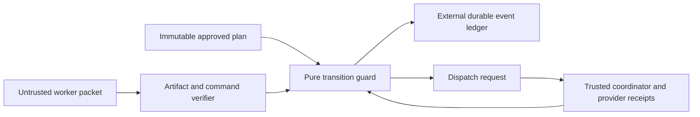
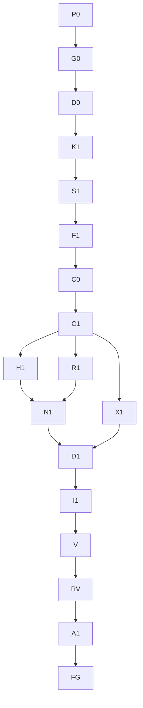

# Execution DAG Guard V1

This contract governs the approved workflow-hardening slice and its synthetic,
fault-tested pilot. It grants no W1 engine dispatch, merge, publish, deployment,
or release authority. MASTER_PLAN W1 authorization remains separate. Historical
queue readiness flags and advisory tier routing do not grant authority.

RCA evidence from `workflow-audit-2026-10-10.json`: the original
`prepare-execution-dag.mjs` validator checked count and individually known graph
IDs, allowing a duplicated known node to conceal a missing node. Advisory
`tiered-swarm/scripts/route.py` consumes tier/`verify_command`, not this plan's
`execution.model`, `verify[]` or `dispatch_authorized`. Execution properties were
prose without a persistent reducer, budgets, session identity or immutable gate
receipts. The approved remedy is this deterministic guard and fault-tested pilot;
static advisory routing success is not execution certification.

## 1. Boundary and trust

The implementation is built-in Node JavaScript: a pure guard in
`scripts/workflow-guard/core.mjs`, a durable CLI in `scripts/workflow-guard.mjs`,
and focused Node tests. The guard accepts states and results; it is neither an
OS sandbox nor proof of a provider's actual model execution. Session provenance
is a trusted coordinator/provider record, never a worker's self-reported model.
The coordinator authenticates CLI access and captures provider session IDs.



The CLI cannot call collaboration APIs. It emits a dispatch request containing
the exact role, model, effort, task, attempt, scope, deadline and fencing token.
The coordinator explicitly requests that model/effort, then registers the
returned session identity before accepting worker output. Model fallback is a
new owner decision, not an implicit runtime substitution.

## 2. Immutable plan and identities

All JSON objects are closed at the security boundary: reject unknown fields,
missing fields, invalid types, non-finite numbers and duplicate IDs. Digest is
SHA-256 of recursively key-sorted JSON (array order retained, UTF-8, no whitespace).
The plan digest excludes no mutable status: the entire plan is immutable.

The logical plan shape is:

```json
{
  "schemaVersion": 1,
  "id": "guard-pilot",
  "revision": 1,
  "baselineSha": "full Git commit SHA",
  "authorization": {"accepted": true, "dispatchAuthorized": true, "scope": "synthetic-pilot", "decisionId": "owner-record"},
  "roles": {"worker": {"model": "gpt-6-luna", "effort": "max"}, "verify": {"model": "gpt-6-luna", "effort": "max"}, "review": {"model": "gpt-6-luna", "effort": "max"}, "audit": {"model": "gpt-6.1-sol", "effort": "high"}, "integration": {"model": "gpt-6.1-sol", "effort": "high"}, "orchestrator": {"model": "gpt-6.1-sol", "effort": "high"}},
  "decisions": [{"id": "D1", "resolved": true, "decisionId": "owner-record"}],
  "tasks": [{"id": "T1", "role": "worker", "dependsOn": [], "requiredDecisions": ["D1"], "writePaths": ["pilot/input.txt"], "requiredAc": ["AC-1"], "timeoutMs": 60000, "leaseMs": 30000, "maxCommandRuns": 4, "kind": "normal"}],
  "graph": {"nodes": ["T1"], "edges": []},
  "acceptance": [{"id": "AC-1", "requirementId": "WF-AC-05", "taskId": "T1", "caseId": "positive", "expected": "pass", "required": true, "commandId": "check"}],
  "commands": {"check": {"executable": "node", "args": ["check.mjs"], "cwd": ".", "timeoutMs": 10000}},
  "policy": {"maxAttempts": 3, "infraRetries": 1, "repeatLimit": 2}
}
```

Concrete effort is pinned for every Sol role; the example uses `high`. Worker,
Research, Verify, Review, build/environment and evidence-custodian specializations
use Luna Max. Decision, Orchestration, Integration, Audit, critical Debug and Final
Gate use Sol. No task may omit its role or silently inherit advisory routing.
Specializations reuse the declared role policy rather than create a model framework.
Supported role keys are `worker`, `research`, `explore`, `verify`, `review`,
`build`, `evidence`, `decision`, `debug`, `integration`, `audit`, `orchestrator`
and `final`. The first seven pin Luna Max; the remaining six pin Sol with concrete
effort. A plan includes every role used by its tasks or gates; unused optional
specializations need not be populated. Gate final accepts `final` when declared,
otherwise `orchestrator`. Decisions have unique IDs; tasks reference existing
decisions by `requiredDecisions`, and unresolved decisions reject dispatch.
Supported concrete Sol efforts are `minimal`, `low`, `medium`, `high`, `xhigh`,
`max` and `ultra`; Luna roles always require `max`.

Task IDs and graph node IDs must be unique and exactly equal. Edges equal the
declared dependency edges, reference existing tasks, and form an acyclic graph.
Graph edges are ordered pairs `[predecessorId, successorId]`.
Every task has at least one required AC and concrete positive time/command budgets.
Each AC maps one requirement, task, case, expected outcome and allowlisted command.
An acceptance row may additionally have `closesAcId`. Each required
`expected-red` AC must be closed by at least one required `pass` AC referencing
its ID, with the same requirementId and a transitive dependency on the
characterization task. Unrelated descendant success cannot close RED.
Expected outcomes distinguish `pass`, `schema-invalid`, `unsupported`, and
`expected-red`; a validator container passing is not the same as an invalid input
being rejected. Required `skip`, zero cases/tests and absent evidence never pass.
Optional acceptance may be absent or explicitly `skip`; it remains unverified
and does not contribute to required coverage.

Write scopes are relative repository paths. Normalize separators, case and dot
segments; reject absolute, drive-relative, UNC, traversal, wildcard and empty
paths. Parent/child containment conflicts (`src` and `src/lib.rs`) count as overlap.
The adapter resolves real filesystem paths and rejects symlink/junction escape.
Overlapping tasks require serialized dependency ordering. Runtime leases still
check every concurrent overlap. The original checkout is outside pilot scope.

## 3. Pure API and event model

The core exports this minimal interface; implementation-specific aliases may be
documented alongside it without weakening the invariants:

```js
validatePlan(plan)                         // {ok:boolean, errors:string[]}
createState(plan, {runId, now, coordinatorSessionId}) // immutable initial state
applyEvent(plan, state, event, {now})       // next state; throws GuardError
digest(value)                              // lowercase SHA-256 hex
normalizePath(path)                        // normalized relative path
pathsOverlap(a, b)                         // equality or ancestor containment
```

`event = {id, type, expectedVersion, actorSessionId, payload}`. Every successful
new event increments state version once. A byte-identical event ID replay is
idempotent; reused ID with changed content is rejected. Version comparison occurs
under the durable storage lock. Rejected events cause no accepted-state mutation
and no dispatch/command side effect. Input state and plan are never mutated.

`state = {schemaVersion, runId, planDigest, version, status, sessions, tasks,
locks, candidate, receipts, seenEvents}`. Attempts have run/task/attempt IDs,
monotonic fencing token, sender session, lease expiry, absolute task deadline,
attempt/infra counters, command usage, handoff and finding fingerprints. Counters
survive handback, rework, restart and derived repair tasks.
`initialTaskDeadline` is pinned on first dispatch and covers every retry/repair;
replacement attempts never receive a fresh cumulative task deadline.
State persists `lastNow` and `commandRuns`. Reject new mutations when trusted
`now < lastNow`; accepted identical event replay may return before this check.
Successful events advance `lastNow`. Recovery never extends a deadline because
the wall clock moved backward; the operator must restore trusted time to proceed.
State also exposes `dispatchRequests`, keyed by attempt ID, with records
`{runId,planDigest,taskId,attemptId,fence,role,model,effort,writePaths,deadline,
leaseUntil}`. Dispatch computes this record purely; CLI prints it only after the
event commits. It is a request to the trusted coordinator, not a provider call.

Event operations cover authorization, trusted session registration, dispatch
reservation, worker binding, handoff submission, receiver ACK/rejection, task
verdict, heartbeat, failure, confirmed stop, candidate integration, candidate gate,
watchdog recovery and abort. Coordinator-only operations must not be expressible
by an ordinary registered worker. The adapter chooses event names consistently
and records the complete validated payload in the ledger.

The exact V1 event names and payloads are below. Every identity/digest is a
nonempty string; versions/fences/counters are nonnegative safe integers and
timestamps are epoch milliseconds. Optional fields are explicitly marked `?`.
The initial coordinator session is supplied by trusted initialization as
`coordinatorSessionId`; it has `orchestrator` authority. A worker cannot choose
this identifier through an event. `now` is trusted CLI time, not packet time.

| type | payload | actor / effect |
|---|---|---|
| `register_session` | `{sessionId,role,model,effort,providerReceiptId}` | Coordinator only; exact pinned role policy; reject duplicate session identity. |
| `dispatch` | `{taskId}` | Coordinator only; reserve attempt/fence/lease and emit dispatch request. |
| `bind_worker` | `{taskId,attemptId,sessionId}` | Coordinator only; registered worker matching task role; fresh binding. |
| `heartbeat` | `{taskId,attemptId,fence}` | Bound worker only; extend live lease within task deadline. |
| `command_reserved` | `{taskId,attemptId,fence,commandRunId,commandId}` | Trusted coordinator runner only; live bound attempt, unique run ID, allowed command; consume cumulative command budget before any spawn. |
| `command_completed` | `{commandRunId,receipt}` | Trusted coordinator runner only; existing reservation, exact captured runner receipt; completion does not consume budget again or revive a stale attempt. |
| `submit_handoff` | `{packet}` | Bound worker only; current attempt, fence, session, candidate and complete checked evidence. |
| `ack_handoff` | `{taskId,packetId}` | Packet's registered Verify receiver; ACK only, no completion. |
| `reject_handoff` | `{taskId,packetId,reason}` | Packet's Verify receiver; failure/rework with finding accounting. |
| `task_verdict` | `{taskId,packetId,verdict,findings}` | ACK receiver only; `pass` or `fail`; all required exact outcome AC must match for pass. |
| `fail` | `{taskId,attemptId,category,fingerprint,critical?,progressDigest?}` | Coordinator or bound worker; category `code`, `infra`, `timeout`, `process-loss`; critical and repeat policy block. |
| `stop_confirmed` | `{taskId,attemptId,stopReceiptId}` | Coordinator only; release quarantined write scopes. |
| `integrate` | `{candidate,taskCommits,groups,artifactDigests}` | Registered Integration session; all normal tasks verified; groups include `{tasks:["C0","C1"],outcome:"pass"}` when characterization exists. |
| `gate_report_reserved` | `{stage,candidateDigest,reportRunId}` | Registered stage actor; one-shot reservation before any integrated Verify command or report creation; crash consumes this stage/candidate reservation. |
| `gate` | `{stage,candidateDigest,reportRunId,verdict,acResults,findings,evidenceDigests,priorEvidenceDigests}` | Registered stage actor; matches reservation, trusted immutable report bytes/hash and ordered prior reports; final uses declared final role else orchestrator. |
| `invalidate_candidate` | `{reason}` | Coordinator only; clear candidate/gates and invalidate dependent evidence; no silent resubmission of old task evidence. |
| `watchdog` | `{}` | Coordinator only; expired live attempts fenced/quarantined; terminal budgets enforced. |
| `abort` | `{reason}` | Coordinator only; run aborted, all live scopes quarantined. |

`candidate = {sha,tree,sourceDigest}` and its digest is `digest(candidate)`;
`taskCommits = [{taskId,sha}]` follows dependency order. Gate `acResults` uses
the handoff AC shape. `findings = [{fingerprint,blocking,critical}]` throughout;
fingerprints are normalized requirement/case/scope identities. `evidenceDigests`
and `artifactDigests` are arrays of SHA-256 digests. Gate reportDigest is
evidenceDigests[0] before any sorting. Gate priorEvidenceDigests is exactly ordered:
Verify `[]`, Review `[Verify reportDigest]`, Audit `[Verify,Review reportDigest]`,
Final `[Verify,Review,Audit reportDigest]`. State retains the one-shot reservation
under the candidate/stage and its reportRunId; no separate report-completion event
exists. Authorization is immutable
plan input; no event can elevate an unauthorized plan. The adapter attests
artifact/candidate/command verification via its trusted entry point, never a
worker-controlled `trusted:true` field. A stale task packet is rejected even if
its bytes and hashes are otherwise valid.
Fingerprint normalization is NFC Unicode normalization, trim, lowercase,
backslash-to-slash and collapse each whitespace run to one ASCII space. Producers
must use stable requirement/case/scope keys; changing explanatory prose does not
create a new finding identity.

## 4. Dispatch, leases and handoffs

Only an accepted and dispatch-authorized plan may reserve a task. All predecessor
results must be accepted, all contract decisions resolved, budgets available and
all scopes free. Reservation atomically allocates one attempt and lease before
emitting its dispatch request. Registration binds one fresh provider session to
that attempt and the exact requested model/effort; session IDs cannot be reused
for another actor. A reserved unbound attempt cannot submit a handoff.

Lease expiry, timeout, cancellation or process loss fences accepted output
immediately. It does **not** prove the worker cannot still write. Keep scopes
quarantined until the trusted coordinator records the stopped provider/process
receipt (or proves isolated worktree disposal). Only then release scopes for a
replacement. Never claim physical fencing from a fencing token alone. Heartbeat
cannot resurrect an expired attempt or exceed its absolute deadline.

The handoff packet binds:

```json
{
  "packetId": "unique-id", "runId": "run", "planDigest": "sha256",
  "taskId": "T1", "attemptId": "T1-1", "fence": 1,
  "senderSessionId": "provider-worker", "receiverSessionId": "provider-verifier",
  "candidate": {"sha": "commit", "tree": "Git tree", "sourceDigest": "sha256"},
  "changedPaths": ["pilot/input.txt"],
  "artifacts": [{"path": "external/artifact", "sha256": "digest", "size": 12}],
  "commands": [{"commandRunId": "check-run-1", "commandId": "check", "cwd": ".", "exitCode": 0, "signal": null, "timedOut": false, "durationMs": 30, "testCount": 1, "caseResults": [{"acId":"AC-1","caseId":"positive","outcome":"pass","testCount":1}], "environmentDigest": "sha256", "stdoutDigest": "sha256", "stderrDigest": "sha256"}],
  "acResults": [{"acId": "AC-1", "caseId": "positive", "outcome": "pass", "testCount": 1, "evidenceDigest": "sha256"}],
  "findings": []
}
```

Artifact sizes/hashes, candidate commit/tree/cleanliness, actual changed paths,
command receipts and captured output hashes are verified by the trusted adapter
from bytes/runner records, not accepted because a worker claims them. Receiver
must be registered with the required Verify role and a different session from the
producer. ACK validates packet completeness and provenance; it is never PASS.
Only a separate receiver verdict over the same packet/candidate can accept the
task. Missing/wrong receiver, changed scope, stale fence, wrong candidate or
corrupt evidence is rejected. An accepted packet replay does not advance twice.

Git status alone is insufficient source evidence. The adapter rejects hidden
index flags (`assume-unchanged` / `skip-worktree`) and index/HEAD tree divergence,
then compares actual tracked file bytes with committed blobs using supported Git
text/CRLF normalization. Metadata-only cache hits cannot certify changed bytes.
V1 rejects symlinks, submodules and custom filter/encoding/ident conversions at
this source boundary; it never silently omits their contents from the proof.
Successful task verdict releases its logical lease and closes its fence. Failure
or rejection quarantines scopes until `stop_confirmed`, as do expiry/cancellation.
Releasing a logical lease after success does not prevent physical writes: source
and candidate integrity must still be checked before downstream acceptance.

## 5. State and integrated gates

Normal task path: `proposed -> ready -> running -> handoff_pending -> verifying
-> verified`. Receiver rejection or failed verification enters `rework`, with
bounded replacement only after stopping/releasing the previous attempt.
`blocked` and `aborted` are terminal for a run. ACK moves into verification only.

Candidate path: `verified tasks -> integrated -> verifying -> reviewing ->
auditing -> done`. Integration records exact SHA, tree, source/artifact digests,
task commits in dependency order, approved scope and clean assembly. Documentation
updates happen before candidate freeze. Integrated Verify, independent Review,
independent final Audit and Final Gate all bind this exact candidate and effective
required AC inventory. X1 consumer audit does not replace final provenance Audit.

Verify, Review and Audit use distinct sessions. Review/Audit cannot be any patch
author or integrator; final Audit uses a separate Sol session from the integrator
and task authors. Final Gate uses trusted Sol Orchestration and requires all three
current PASS receipts, integration provenance, required AC coverage and no open
blocking finding. Final Gate is a completion receipt, not merge/publish authority.

The trusted `gate-report` adapter consumes the closed input
`{stage,sessionId,verdict,findings,assessment,commandIds}`. It reserves first and
generates an immutable hashed report binding candidate identity, assessment,
actual fresh integrated Verify command receipts and ordered prior reports. Generic
CLI `event` rejects `gate`; it cannot import caller-fabricated gate evidence.
Integrated Verify executes finite unique command IDs covering every required
normal AC, under the sum of their pinned command timeouts. Historical expected-RED
evidence is carried only alongside explicit freshly verified closure ACs.
Review/Audit/Final import their independent assessment and prior report references;
they do not rerun the Verify test commands. PASS requires full required AC coverage.
FAIL may record partial/empty AC results but requires a blocking finding and a
valid evidence report; it permanently blocks the run.

Any source, generated tracked file, artifact, plan or normative contract change
invalidates affected evidence and all integrated gates. Reopening S1/F1/C1 or
changing a task write scope needs a Sol Decision record and new immutable plan/run;
downstream results cannot be copied as current without revalidation. No silent
in-place plan edit. Runtime receipts remain outside the candidate source tree.

C0 is explicitly `kind: characterization`, with AC expecting `expected-red`.
Observed expected failure can be accepted for C1 dependency readiness, without
ordinary repair accounting or candidate GREEN. Integration requires C0+C1 as one
atomic GREEN group, with C1's positive evidence closing the characterized failure.
That group must include the characterization task and every actual closure task
linked through `closesAcId`, with accepted positive evidence for each required
closure AC. Merely grouping C0 with any passing successor is insufficient.
Any unexpected RED follows ordinary bounded failure handling.

## 6. Failure budgets and recovery

Code attempts: initial plus two repairs (three total). Infrastructure retry: one
extra recovery within the same code attempt, not a hidden fourth code attempt.
Same finding fingerprint twice, or two candidate attempts with no source/artifact
progress, blocks and escalates to Sol Decision. Critical findings block and route
to Sol Debug immediately. Fingerprints use normalized finding identity/scope,
not prose text that can be renamed to reset a counter. Duplicate triggers do not
consume retries, create writers or count as progress.

Each command/task has a pinned deadline and cumulative command/resource budget.
No-progress identity is the checked packet candidate sourceDigest only. All
deliverable changes must be committed into this source/tree identity. Logs,
external artifact hashes, command receipts, timestamps and packet IDs do not
count as source progress; a worker-supplied failure `progressDigest` is
advisory and cannot reset counters. The adapter computes the identity from checked
candidate source bytes and core compares accepted identities across attempts.
The first failed candidate sets noProgressCount to 1; a second failed candidate
with the same source identity sets it to 2 and blocks. A failed changed
candidate starts a new count of 1. Successful metadata or logs cannot reset it.
Counter or deadline exhaustion blocks, retains evidence and quarantines writers.
Trusted cancellation records `aborted`. Continuing requires an explicit owner
decision and a new bounded run linked to the previous ledger; no counter reset
inside the blocked run. Restart replays accepted events, retains reservations,
fences expired attempts and waits for stop proof before reallocation. Never assume
that absence of a local child process means a remote provider session stopped.

## 7. Durable CLI and command runner

Store plan copy, accepted immutable event files, candidate/evidence blobs and any
cached state in an absolute run directory outside all source trees. A run lock
serializes independent CLI processes. Acquire exclusively; ambiguous stale lock
ownership fails closed pending trusted recovery. Validate expectedVersion, compute
next state, write an event temp file and fsync, then atomically rename to its
sequence filename. Committed event files are the authority; state cache is
rebuildable. Crash before rename commits nothing; crash after rename must replay
the event even if cache/response is absent. Reject gaps or corrupt event digests.
Do not silently truncate or rewrite accepted history. This is append-only by
program policy, not protection from a malicious filesystem administrator.

Minimal CLI operations initialize a run from plan JSON, inspect/replay state,
consume one event JSON and return machine-readable `{ok,state}` or `{ok:false,
code,message}`, run one approved command ID, and recover/watchdog. Exact operation
names are exposed in CLI help. JSON output includes current version and dispatch
requests; rejected mutations return nonzero. JSON worker packets cannot inject
coordinator/provider authority.

`command_reserved` must commit before spawn and consumes one cumulative task
command slot, including crashes, failure and omitted handoff commands. The same
commandRunId cannot spawn twice. `command_completed` records actual runner output
after exit; its `receipt` has the packet command fields except commandRunId.
Packet commands must reference and exactly match completed ledger receipts.
Watchdog marks unfinished reservations unknown/failed, conservatively retaining
their consumed budget; completion may record late evidence but never revive a
fenced attempt. Generic CLI event JSON rejects both command event names; only
the internal trusted runner path emits them. Caller-provided test counts or
outcome assertions are prohibited. Captured stdout must contain exactly one
strict line `WORKFLOW_GUARD_RESULT=<JSON>`, where the closed JSON object is
`{"acResults":[{"acId":"AC-1","caseId":"positive","outcome":"pass","testCount":1}]}`.
Parsed rows become receipt `caseResults`; aggregate receipt testCount is their
sum. Receipt rows contain no evidenceDigest. Top-level packet `acResults` must
match the required captured rows exactly, adding evidenceDigest equal to that
receipt's stdoutDigest. `pass`, `schema-invalid` and `unsupported` require
exitCode 0 and no signal/timeout; `expected-red` requires a normal positive
nonzero exit code, no signal and no timeout, plus the captured expected case.
Timeout, process loss and spawn failure never count as expected assertion RED.
Absent, duplicate or malformed markers, duplicate case rows and zero/unparseable
counts cannot attest acceptance. Generic TAP counts alone are insufficient. These
records belong to the central append-only ledger, not a second journal authority.

Commands use immutable plan executable+argv+cwd, `spawn` with `shell:false`, pinned
timeout and captured bounded output. No arbitrary shell strings from handoff,
dynamic extra arguments or worker-selected executable. Record actual command,
cwd, relevant environment/toolchain fingerprint, timestamps, exit/signal/timeout,
test counts and output digests. Cwd is checked within the approved isolated
workspace. Build outputs are isolated; before/after source cleanliness must match
the candidate. An allowlisted executable may itself be powerful: this runner is
not a sandbox. Pilot commands never invoke W1 engine suites, merge or publish.

## 8. Acceptance and fault pilot

The non-dispatchable W1 adapter lives in
`queue/QUERY_IR_W1_EFFECTIVE_PLAN.json`; regenerate deliberately with
`node scripts/workflow-w1-plan.mjs --write` and check with `npm run workflow:plan`.
It preserves and hashes LF-normalized UTF-8 historical queue/graph bytes (stable
across Git CRLF checkouts), numbers effective W1 AC,
resolves the model override and repairs task ownership/order. It is a planning
artifact, not a V1 runtime plan: its listed materialization blocks must be closed
before it can enter this guard. W1 implementation approval remains separate.



K1 resolves normative contracts before schema freeze. D1 freezes documentation
before I1 integrates the candidate. V is Luna Verify, RV is independent Luna
Review, A1 is independent Sol final Audit, and FG is Sol Orchestration. H1/R1/X1
can proceed in parallel in separate workspaces. Retry handling belongs to the
bounded state machine; it never inserts a cycle into the dependency graph.

V1 initializes an optional task-ID to absolute-workspace mapping. Each mapped
workspace is pinned outside the external ledger. Concurrent active writers may
not share a workspace root, even when logical paths differ. The command runner
serializes command spawn/execution/completion under the global ledger lock in
V1; this favors durable budget correctness over parallel command throughput.

All following AC are required and must map to named executable test cases and
hashed receipts. The pilot uses synthetic files/commands and fake trusted provider
receipts; it proves guard behavior, not real-provider model identity or W1 fitness.

| AC | Required evidence/cases |
|---|---|
| WF-AC-01 | Reject unknown/missing/duplicate task or graph IDs, cycle, normalized parent/child scope conflicts and model/effort mismatch. |
| WF-AC-02 | Unauthorized plan, unresolved decision, unmet predecessor and locked path produce no dispatch side effect. |
| WF-AC-03 | Concurrent overlap denied; expired/replaced/cancelled fence denied; quarantined lease retained until stop proof. |
| WF-AC-04 | Missing/incorrect receiver, SHA/tree, hash, scope or packet rejected; identical replay idempotent and changed duplicate rejected. |
| WF-AC-05 | Positive, schema-invalid, unsupported and RED outcomes distinguished; zero tests, required skip and missing AC cannot pass. |
| WF-AC-06 | Session receipt must match role model/effort; worker cannot register itself; same-session Verify/Review/Audit and author/integrator audit rejected. |
| WF-AC-07 | Candidate/plan/artifact changes invalidate gates; external status updates leave source identity unchanged. |
| WF-AC-08 | Duplicate dispatch, code attempt four, infra retry two, repeated finding/no-progress two, timeout/process loss and restart cannot create duplicate writers or exceed budgets. |
| WF-AC-09 | Expected C0 RED advances only characterization dependency; integration without atomic C1 GREEN rejected. |
| WF-AC-10 | Missing integration or stale/missing integrated Verify, Review, final Audit, AC or open-finding receipt prevents FG; full independent happy path reaches done. |

Exercise durable crash points before/after event commit and cache write, simultaneous
CLI writers, bad ledger digest/gap, command timeout and shell-injection-shaped
input. Every rejection test checks unchanged accepted state/version and absence
of worker/command side effects, not merely an error message. Report remaining
limits honestly; synthetic PASS never authorizes full W1 execution.

## Local CLI runbook

Run `node scripts/workflow-guard.mjs --help` for the installed exact options.
Initialize once using `init --plan <plan.json> --run-dir <absolute-dir>
--workspace <git-worktree> --run-id <id> --coordinator-session-id <id>`;
optional `--task-workspaces <mapping.json>` pins independent task worktrees.
Inspect using `show --run-dir <absolute-dir>`. Submit ordinary allowed transitions
using `event --run-dir <absolute-dir> --event <event.json>`. Execute the pinned
task command using `command --run-dir <absolute-dir> --task <task-id>
--attempt <attempt-id> --command <command-id>`. Use `recover --run-dir
<absolute-dir>` to replay/watchdog after interruption. `--ack-stale-lock <nonce>`
is a trusted recovery decision after inspecting stopped ownership, not automatic
stale-lock deletion. Generate gate evidence using `gate-report --run-dir
<absolute-dir> --report <closed-report-input.json>`. The input has exactly
`{stage,sessionId,verdict,findings,assessment,commandIds}`. Verify names the
required normal-case command IDs; Review/Audit/final use an empty command list.
Never import `gate` or `gate_report_reserved` through ordinary event input.
A recorded failed gate retains its report and blocked state and returns nonzero.

## Version diff and changelog

| Version | Date | Status | Change |
|---|---|---|---|
| 0.1.0 | 2026-10-10 | accepted | Approved workflow remediation contract: immutable plan and external ledger, trusted session registration, bounded leases/retries, typed handoff/evidence, independent candidate gates and synthetic fault AC. No W1 execution authority. |
