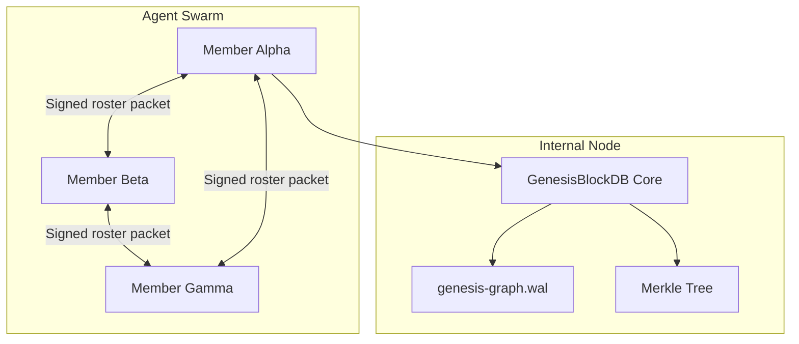

# Architecture Blueprint: P2P Gossip Protocol (Mark VIII, Step 3)

## 1. Introduction
The **P2P Gossip Protocol** is GenesisBlockDB's optional synchronization layer. It enables independently operated database instances to exchange authenticated state events and reconcile graph state without a central server. Client applications may use this capability for their own domain records; the engine does not own any client's ontology or authority policy. Peers are configured by an operator before gossip starts.

### Membership and authorization contract (2026-10-16)

Plain `open()` is self-only and starts no gossip listener. Multi-node use opens
with a closed operator roster containing each remote peer's derived ID,
Ed25519 public key, numeric UDP endpoint, and `masterAuthority` role. A heartbeat
can refresh live-peer state but cannot create a member or replace its key or
endpoint. Roster changes require an operator-coordinated restart.

Gossip uses wire protocol version 8 independently of storage schema v6. Version
8 adds detached MASTER proofs, revision-bound compacted-base proofs, and an
explicit storage-schema field. A peer must match both the wire protocol and the
local storage schema before it is admitted for synchronization; a schema
mismatch returns `StorageSchemaMismatch` without serving deltas. Peers on earlier
gossip versions receive `UpgradeRequired` before sync begins.

Every gossip datagram is an authenticated packet that binds the sender ID,
roster digest, and message under an Ed25519 signature. Receivers verify the
signature and configured source endpoint before dispatch. Event signatures
remain independently checked at reconciliation, and the event origin may
differ from an authorized relay.

`openWithMembership` also preflights the retained journal against that roster
before replaying recovery state. A signer or `MASTER`-role authorization failure
stops startup with `RECOVERY_AUTH_REQUIRED`. Operators upgrading a multi-node
database must keep the historical signer and proof material needed to authorize
its retained journal until a trusted migration no longer depends on it. Plain
`open()` remains self-only and must not be used to bypass this recovery check
before starting gossip. If the roster is configured after `open()` through the
storage API, the retained journal is checked against the proposed roster before
membership is enabled; failure leaves gossip unavailable.

Membership authorization preflight is resource-bounded before journal events
are accumulated for source-order evaluation. It counts the aggregate
uncompressed signed-event payload bytes and top-level journal records across
the legacy JSONL file, legacy JSONL segments, framed history/base segments, and
the active WAL. The production limits are 64 MiB and 100,000 records, matching
the existing fail-closed consensus-ledger limits. Before whole-file reads,
source lengths are capped at 64 MiB plus 16 bytes per allowed record; one
sealed-segment read also allows its fixed 72-byte envelope and up to 1 MiB of
LZ4 container overhead. The declared uncompressed segment length bounds
decompression, so a frame at the 64 MiB format maximum fits while a segment at
the 128 MiB reader maximum is rejected before its body is read. Exceeding either
limit makes membership-aware startup fail with `RECOVERY_AUTH_REQUIRED` before
replay. Late configuration reports the same error after plain `open()` may have
replayed state for local-only use; it rolls back the staged roster and leaves
membership disabled. Backup restore reports `BACKUP_AUTH_REQUIRED` before the
target is published. This is an input/vector-growth bound, not an empirical
peak-RSS guarantee. A database above the limits needs a trusted migration or
compaction before it can be opened with multi-node membership.

Compacted `MASTER` nodes and retained node retractions are emitted as current
single-event projections. Their `SignedEvent.signature` contains a versioned
proof envelope: the relay signs the projection together with the original
MASTER-signed event. Receivers verify both signatures and the matching node or
retraction before authorization. A nested proof event is evidence only; its
Batch/Transaction siblings are never applied. A detached MASTER proof matches
only the source node projection and logical clock. A node projection may omit
an embedding when the corresponding vector is transported separately, but any
embedding attached to that node must equal the signed source; a historical
proof cannot authorize a changed payload, embedding, or higher clock. Schema-v6
compacted `Node`, `Edge`, and `VectorMaterialized`
rows carry the exact signed, revision-bearing source transaction as evidence;
the relay signature binds both that transaction and the materialized
projection. Receivers validate the source signature, revision-to-payload
binding, and exact projection before treating it as a base materialization.
Compaction never accepts a relay-created wrapper as a substitute for source
revision evidence. A later USER update after a MASTER-authorized declassification
is emitted after the exact declassification projection and carries its own
revision-bound proof. Every retraction still requires MASTER authority. Missing
or mismatched proof stops the fold and leaves the prior WAL intact.

Compacted proof envelopes use the compressed V2 encoding. The compacted
`SignedEvent.signature` is transported as a `b64:` string; readers continue to
accept legacy byte-array signatures. Each signed event is capped at 54,000 JSON
bytes and each sync delta at 55,000 bytes. For a validated schema-5-to-6
migration, compaction may create a local revision-bound attestation for the
exact migrated projection because the original legacy WAL event predates
schema-6 revision records. The original MASTER signature remains separate and
is still required for protected state. Edge-derived `impact` is recomputed
after graph sync; it does not change which signed source projection is emitted.

Only roster members can submit votes or originate sync. A member with
`masterAuthority` may create or change `MASTER` state; all node retractions also
require that role because their event format does not prove the target's prior
labels. Consensus uses the fixed roster including the local peer and requires
a strict majority. Each vote signature binds the proposal ID, voter, decision,
the roster digest, and digest of the complete signed event; the proposal must be present locally
before a vote can be signed. See the accepted
[peer-membership authorization ADR](adr/ADR--GENESISDB-PEER-MEMBERSHIP-AUTHORIZATION.md).

Applications can relay a proposal through the supported REST or NAPI
`exportConsensusProposal` / `importConsensusProposal` surfaces. The export
contains the signed event and proposal ID but clears local vote state; each
roster member imports and validates it before signing. The current manager does
not automatically broadcast locally created consensus proposals, so the
application or operator control plane carries this envelope and its vote
signatures between members. Each member's first signed choice is durably locked
to the proposal event digest and roster digest; identical retries are idempotent
and conflicting choices are rejected across process restarts. Pending proposal
objects must be imported again after restart, and durable vote locks are
restored when that proposal is imported.

Quorum commits use a prepare/completion receipt ledger beside the vote-lock
ledger. The prepare record is durable before the event WAL append; a missing
completion record is recovered by matching the exact signed event in the WAL.
Completed receipts survive compaction and stop an imported proposal from
re-appending its event. Both append-only ledgers have 64 MiB, 100,000-record,
and 4 KiB-per-record limits. The engine fails closed at those bounds instead
of pruning security history; see [Operations](OPERATIONS.md) for backup and
migration handling.

## 2. Software Requirements Document (SRD)

### FR1: Operator-Configured Membership
- Operators configure every member's `peer_id`, Ed25519 public key, numeric UDP endpoint, and `masterAuthority` role.
- Every member configures the same roster and local role. A roster digest mismatch rejects packets.
- Plain `open()` remains self-only. Unknown peers and raw unauthenticated gossip messages are rejected.

### FR2: State Reconciliation (Merkle Sync)
- Agents periodically exchange their **Merkle Root**.
- If roots differ, agents perform a binary search on the WAL to identify the specific events that are missing or conflicting.

### FR3: Gossip Mechanism
- **Epidemic Diffusion:** When an agent receives a new mutation, it "gossips" it to a random subset of known peers.
- **Damping:** Ensure messages have a TTL (Time-To-Live) or version check to prevent infinite loops.

---

## 3. Technical Design Document (TDD)

### 3.1 Network Architecture (Diagram)


### 3.2 Sync Sequence Diagram
```mermaid
sequence_diagram
    participant A as Agent Alpha
    participant B as Agent Beta
    
    A->>B: SignedPacket(Heartbeat, PeerID, RosterDigest)
    Note over B: Compare Root
    B->>A: SignedPacket(PullRequest, PeerID, RosterDigest)
    A->>B: SignedPacket(PushDelta(Vec<SignedEvent>), PeerID, RosterDigest)
    Note over B: reconcile_state(Events)
    B->>A: SignedPacket(SyncProgressReceipt, PeerID, RosterDigest)
```

### 3.3 Message Schema (API Contract)
```rust
pub struct AuthorizedPeerConfig {
    peer_id: String,          // first 16 hex chars of SHA-256(public key)
    public_key_hex: String,   // Ed25519 key, pinned by the operator
    gossip_addr: String,      // numeric SocketAddr, fixed for the process
    master_authority: bool,
}

pub struct AuthenticatedGossipPacket {
    version: u32,
    source_peer_id: String,
    roster_digest: String,
    message: GossipMessage,
    signature: Vec<u8>,       // signs version, source, digest, canonical message
}

#[derive(Serialize, Deserialize)]
pub enum GossipMessage {
    Heartbeat { 
        peer_id: String, 
        merkle_root: String, 
        logical_time: u32 
    },
    StateRequest { 
        from_clock: u32, 
        limit: u16 
    },
    StateResponse { 
        events: Vec<Event>, 
        source_peer_id: String 
    },
}
```

---

## 4. Implementation Strategy
1. **Network Transport:** Use `tokio::net::UdpSocket` at operator-configured fixed endpoints; accept only signed packets from a roster member's configured address.
2. **Background Task:** A dedicated `gossip_manager` loop in `src/lib.rs`; the self-only open path does not bind a network socket.
3. **Authorization:** Verify every event at shared reconciliation ingress. Apply `MASTER` and retraction role checks before WAL or memory effects.
4. **Consensus:** Resolve voter keys and strict-majority denominator only from the immutable roster; discard vote state supplied inside inbound proposals; bind each vote to the proposal's complete signed event.

## 5. Definition of Done (DoD)
1. [ ] A correctly configured pair exchanges authenticated packets and converges ordinary signed events.
2. [ ] Unknown identities, altered packet signatures, endpoint mismatch, and roster-digest mismatch fail before dispatch.
3. [ ] Unauthorized peers cannot apply nested `MASTER` events, retract nodes, or count toward quorum.
4. [ ] Configured master members can sync authorized master state; strict-majority quorum uses the full fixed roster.
5. [ ] A singleton retains local self-vote behavior; reopening a database preserves already durable records.

---
**Please review and approve this C-3 Architecture Blueprint. I will generate the code once approved.**
