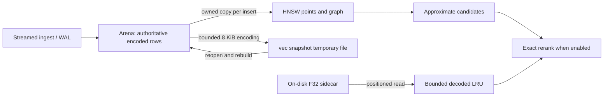

# GenesisBlockDB vector memory audit

Scope: local nonproduction audit of baseline `ad94aa2e46025b7729d117ff376ab281ac15c49d`.
Existing staged HQL2 documentation/tests are outside this change. The user explicitly
authorized audit, benchmark, justified optimization and verification without stopping
at the plan. No deployment, release, production data or destructive scale experiment.

## Audit decision

Retain the Arena/HNSW two-copy vector design. The pinned insertion API requires
owned point vectors; the arena remains authoritative for persistence, history,
exact fallback and rebuild. No unsafe sharing or index replacement is introduced.

The audit also found a much larger avoidable **default-checkpoint proof cache**:
whole signed transactions were cloned per materialized leaf. Private immutable
proof sharing removes that quadratic resident expansion while preserving public
proofs, bytes, authentication and caps. At the initial Arc-sharing-only stage, a
successful default-retention NAPI checkpoint diagnostic (128 rows, D=8) reduced
OS peak working set 435.20 -> 100.80 MB,
a measured 334.40 MB (76.84%). This is a matched Windows debug-addon diagnostic,
not a cloud instance-size guarantee. The separate initial release/full-retention F32
10k/768 repeat reduced snapshot peak 187.00 -> 158.62 MB (15.18%); its largest
named-phase peak barely changed. Neither number means vector payload was halved.
The later timeout fixes retain sharing and add bounded checkpoint caches; their
separate final-candidate RSS increases and performance observations are reported
below. The initial savings are not relabeled as measurements of that later source.

Default checkpoint limits remain open: the explicit 1000-row diagnostic returns
`COMPACTION_PROOF_TOO_LARGE` at the unchanged 1 MiB envelope cap. WAL reopen
count/indexed and search sanity pass after that rejection. Passing a bulk test or
seeing the existing shutdown message is not proof of checkpoint success.

<!-- SQLITE_PREPARE_FOLLOWUP_START -->
## SQLite prepare follow-up: confirmed deferral, final correctness gates passed

Production core SHA256: `5b8bb9bed5dde5fa6e7d4d255da3acce6c1bfe892092456133adb65a78998fdd`.
Final projection-test SHA256: `e69dc7dd5cbc5043aa5ed9c717e449e50246a8fbd8ad56ac95ed135718c99be2`.
This section supersedes the current-status interpretation of earlier stages;
all earlier timings retain their original source and workload provenance.

**The deferral mechanism is fixed, regression-tested and reproduced with pinned
SQLite on the saved 1 GB projection. The 100k reopen deadline remains unqualified.**
It must not be inferred from library tests, historical timings or an exit code alone.
The source-bound correctness receipt is `passed:true` for the final immutable source; it does not qualify the pending timed workloads.

The pinned versions are rusqlite **0.32.1**, libsqlite3-sys **0.30.1**, and bundled
SQLite **3.46.0**. The amalgamation SHA256 is
`c01235302fe80da901fb70c7622c39147e29d9f29b7f6eb746b23517f320c90d`.
Backup commits the live destination WAL through SQLite's lower-level B-tree API,
sets a pending WAL callback and resets the schema. It bypasses the SQL executor's
callback dispatch. The next prepare loads schema through a nested SELECT; when
that statement reaches DONE, it dispatches the default 1,000-frame passive
checkpoint. Thus publication I/O can be charged to the first query's prepare.
This is an engine lifecycle mismatch with the pinned API, not evidence of an
upstream SQLite defect. The standalone matrix reproduces this class of prepare stall on the saved real
projection without Genesis replay. It cannot retroactively observe the callback
state of the historical 2.631-second trace.

| Real pinned SQLite callback fixture | Before | After |
|---|---:|---:|
| Hook calls during publication | 0 | 1 |
| Hook calls during first property read | 1 | 0 |
| Frames checkpointed during publication | Deferred | 2,352 / 2,352 |
| First-read callback after releasing an old reader | 1 | 0 |

The production change scopes/drops `Backup`, keeps the destination mutex held,
and fully executes `PRAGMA wal_checkpoint(PASSIVE)` before publication returns.
This completes real maintenance at its ownership boundary; it does not execute a
dummy search or prime a query cache. It moves page I/O into open/publication and
**does not remove that I/O or claim a RAM saving**. PASSIVE accepts partial/busy
progress, preserves old read-only snapshots, and does not truncate the WAL. Hard
maintenance errors explicitly say that projection publication already committed.
Open's existing recovery-required guard then prevents a failed recovery from
checkpointing its state on Drop. A direct FFI checkpoint alone was rejected as a
fix because it can leave the pending SQL-layer callback undispatched.

Three regressions cover deferred callback ownership, a reader held across
publication and released before the first new read, and committed data observed
through an independent connection after a denied maintenance PRAGMA. The hook
mirrors SQLite's default passive 1,000-frame behavior; it has no wall-clock gate.
Read-only review found no actionable production or test issues after cleanup.

| Verification stage | Result and scope |
|---|---|
| RED, original core `812afd...`, new regressions | Existing 2 passed; new 3 failed as expected; first read dispatched the deferred callback |
| GREEN library, production core `5b8bb9...` | 57 passed / 0 failed / 1 existing manual-profiler ignore |
| Whole 159-target core suite, pre-lint test source `40c4a1...` | 1,328 passed / 0 failed / 7 ignored; all six formerly timed-out targets completed under the original limits |
| Strict Clippy, pre-lint test source | Failed on the new test's manual NUL-terminated string literal; raw failure retained |
| Final test source `e69dc7...` | Replaced that literal with `c"main"`; production core unchanged; locked/offline compile completed |
| Final library tests | 57 passed / 0 failed / 1 ignored on `e69dc7...` |
| Earlier final-source attempt (preserved) | 85 targets completed, zero failures; `hql_cypher_tests` interrupted by resource hold at 216.8 s, before its 300 s cap; not a complete suite or a timeout result |
| Fresh complete final-source suite | 159 targets; 1,328 passed / 0 failed / 7 ignored; original 300 s / 4 GiB per executable; frozen executable hashes and 287-path source manifest bound to receipt |
| Final strict Clippy, Node/NAPI and host-mobile checks | All 8 gates passed: strict Clippy core/default, host-mobile compile, doctests, isolated NAPI build, DTS freshness, native smoke, Node 88 passed / 0 failed / 0 skipped |
| Pinned-SQLite matrix | Fresh isolated four-mode run passed: SQLite 3.46.0, exact payloads, source unchanged, deferred backfill observed; original interfered attempt retained separately |
| 100k / new real-embedding pair | NOT_RUN; fresh admission required |

The final rebuild changed all 159 executable hashes, so earlier binary results
were not reused as if they qualified the final set. All binaries were frozen and
hashed; a fresh complete final-source run supersedes the interrupted attempt.
Final-source rerun of the six previously incomplete groups (functional timings,
not an idle-host throughput comparison):

| Complete target | Seconds | Result |
|---|---:|---|
| concurrency | 67.177 | PASS |
| consensus_checkpoint_race_tests | 41.522 | PASS |
| hql_cypher_tests | 155.210 | PASS |
| journal_format_tests | 27.344 | PASS |
| rebuild_from_truth_tests | 58.174 | PASS |
| wal_compaction_tests | 20.697 | PASS |

Raw fresh logs are under `final-runtime-fresh-20261031T213000/`;
`qualification-receipt.json` binds the full source manifest and four final gate files.
The receipt covers correctness only, not the pending timing/100k claims.
The seven pre-existing staged files remain protected and unchanged. No commit,
deployment, release, production database write, or structural vector change was made.

At 20:26 local time the host had 84% CPU, seven unrelated compiler processes and
10.57 GiB free RAM; earlier samples reached 98% CPU with thirteen compilers.
Only the owned test controller and its owned current test were stopped. Their
birth/path identities and zero remaining owned tests are recorded in the hold
receipt. Unrelated processes were preserved. The unchanged limits are:

- Core tests: 300 seconds / 4 GiB per executable.
- Timed benchmark jobs: 1,200 seconds / 2 GiB tracked process-tree RSS.
- Engine query deadline: 5,000 ms.
- Benchmark admission: 10-second CPU average below 20%, at least 6 GiB free RAM,
  and no competing compiler/benchmark job.

Compilation and callback/content tests were explicitly separated from idle-host
latency qualification. No rejected admission is treated as a measurement. A
PID-only early monitor mistakenly waited for an older VCTIP helper; the helper was
not stopped. Raw corrections and a fresh successful Cargo receipt are retained.
The replacement controller validates PID, birth, path/name and the original
process handle, bounds cleanup, and fails closed on uncertain ownership. Release
build preparation uses an exclusive lock, source/gate-bound receipts, a fresh
private source clone and a private target directory. It never edits/restores C/D
sources or D target artifacts. Toolchain telemetry/PDB services are not killed or
claimed terminated; successful compiler-client completion is a separate condition
for subsequent edits inside the private clone. Normal-completion and owned-child
timeout fixtures both passed on the current controller: cleanup completed and no
tracked owner remained. The deliberate three-second timeout is a controller test,
not a workload failure or a benchmark pass. The validation receipt binds its SHA256.

The prepared causal matrix opens the source read-only and uses disposable copies:
direct open; backup without Genesis replay; the same backup with automatic
checkpointing disabled only as a diagnostic control; and backup followed by the
explicit publication maintenance. It records prepare/row/finalization timing and
WAL/backfill state. It never treats disabling checkpointing as a production fix.


<!-- SQLITE_MATRIX_RESULTS_START -->
Standalone pinned-SQLite diagnostic attempt (no Genesis replay; **interfered timing,
not isolated performance qualification**):

| Mode | First prepare ms | First row us | Publication maintenance ms | Backfill during first prepare |
|---|---:|---:|---:|---|
| direct | 1.469 | 56 | n/a | 0 -> 0 |
| backup | 2902.725 | 62 | n/a | 0 -> 248368 |
| backup-noauto | 0.262 | 40 | n/a | 0 -> 0 |
| backup-checkpoint | 0.034 | 67 | 4087.699 | 248368 -> 248368 |

All four modes returned the exact `{}` payload; source SHA256 stayed
`c9bee7777ff99c1632eabf64ffc46bbbea7970655f67902727a838a9c3ceb77b`.
Backup produced 248,368 WAL frames. Disabling autocheckpoint is a diagnostic control
only; the production fix retains it. Maintenance moves work to publication.
Whole-case wall times include backup, connections and close-time checkpoint work;
they are not claimed to improve. Unrelated gs-creator compilers started at
22:26:04 local time after admission, so the raw timing attempt is preserved with
`matrix-real-interference.json` and excluded from isolated performance conclusions.
The next guard continuously rejects newly arriving competing compiler/benchmark
processes, stops only its owned tree, and retains the original time/RSS limits.

Fresh isolated rerun (`matrix-isolated/`, `matrix-isolated-analysis.json`):

| Mode | First prepare ms | First row us | Publication maintenance ms |
|---|---:|---:|---:|
| direct | 1.205 | 54 | n/a |
| backup | 2915.156 | 42 | n/a |
| backup-noauto | 0.546 | 40 | n/a |
| backup-checkpoint | 0.027 | 43 | 3220.885 |

All payloads and source hashes passed. Normal backup again left 248,368 frames
unbackfilled, and first prepare backfilled all of them. The no-autocheckpoint
control left them unbackfilled through prepare; the production maintenance
completed backfill before the first SELECT. The runtime reported SQLite 3.46.0
in every case. No Genesis replay or SQL/search warm-up ran in this harness.
Admission CPU averaged 16.55%; free RAM minimum 12.92 GiB;
the complete four-mode guarded job took 33.489 s and sampled tree RSS peaked at
51.63 MB. Continuous process checks found no competing compiler/benchmark.
This fixed-order single observation does not establish total-I/O or statistical
performance improvement, and the OS file cache was not reset. Maintenance
includes schema loading and real checkpoint work; it is not a dummy cache prime.
<!-- SQLITE_MATRIX_RESULTS_END -->

The prepared 100k workload makes one legitimate non-vector `Storage.add_node`,
uses normal Drop/snapshot, reopens read/write in the same process and runs query 0
before searches, coverage, metadata or marker probes. It retains 100,000 vectors /
1,024 dimensions and checks 100,001 nodes, complete k10/k100 result counts, READY
coverage of all 100,000 vectors, and marker recovery. Both 24-query sweeps report
recall; lifecycle `state:ok` alone cannot qualify retrieval quality. The run parser
must prove the second open's marker miss and actual backup publication. Reading
the 100-byte SHM header is disclosed diagnostic observation; no filesystem-cold
claim is made. The original full 100k ingest lifecycle remains a separate
historical NOT_RUN under its unchanged cap.

Latest resource hold (22:48 local time): six external compiler processes remained,
instantaneous host CPU was 43%, and available RAM was 11,527,102,464 bytes.
Earlier fresh 10-second admissions failed at 22.09% and 35.18% average CPU; a later
attempt was rejected before sampling because compilers were active. The first
100k copy/hash job was interrupted at 80.148 s when an unrelated Cargo arrived;
the current monitor stopped only its owned Python and recorded complete cleanup.
No SQLite/Storage open occurred. Both copies contain 109 files / 12,689,795,140 B
with identical file-size lists, but **this is not full hash qualification**.
`complete-100k-copy-verification.py` must finish byte hashes against the unchanged
closed source before either engine case can start. The source-bound run configs,
frozen binaries and strict result parsers are ready. The optional resource-window
question remains pending; no permission or elapsed time substitutes for admission.
No benchmark deadline, RSS limit, correctness gate or CPU threshold was widened.
The 100k deadline and current real-BGE performance remain explicitly open.
At 22:53:45 a fresh sample briefly found zero compiler processes but 42% CPU;
the next copy-verification admission was again rejected because an external
compiler had arrived. No engine run started. Final source recheck matched all
287 qualified paths, and 1,089 recorded owned process identities had no live
PID/birth/name match. Source and resource receipts are separate from performance
qualification.

Remaining timing gates: the matched
100k before/after reopen cases; and real BGE before/after latency/recall/RSS.
No new MB/percentage RAM saving or statistical performance non-regression is
claimed. Retain the Arena/HNSW two-copy design and existing quantization/sidecars.
Evidence: [SQLite follow-up artifacts](evidence/vector-memory-sqlite-prepare-20261031/README.md).

<!-- SQLITE_POSTCOMMIT_START -->
### Authorized checkpoint commit and subsequent workload qualification

Audit checkpoint: `f98a324c6ac9c16bbd98679622012519107628a3` on the existing
branch. It commits 1,742 audit/runtime/test/report/evidence paths and excludes all
seven pre-existing staged H2a paths. Their cached patch is byte-identical before
and after commit. All 287 qualified working-tree source hashes remain unchanged.
The recorded 1,328-test qualification includes the additional uncommitted H2a
tests; the original committed tests are unchanged as their prefix. This is a
source-identity bridge, not a claim of a fresh whole-suite CI run at the new HEAD.
The scoped evidence `.gitattributes` preserves verbatim bytes under Windows
`core.autocrlf`; all 1,730 evidence blobs matched their source bytes before commit.

The first actual same-process mutation/two-open 100k workload hit its original
1,200-second cap (controller receipt 1,200.774 s including bounded cleanup),
with sampled tree RSS peak 750,157,824 B. It reached a genuine second-open
`marker_miss`, `force_rebuild=false`, but did not reach backup-complete/query 0.
First open took 420.429 s; the legitimate non-vector insert took 0.0023 s;
normal Drop/snapshot took 76.201 s. Later projection replay took 103.545 s,
edge-history rebuild 51.385 s and backfill 1 us. This is **TIMEOUT / query deadline
NOT_EXERCISED**, not a pass or evidence that the maintenance fix failed.
The owned process tree was terminated with complete cleanup; no unrelated
process was stopped. Raw artifacts are retained under the relocated
`100k-two-open-attempt1/`, mapped by `100k-archive-relocation.json`.

The diagnostic observer emitted 100,001 per-property messages during replay,
making the raw trace 37,144,276 B. The next paired diagnostic variants use the
same extra observer gate in both binaries: per-property trace is enabled only
around query 0. SQL, data, query budgets and retrieval code remain unchanged.
This removes observer allocations/I/O; it is not an engine RAM/performance win.
Both variants build with Rust 1.96 and the same pinned dependencies/release
profile in a private clone. Production source remains the committed `5b8bb9...`.

The requested separated-workload measurement now distinguishes:

- **Fixture preparation:** one RW open, one non-vector `Storage.add_node`, normal
  Drop, zero search queries. It creates a valid closed snapshot with 100,001
  nodes / 100,000 vectors through the real API; no SQLite/P6 edits.
- **Fresh-process RW reopen:** byte-identical copies of that fixture; all snapshot
  loading, marker-miss replay, backup, maintenance, query 0, 24 k10/k100 queries,
  coverage/count/marker checks and normal Drop remain inside its own unchanged
  1,200 s / 2 GiB parent job. Query 0 remains first, with the 5,000 ms deadline.

This does not qualify or rename the failed same-process two-open lifecycle.
Preparation time and fresh-reopen time are reported separately; their sum is not
presented as a lifecycle pass. No warm-up query or OS-cache-cold claim is made.
New fixture/fresh-reopen and real-BGE results remain pending until their actual
guarded executions complete. Recurrent unrelated Rust 1.99.1 compiler activity
has blocked additional admissions; those processes were preserved.

**2026-11-01 rerun:** A new admission passed at 18.45% average CPU and
13,802,835,968 B minimum available memory. The 100k fixture preparation then
stopped at 488.016 s because three external Cargo processes appeared during the
run (`resource_competition`). Its sampled owned-tree peak RSS was 564,862,976 B;
cleanup completed with no owned processes remaining. The log reached snapshot
loading and index reconstruction, but not a completed open, marker insertion,
normal close, or any query. This interrupted fixture must not be reused for the
paired measurement. The fresh-reopen before/after and real BGE runs were not
executed, so their deadline, recall and RSS remain unverified. The guard receipt,
admission samples, competing-process identities and logs are preserved in
`evidence/vector-memory-resource-recheck-20261101/`. No query warm-up or budget
change was used; preparation must restart from a verified pristine copy when
the host can remain uncontended.

Latest post-commit resource disposition (2026-11-01): the bounded preparation
wait ended after nine admission attempts without opening the relocated pristine
fixture. Last 10-second admission averaged 32.73% CPU with
3,905,114,112 B (3.64 GiB) available RAM, against unchanged <20% /
>=6 GiB thresholds. No preparation result/query exists. Initial StrictMode config
rejections were infrastructure errors with no launch; explicit original defaults
(`kind=benchmark`, `cap_seconds=1200`) fixed the schema, and future waiters fail
fast on non-resource exceptions. These are not benchmark passes. Both fresh
diagnostic binaries built successfully under pinned Rust 1.96; fresh 100k
query deadline/quality and the new real-BGE pair remain NOT_RUN. No new RAM
savings percentage or MB delta is claimed. See `postcommit-resource-hold.json`.
<!-- SQLITE_POSTCOMMIT_END -->

<!-- SQLITE_PREPARE_FOLLOWUP_END -->

<!-- VECTOR_MEMORY_FOLLOWUP_START -->
## Timeout follow-up and isolated-performance remeasurement

This follow-up is a separate candidate stage after the initial audit. The original
24 observations and their source/binary hashes remain frozen under the original
evidence directory; they are not measurements of the later implementation.
Follow-up raw logs, regression failures, build profiles and source/binary hashes
are indexed in [the separate follow-up evidence](evidence/vector-memory-followup-20261031/README.md).
Status: the six test-timeout groups are closed by complete bounded runs. The
historical 100k query deadline and statistical performance non-regression remain
open; successful smaller diagnostics are not substituted for those gates.

### Confirmed causes and bounded fixes

- Large graph transactions scanned every revision mutation for each leaf; folding
  revalidated the source for each materialization. The new borrowed identity/owner
  indexes preserve first-match order and duplicate rejection. Small transactions
  remain allocation-free. The regression failed at 8,385 probes for 129 mutations;
  the indexed representative workload passes its linear-work bound.
- A CPU diagnostic matching the 2,000-node journal fixture spent 5.873 s inserting
  and 132.207 s in explicit checkpoint, with 124.70 s process CPU. The delay was
  checkpoint work, not evidence that the durable append/fsync contract should change.
- Identical signature math ran seven times per checkpoint. A thread-bound RAII
  cache now reuses only exact verifying-key/message/signature results; SHA256 is
  a lookup accelerator and full message bytes are compared. Current peer-key lookup,
  membership/authority and graph/revision/target binding checks still run.
  The cache is scoped to the outermost checkpoint, limited to 16,384 entries and
  8 MiB retained message payload; it is cleared on return/error/unwind.
- Canonicalization cloned and encoded the entire source transaction once per leaf.
  A regression observed 70 encodings for one shared source. A separate borrowed
  cache now retains at most 8 MiB of canonical/source JSON and 4,096 source entries
  during one fold. Its references cannot outlive the immutable source. It carries
  no authorization result. Existing hits survive admission closure; after the first
  byte-budget rejection new admissions stop, avoiding repeated failed preparation.
  Uncached sources use the original signing path. One initial refused preparation
  can still allocate transient buffers; the cap is retained payload, not peak RSS.
- Cached envelopes preserve the exact serde field order, signature domain, LZ4
  encoding and proof caps. Node/Edge/Vector byte equality, escaped/Unicode values,
  real verification, mismatched-cache fallback and capacity fallbacks pass.
- The unchanged wire protocol still hashes full detached proofs for every leaf.
  Unoptimized dependency code amplified this cost: four representative signatures
  took 0.4557 s and four SHA512 hashes 0.2275 s. The explicit dev-package overrides
  optimize only sha2, curve25519-dalek and lz4_flex. Cargo artifact metadata confirms
  all three at opt-level 3 with debug assertions/overflow checks enabled; engine
  code remains opt-level 0 with both checks enabled. Release settings and locked
  versions are unchanged. This is not a larger test/query budget or fewer assertions.

The two new caches add at most 16 MiB retained byte payload together, plus bounded
map metadata, per active outer checkpoint/thread. Indexes also trade O(M) transient
lookup metadata for fewer scans. These are deliberate CPU/RAM tradeoffs and are
included in process RSS; do not add them to sidecar cache metrics or claim they
reduce persistent vector payload. Repeated-owner vector buckets retain source-order
scans; this is not a universal linear-time claim for all adversarial transactions.

### Verification of the six complete groups

All tests in these groups ran without filtering, with the original 300 s per-target
and 4 GiB process guard. Source-only stages and dependency profile changes are
shown separately so a compiler speedup is not attributed solely to source changes.

| Group | Initial candidate | Indexed/math-cache stage, unoptimized deps | Encoding-cache stage, unoptimized deps | Final checked dev profile |
|---|---|---|---|---|
| concurrency | timeout 300 s | timeout 300 s | PASS 276.266 s | PASS 72.061 s |
| consensus checkpoint race | timeout 300 s | PASS 181.817 s | PASS 170.912 s | PASS 45.826 s |
| HQL Cypher | timeout 300 s | timeout 300 s | timeout 300 s | PASS 156.357 s |
| journal format | timeout 300 s | PASS 148.984 s | PASS 145.551 s | PASS 28.519 s |
| rebuild from truth | timeout 300 s | timeout 300 s | timeout 300 s | PASS 64.285 s |
| WAL compaction | timeout 300 s | PASS 95.028 s | PASS 100.998 s | PASS 21.720 s |

Final core run: **159/159 executable targets completed, 1,325 tests passed,
0 failed, 7 ignored**. The seventh ignored test is a new explicitly invoked manual
CPU profiler; the six previous ignores are unchanged. All six formerly incomplete
groups completed with no skipped cases. Native/Node: **88/88 passed**. Strict
Clippy core/default, Windows-host mobile compile, NAPI build/smoke and TypeScript
freshness checks passed. Local Windows results do not certify hosted CI or a release.
Final formatting, documentation validation (0 violations in 247 files), diff
whitespace and source-provenance checks passed. All 253 compiled code/config/API
files match the restored verification checkout; the seven original staged paths
also match their protected hashes and exact staged path set. Evolving report/RCA
files are recorded separately from compiled source, not forced to match an older
documentation snapshot. The first verifier attempt misclassified those documents;
that receipt and its corrected scope are retained explicitly.

An independent read-only reviewer checked acceptance/rejection equivalence,
source lifetimes, cache key/context, bounds, codec bytes and checked build profiles,
then rechecked the fixes and final profile changes.
The over-budget admission issue found during review was reproduced by a RED
encoding-count assertion, fixed, and reviewed again with no actionable findings.

### Isolated native checkpoint performance

Six fresh writer processes ran ABBAAB (three per binary), one at a time, each
followed by a separate read-only verifier. Both binaries used the same checked,
optimized dependency profile; the engine remained opt-level 0. Each writer streamed
2,000 individual node mutations with a 32 MB page cache. Every writer and verifier
exited successfully; all verifiers found exactly 2,000 unique rows and checked both
endpoint values. No vector query was part of this checkpoint workload.

| Median measurement | Before follow-up | Final candidate | Change |
|---|---:|---:|---:|
| Open | 41.671 ms | 44.232 ms | +6.15% |
| Ingest | 4,105.625 ms | 4,025.749 ms | -1.95% |
| Explicit checkpoint | 6,173.717 ms | 5,484.191 ms | -11.17% |
| Whole process wall | 11.059 s | 11.015 s | -0.40% |
| Whole process CPU | 9.766 s | 9.078 s | -7.04% |
| OS peak RSS | 120.361 MB | 131.625 MB | **+11.264 MB / +9.36%** |

MB is decimal. This workload demonstrates a bounded-cache CPU/RAM tradeoff, not
additional RAM savings. Process wall time is essentially unchanged. Host admission
samples averaged 7.7-11.3% CPU with at least 18.84 GB free RAM; no owned compiler or
test workload overlapped. The 300 s / 4 GiB guards were unchanged. A pilot with an
incorrect verifier field name is retained and excluded from these six observations.

The before binary includes inactive query-trace helpers; no vector queries execute
in this workload and its diagnostic stderr is empty. Source/profile/binary hashes
are retained separately. The earlier 132.207 s diagnostic used unoptimized
dependencies and is not the matched-profile performance denominator above.

Native wrapper finalization does not measure `Storage::drop`: an autonomic worker
retains an Arc to Storage. These runs measure explicit save and then terminate the
writer. Worker lifecycle/explicit close behavior needs a separate design and test;
there is no new close API in this patch.

### Reopen deadline investigation and measurement status

The initial 100k first-query failures remain historical evidence. Fresh-process
read-only and read-write diagnostics both returned 10 results within the unchanged
5,000 ms budget (outer query measurements about 11.9 ms and 9.2 ms respectively).
Both found 20/20 eligible
candidates, no refills, no retired/missing/invisible nodes, and READY coverage.
Those observations do not establish the cause of the original same-process failure.
No speculative query algorithm or budget change is included.

The controlled old/new same-process open/query/drop/reopen runs both completed
within 1,200 s / 2 GiB, with Rayon=4, ef=200 and identical input hashes. Metadata
scans and warm sweeps occurred after the first query; only the original coverage
validation preceded the second open's first query. No owned build/test workload
overlapped. Each binary queried the first open before Drop, reopened in that same
process, then queried again. All four first queries returned 10 results.

| 100k/1024 BQ, no rerank | Before follow-up | Final candidate |
|---|---:|---:|
| First open | 411.645 s | 415.183 s |
| First-open q0, traced outer measurement | 179.507 ms | 177.030 ms |
| First Drop/save | 74.198 s | 74.545 s |
| Same-process second open | 414.557 s | 410.170 s |
| Second-open q0, traced outer measurement | 176.303 ms | 177.970 ms |
| Second Drop/save | 74.365 s | 74.376 s |
| Largest sampled named-phase RSS | 608.391 MB | 611.303 MB |
| Additional warm q@10 p50/p95/p99 | 2.281/2.708/2.979 ms | 2.268/2.704/2.899 ms |
| Additional warm Recall@10 | 0.14167 | 0.17500 |

The warm sweep is **24 unique queries repeated five times**, not 120 independent
queries. It follows first q0 and disables query tracing. BQ recall is low without
rerank; random rebuilt HNSW graphs vary and these observations do not establish a
quality improvement. No threshold was reduced. Recall@100 was not measured in
this diagnostic. Both final summaries show 100k metadata/current-visible nodes,
zero retired/missing rows and READY coverage. No deadline was reproduced. Sampled
phase peaks are distinct from OS lifetime PeakWorkingSet; this pair shows a
2.912 MB RSS increase, not savings. The traced HNSW subcalls took about 2.2 ms;
the remaining first-query interval is not fully attributed by these probes.
Traced q0 includes synchronous diagnostic output and is not a clean uninstrumented
latency benchmark. The OS file cache was not cleared; "first" describes query
order, not a cold-storage guarantee. The trace return timer starts after the
commit lock, from `QueryBudgetState::started`.

Candidate startup attempts that omitted dispatch environment flags exited before
opening the database. Their logs are retained as controller failures and excluded;
the completed run explicitly matched all 16 old-run environment keys, substituting
only scratch/output paths, and passed a fresh CPU/RAM admission check.

Exact-main-sequence replay
(streamed ingest through same-process reopen and fresh-child reopen) is **NOT_RUN**
under the unchanged 1,200 s / 2 GiB follow-up guard. Summing the historical audit's
named phases gives 2,394 s and 2,439 s before Drop; those contended observations
are directional evidence, not isolated estimates for the new binaries. They exceed
the cap by about twofold and suggest a cutoff before the target query. No phases
are excluded or split across budgets to manufacture a complete lifecycle result.
The exact cause of the original deadline remains unconfirmed.

### Isolated real-embedding release workload

One serial before/after pair used the frozen repository BGE-M3 corpus
(11,266 x 1024 F32, no rerank), 24 fixed perturbed-row queries, full retention,
compaction enabled, Rayon=4 and ef=200. Both used the original streamed harness
and matched release flags; dev-package overrides do not affect this comparison.
Both completed all phases within the unchanged 1,200 s / 2 GiB process-tree guard.
Admission CPU averages were 11.09% and 8.45%, with at least 18.9 GB free RAM.

| Measurement | Before follow-up | Final candidate | Change |
|---|---:|---:|---:|
| Ingest | 64.111 s | 63.080 s | -1.61% |
| Rebuild | 42.454 s | 42.238 s | -0.51% |
| Snapshot | 8.630 s | 8.574 s | -0.65% |
| Compaction | 42.754 s | 42.413 s | -0.80% |
| Same-process reopen | 97.950 s | 96.017 s | -1.97% |
| Fresh read-only reopen | 69.254 s | 68.510 s | -1.07% |
| Whole process tree wall | 345.914 s | 342.135 s | -1.09% |
| Root OS lifetime peak RSS | 360.493 MB | 361.288 MB | +0.795 MB / +0.22% |
| Snapshot sampled peak RSS | 202.146 MB | 204.358 MB | +1.09% |
| Compaction sampled peak RSS | 256.299 MB | 265.458 MB | +3.57% |
| Reopen sampled peak RSS | 352.121 MB | 358.457 MB | +1.80% |

Root OS PeakWorkingSet is read from the monitoring timeline. Summed process-tree
RSS samples are a conservative guard and may double-count shared pages; they are
not substituted for root lifetime peaks or unique physical RAM.

| Search | Before p50/p95/p99 ms | Final p50/p95/p99 ms | Recall before -> final |
|---|---|---|---|
| k=10 | 4.166/4.540/4.690 | 4.185/4.656/4.677 | 0.97500 -> 0.97500 |
| k=100 | 5.877/6.436/6.632 | 6.322/6.917/6.972 | 0.97833 -> 0.97833 |
| Reopened k=10 | 4.356/5.257/2760.362 | 4.317/4.846/2657.669 | 0.97917 -> 0.98333 |

Search@100 p95 increased **7.47%** in this pair; search@10 p95 increased 2.55%.
These observations are retained rather than called non-regression passes. One
pair with 24 queries and random HNSW rebuilds cannot qualify tail behavior or
assign causality to the patch. Real vectors are used, but the queries are not
semantic relevance labels. Existing correctness/quality tests remain the contracts.

Both snapshots and both fresh reopens passed; all search errors were null and
coverage was READY, validated, indexed=source=11,266 with no missing/extra rows.
The persisted 46,145,536-byte `vec_bench.bin` files are byte-identical (SHA256
`f83b5bc3b3d1057f01114196cd37ac95ecbeefe2f04ad0168d723e0860af3133`).
Arena logical payload and HNSW point payload remain 46.146 MB each; sidecar cache
and disk bytes are zero for this F32 case. Disk footprint was 1,501.142 ->
1,501.161 MB, with timestamped/authenticated metadata differing between runs.
This follow-up pair demonstrates no additional vector-payload or RSS saving.
See `isolated-real-comparison.json` and the raw release-control run receipts.

### Real-workload tail attribution

An additional candidate-only full-main diagnostic used the same real F32 input,
compaction/retention settings and unchanged guards, with direct-file trace output.
It completed in 347.077 s, engine exit 0, no guard hit, and unchanged input hashes.
The 73 trace groups cover initial k10 x24, initial k100 x24, reopened k10 x24 and
fresh-child q0. Reopened **query 0** was the single large sample: core 2,550.755 ms,
including **2,539.473 ms hydrating node 5932**. The other 19 hydrations summed to
0.310 ms; HNSW took 4.103 ms, eligibility 0.033 ms, serialization 0.010 ms.
There was no refill and all 20 candidates were eligible. Initial/fresh-child
hydration of the same node took 0.070/0.065 ms.

The supported attribution is the projection-property hydration path:
`hydrated_node -> hydrated_props -> projection_props_unlocked`, which acquires
the projection connection mutex, executes a primary-key SELECT and parses JSON.
The timer covers that entire path. A separate read-only SQLite probe after engine
close found the payload was two-byte `{}`, used INTEGER PRIMARY KEY lookup, and
returned in 7.85 ms. That is a different connection/state and does not establish
the subcause during the timed engine query. It also uses Python SQLite 3.50.4;
the engine pins rusqlite 0.32.1 / libsqlite3-sys 0.30.1 with bundled SQLite 3.46.0.
Writable open can replay/publish a projection candidate via SQLite backup on a
journal-fingerprint miss; read-only open skips that sync. This is a relevant source
path difference, not proof of delayed backup or checkpoint work. The pinned
SQLite backup step commits before reporting DONE and finish rolls back only a
still-open destination transaction. The existing hydration fallback swallows
lookup errors, so a second diagnostic measured both status and individual stages.
See `query-reopen-bge-candidate-trace-20261031T145352/analysis-summary.json`.

The split-stage run completed successfully in 353.038 s with no guard hit and
unchanged inputs. Reopened q0 core time was 2,650.856 ms. For node 5932:

| Hydration stage | Time |
|---|---:|
| Projection mutex acquisition | 0 us at timer resolution |
| SQLite `Connection::prepare` | **2,631,425 us** |
| Row step/read | 37 us |
| Statement finalize | 0 us at timer resolution |
| JSON parse | 0 us at timer resolution |

The SELECT returned a row, payload length 2, and JSON parsing succeeded. No lookup
error was hidden in this observation. HNSW took 4.014 ms; all 20 candidates were
eligible with no refill. This confirms a **successful prepare-stage stall**, not
mutex contention, large JSON decoding or a slow HNSW lookup. It does not establish
which SQLite/OS operation inside prepare waited or prove that the historical
100k deadline has the same cause.

No speculative query fix, eager query warm-up, budget increase or changed error
contract is shipped. Preparing a statement early merely to move this unproven
cost outside the query timer is not presented as an optimization. The historical
100k full-main gate remains unresolved under the unchanged resource/time cap.
The next investigation should isolate the pinned SQLite RW-publication/prepare
state and obtain SQLite/OS profiling in a bounded reproducer.

`projection-props-split-20261031T151315/split-stage-result.json` records the run.
Its helper-only source/binary hashes are frozen; delivery source remains the
qualified `812afdbe...` core. The raw launch context retained an old base-source
metadata field (AE2D); the build context and binary identify the actual split
source D64EC0. A separate provenance-correction sidecar records that distinction;
the observation is not relabeled as a different executable. The C verification
checkout was restored to delivery source, and all owned run processes exited.

<!-- VECTOR_MEMORY_FOLLOWUP_END -->

## Design and implementation plan

Parent contracts reviewed: AGENTS.md, AGENT.md, MASTER-SPEC--GENESIS-DB.md,
C4 architecture map, BENCHMARKING.md; peer decisions: vector quantization,
on-disk rerank sidecar, HNSW capacity, async indexing and documentation governance.
Historical prose is contextual; current source and Cargo.lock are the evidence.

Risk: C-3 architecture evaluation; MEDIUM additive collection metrics; LOW snapshot
serialization and typed rebuild input changes, contingent on byte/parity tests.

1. Record ownership, pinned dependency implementation, resource limits and baseline.
2. Extend the existing vbench-genesis infrastructure with an opt-in memory audit:
   streamed corpus, bounded batches, sampled phase RSS, search@10/@100, rebuild,
   checkpoint and reopen. Preserve legacy benchmark behavior. Use fresh directories.
3. Before engine changes, freeze baseline JSON/logs and binary/source hashes.
4. Add tests for cache payload accounting/bounds, arena capacity, legacy metric
   deserialization, snapshot bytes and rebuilt index parity in every quantization mode.
5. Replace full-arena snapshot buffers with bounded little-endian writes; insert
   arena-native F32/SQ8/BQ slices into HNSW during rebuild, decoding F16 once.
6. Add separate cache and arena allocation metrics, retain legacy metric meanings.
   Report HNSW vector payload estimate explicitly; do not invent graph allocation totals.
7. Repeat the identical workloads, run relevant and full Rust tests, formatting,
   feature checks and documentation validation. Record limits and open gates.

Acceptance: unchanged snapshot layout/durability orchestration, quantization results,
coverage, historical vectors, sidecar replacement and capacity floor; bounded cache;
no unsafe storage sharing or HNSW replacement. RSS and logical byte counts remain
separate. Synthetic recall is characterization, not real-embedding acceptance.

Alternatives: retain both copies and remove transient copies (selected); share a
growing arena with borrowed HNSW points (rejected for this scope); replace/fork the
index (deferred architecture project). Cache clone changes require measured benefit
and are not included merely because a clone exists.

## Execution ledger

- Source audit: snapshot calls arena.to_bytes(), which allocates the full payload.
- Rehydrate: every row allocates f32, then SQ8/BQ/F16 allocates another conversion.
- Sidecar metrics omit the bounded cache; arena byte_size uses length, not capacity.
- Compaction holds Vec<Vec<f32>> for all surviving rerank rows; calibrated SQ8 also
  flattens/sorts those rows. Comments claiming row-bounded compaction are inaccurate.
  Changing the truncate/rewrite/calibration algorithm is deferred pending a dedicated
  crash-safe streaming design; measured compaction results are recorded below.
- HNSW rebuild retains the old graph until the new graph is installed. Keeping this
  availability behavior is deliberate; peak memory is larger than steady state.
- Additional lifecycle finding: rehydrate returns early for empty metadata without
  dropping a previous index. After retracting the last vector and compacting, the
  entire stale graph remained owned. The new regression reproduced this before the
  fix; empty rebuild now clears the derived view while non-empty rebuild retains
  its existing availability behavior.
- Compaction reserves global live-node count for metadata in every collection,
  including empty ones. Bound that reservation by the collection's source metadata
  length; Vec growth remains available for retained history. The new regression
  covers unrelated live nodes and empty vector spaces.
- Original and candidate attempts retain both successful and failed evidence. Query
  deadline errors are recorded without widening engine query budgets. The first
  harness used unwrap in search and lost later phase JSON on a post-reopen deadline;
  a harness-only correction returns explicit error/null recall while retaining RAM
  phases. Both engines use the same correction for subsequent cells.

### Baseline failures captured before any engine changes

Frozen original-profile binary SHA-256:
`b0f7e82e12b167fe7b381904295600c7b752bc4883400eeb6c6afea049350ce9`.
The default frontier-only checkpoint at 10,000 x 768 F32 failed with
`JOURNAL_AUTH_PREFLIGHT_LIMIT`: segment declares 76,267,081 uncompressed bytes,
authorization source limit 68,708,864 bytes. A 1,000 x 768 control instead reached
`SYNC_AUTH_REQUIRED: invalid signature or unauthorized event signer` during folding.
Both scratch databases and stderr/stdout are retained; neither is a successful run.

An independent small executable linked to the baseline serde_json dependency
round-tripped the first 768 streamed f32 values promoted to f64 through JSON:
66 changed f64 bits (e.g. 0.014804803766310215 -> 0.014804803766310217).
This is evidence of a floating-point serialization/signature compatibility hazard,
not permission to change signed-event canonicalization or weaken authentication.
The exact engine failure and this diagnostic are reported separately; no general
signature repair is included in this memory change.

The measurement harness now records phase/error JSON instead of aborting before
writing results. Its explicitly selected `full` retention measures snapshot writes
without the frontier-only fold; errors and reopen coverage remain acceptance gates.
Do not extrapolate those snapshot results to a successful default checkpoint.
Build profile for comparable measured runs: optimized release, LTO disabled,
16 codegen units, 2 build jobs. The initial failed original-profile attempts remain
separate from that comparison. Benchmarks use fresh processes, 256-row streaming
batches, ef construction/search 200, 24 queries and 20 ms sampled working sets.

First completed measured baseline, recorded before engine optimization:
F32 10,000 x 768, `full` retention, binary SHA-256
`4d2b475a430db0553a9243b801eb4268c89f36211f8d06c9ae5a4e53cdab1b78`.
RSS after ingest 144,572,416 B; rebuild peak 202,117,120 B; snapshot peak
182,153,216 B; fresh-process reopen RSS 120,582,144 B (peak 204,107,776 B).
Ingest 71.130 s, rebuild 48.951 s, snapshot 6.407 s. Recall@10 0.87917,
Recall@100 0.73542; search@10 p50/p95/p99 5.552/6.322/6.326 ms.
Snapshot and both reopen paths succeeded; source/index ID coverage READY.
Subsequent baseline cells use the frozen original production engine, even while
implementation proceeds. Later cells use a second immutable baseline executable
with the harness-only query-error recording correction described above; exact
per-cell binary/source mappings are in provenance. Source/harness copies and
executables are retained outside git.

## Current ownership map (source-verified)

| Owner | Payload/lifetime | Classification |
|---|---|---|
| VectorCollection.arena | One contiguous growable Vec: f32, u8, packed u64 or f16 bits; includes retained historical/re-embedded rows | Required persistence, exact fallback and rebuild source in current design |
| hnsw_rs PointData::V | Per-point owned Vec copied by generate_new_point(data.to_vec()); F16 uses f32 here | Required by pinned index insertion API; separate from arena |
| HNSW graph | Arc<Point>, 16 Vec headers per point, neighbor Arc<PointWithOrder>, lock/control allocations and per-layer point tables | Required ANN topology; no exact byte total exposed by library |
| Metadata/maps | NodeMetadata rows, current node-to-arena DashMap, engine node interning/maps, coverage sets | Required identity, temporal filtering and graph/vector resolution; separate from vector payload |
| Rerank file | fvec file of raw prepared exact-f32 rows for SQ8/BQ rerank | Disk, not a heap-sized resident vector; OS page cache is separate |
| Sidecar LRU | At most 4096 owned decoded rows plus HashMap/VecDeque storage | Bounded resident payload; previously absent from metrics |
| Sidecar row caller | clone on hit, clone into cache on miss; byte decode buffer | Transient per-row allocation; changing return ownership deferred |
| Async ingest | f64 NodeInput, WAL serialization/signatures, staged f32 IndexJob; queue bounded at 4096 jobs (a Batch can contain many vectors) | Required transport/durability staging; job bound is not a byte bound |
| Rebuild | Old HNSW plus new HNSW until atomic lock-protected installation; decoded row scratch | Old/new overlap preserves read availability; row conversions avoidable |
| Snapshot | Compacted WAL payload/proofs; metadata encode; cloned node/edge JSON; baseline per-leaf signed-source copies and full vec buffer; sidecar row streaming fills LRU | This patch removes deep source clones and full arena buffer; wire proof repetition and other checkpoint peaks remain |
| Compaction | Old/new arenas and metadata, old/new HNSW, all survivor f32 rows, optional SQ8 flattened sorted values | Significant remaining transient peak; changing calibration/rewrite is a separate durability design |

In-memory lean nodes clear their embedding (`insert_node_lean`); there is no
persistent third f64 embedding on every current node. Signed WAL/transaction and
revision-projection representations still carry source payloads for durability.
`execute_batch` transiently owns input/output/event clones and groups f64 rows
before producing staged f32 jobs. `VecIndex::insert_f32` borrows F32, but allocates
SQ8/BQ/F16 conversion scratch before the library copy. `parallel_insert_f32`
materializes a whole batch of converted rows for quantized modes plus a reference
list (F32 uses only a reference list). Those ingest conversions are unchanged;
removing them needs a typed staged-job design and concurrency/byte-admission tests.
The 256-row benchmark batch bounds harness-induced traffic without pretending the
engine's 4096-job queue bounds bytes. On reopen, snapshot reads and decoded arena
buffers can overlap; the new serializer does not remove reader-side allocations.

Pinned dependency: Cargo.lock hnsw_rs 0.3.4, checksum
`43a5258f079b97bf2e8311ff9579e903c899dcbac0d9a138d62e9a066778bd07`.
Local registry source `src/hnsw.rs`: PointData V/S at 130-152; Point at 163-205;
point tables at 447-461; insertion copy at 508; parallel_insert at 1212-1225
delegates to insert. S/mmap-backed points exist for library loading, but the public
live insert API used here owns a Vec. This is not evidence of a safe shared-arena API.
The cached crate archive hash matches Cargo.lock, and the registry source file
matches that archive (see dependency provenance). `PointIndexation::drop` at
408-444 explicitly clears neighbor references to break Arc cycles before releasing
layer ownership. Clearing a stale index releases graph ownership; allocator pages
need not immediately leave RSS.
Vec::push grows point tables; the existing 1024 minimum/lazy index policy stays intact.

## Structural deduplication decision

Retain the two-copy design. Borrowing the growing arena would invalidate slices on
reallocation; the stored index is Hnsw<'static,...>, while arena reads are scoped
RwLock guards. Owned per-point memory allows concurrent distance evaluations without
holding an arena guard for the index lifetime. SQ8/BQ could share codes only with a
new stable-storage adapter; F16 additionally uses a different representation in HNSW.

The arena is also used by exact-search fallbacks, persisted snapshots and recovery,
historical vector visibility, compaction and re-embedding. HNSW is a rebuildable
derived view; removing the arena in favor of HNSW would reverse that authority and
must account for staged/unindexed and historical rows. Removing the HNSW copy would
require stable immutable chunks/owned row handles and an index API accepting them,
with generations pinned through concurrent reads and a persisted recovery mapping.
No unsafe lifetime extension, mmap, HNSW replacement or new ownership architecture
is justified by this bounded audit.

A concrete future safe ownership direction is immutable `Arc<[T]>` row/chunk
storage shared by arena handles and an upstream index point-data variant that owns
an Arc. Growing the arena would grow its handle/offset table, not move row bytes.
Concurrent readers retain generation handles; compaction/re-embedding create new
rows and release old generations only after historical retention and active reads
permit it. Recovery reconstructs row handles from persisted encoded bytes before
index rebuild. This requires a compatible point-storage API extension and careful
Arc/header/locality accounting, rather than lifetime transmutation. It is not
implemented or benchmark-qualified here.

A separate F16 option is HNSW owned u16 codes with a custom half-decoding distance,
still retaining two copies. That could remove 2*N*D bytes from the current f32 index
payload (3.072 GB at 1M/1536), but changes the distance implementation and needs
numeric parity, overflow policy, throughput and concurrency evaluation. These are
design estimates only; current F16 distance behavior stays unchanged.

Potential payload-only savings from a future compatible shared representation:
N*D*4 bytes F32, N*D bytes SQ8, N*ceil(D/64)*8 bytes BQ. F16 cannot simply share its
u16 arena with the current f32 index. Graph, metadata and pending jobs would remain.
These are theoretical payload savings, not measured RSS reductions.

## Implemented optimizations and accounting contract

- **Snapshot:** `ArenaStore::write_bytes` replaces `to_bytes` at its only production
  caller. F32/F16/BQ encode little-endian into an 8192-byte stack buffer; SQ8 writes
  borrowed chunks. The output ordering, temporary path and replacement sequence are
  unchanged. Write failures still propagate. This removes one whole logical-arena
  heap buffer per serialized collection, not every checkpoint allocation.
- **Rebuild:** borrow native arena rows for F32/SQ8/BQ until synchronous HNSW insert
  returns. hnsw_rs still makes its required owned copy. F16 decodes once into a row
  buffer instead of decoding, rounding and decoding again. Old/new graph overlap
  and insertion order remain unchanged. No unsafe references or live index API change.
- **Empty lifecycle:** rebuilding an empty metadata set drops its stale HNSW and
  invalidates coverage. The last-vector retract/compact regression reproduced the
  previous `count=0,indexed=1` state before this change.
- **Compaction metadata:** reserve `min(collection_metadata_len, global_live_nodes)`
  instead of global node count for every collection. Survivors cannot exceed source
  rows. A regression reproduced 128 allocated metadata slots in empty collections
  with unrelated live nodes; the corrected empty reservation is zero.
- **Default checkpoint proof caches:** private base/master maps and action records
  now share one immutable `Arc<SignedEvent>` per scanned source. The public event
  and envelope types, source order, overwrite rules, all verification calls and
  serialization/caps are unchanged. Different collector scans still own separate
  sources; encoded envelopes and the final fold buffer remain duplicated on wire.
- **Observability:** expose separate allocation categories through CollectionInfo,
  REST/NAPI/TypeScript and Prometheus. Existing fields retain their meanings.

The table uses Rust/REST/benchmark snake_case names. NAPI/TypeScript uses
`sidecarCacheBytes`, `arenaAllocatedBytes` and `hnswVectorBytes`, as generated from
the same fields and verified by the declaration check and isolated native smoke.

| Field | Meaning and exclusions |
|---|---|
| `arena_resident_bytes` (legacy) | Logical occupied arena payload, despite the historical name; not actual resident pages |
| `arena_allocated_bytes` (new) | Backing Vec capacity times element width; includes spare capacity, excludes allocator overhead; overlaps the legacy field |
| `sidecar_resident_bytes` (legacy) | Zero for positioned on-disk reads; preserved for compatibility; excludes decoded cache |
| `sidecar_cache_bytes` (new) | Sum of cached decoded Vec capacities times 4, under the cache lock; excludes map/deque headers, caller clones and OS file cache |
| `sidecar_disk_bytes` | Referenced row count times D times 4; disk payload, never add as process RAM |
| `hnsw_vector_bytes` (new) | Point count times D*4 for F32/F16, D for SQ8, ceil(D/64)*8 for BQ; vector-payload lower bound, excludes graph, headers, allocator capacity/overhead |
| `process_rss_bytes` (benchmark) | sysinfo process working set on Windows; includes other engine/allocator resident pages; not a sum of collection fields |
| `index_rebuild_peak_rss_bytes` (benchmark) | Maximum 20 ms sampled working set during rebuild, including endpoints; short spikes can be missed |

A total `hnsw_estimated_bytes` is deliberately not published: the dependency exposes
point count and payload width but no trustworthy total allocation accounting. The
narrower name prevents a vector-only lower bound being mistaken for graph-inclusive
RAM. Runtime `memory_usage_mb` remains a logical engine estimate; Prometheus HELP
now explicitly excludes HNSW/cache and distinguishes it from RSS. New JSON fields
use serde defaults so old serialized CollectionInfo values continue to deserialize.

Metrics are individually observed, not an atomic snapshot under concurrent mutation.
Do not add arena logical bytes to arena capacity, or add either category to process
RSS. Cache inspection does not touch/populate entries. The cache still owns at most
4096 rows. Its full decoded payload cap is 12.58/16.78/25.17 MB at D=768/1024/1536,
plus container overhead and simultaneous caller results. Cache clone behavior is
retained because this audit did not establish a material measured benefit from an
ownership/API change. Sidecar replacement and eviction code remain unchanged.

## Allocation-level savings and scale projections

Decimal MB (1,000,000 bytes) are used below. These are removed snapshot temporary
payloads, not measured steady-state RSS savings or total memory requirements.
Subtract at most 0.008192 MB of bounded serializer scratch (stack) from each entry.

| Rows | Dimension | F32 MB | SQ8 MB | BQ MB | F16 MB |
|---:|---:|---:|---:|---:|---:|
| 10,000 | 768 | 30.72 | 7.68 | 0.96 | 15.36 |
| 10,000 | 1024 | 40.96 | 10.24 | 1.28 | 20.48 |
| 10,000 | 1536 | 61.44 | 15.36 | 1.92 | 30.72 |
| 100,000 | 768 | 307.20 | 76.80 | 9.60 | 153.60 |
| 100,000 | 1024 | 409.60 | 102.40 | 12.80 | 204.80 |
| 100,000 | 1536 | 614.40 | 153.60 | 19.20 | 307.20 |
| 500,000 | 768 | 1536.00 | 384.00 | 48.00 | 768.00 |
| 500,000 | 1024 | 2048.00 | 512.00 | 64.00 | 1024.00 |
| 500,000 | 1536 | 3072.00 | 768.00 | 96.00 | 1536.00 |
| 1,000,000 | 768 | 3072.00 | 768.00 | 96.00 | 1536.00 |
| 1,000,000 | 1024 | 4096.00 | 1024.00 | 128.00 | 2048.00 |
| 1,000,000 | 1536 | 6144.00 | 1536.00 | 192.00 | 3072.00 |

Rerank does not alter these arena figures; its on-disk F32 file and bounded cache
remain additional categories. Removing the full-arena temporary reduces that
specific allocation by almost 100%, but persistent vector payload savings from
snapshot/rebuild changes are **zero**. Freed memory from stale empty indexes or
excess metadata capacity depends on collection history, not only N and D.

Metadata reservation savings are separate: Rust 1.96.0/MSVC x64 evaluates
`size_of::<NodeMetadata>()` to 96 bytes (compiler IR retained). For an empty
collection, the old compaction hint requested 96*global_live_nodes bytes and the
new hint requests zero backing slots. The regression's 128 unrelated nodes imply
12,288 bytes per empty collection; 100k global nodes would imply 9.60 MB per empty
collection (614.40 MB over 64 empty collections). Those larger examples are
capacity projections, not measured resident savings. Vec headers remain, and the
allocator/OS can keep untouched reserved pages nonresident.

An observed F32 10k/768 candidate arena has 30.72 MB logical bytes but 50.33 MB
backing capacity after ingest, versus 30.72 MB capacity after fresh reopen. Spare
capacity supports amortized growth; removing it on every checkpoint could add
reallocation/copy peaks and ingest latency. No automatic shrink policy is added.

Each rebuilt F32/SQ8/BQ row avoids an intermediate D*4-byte f32 allocation;
SQ8 additionally avoids a D-byte requantized scratch Vec, BQ a ceil(D/64)*8-byte
scratch Vec. F16 avoids repeated conversion buffers but retains one D*4 decode
buffer. These rows were sequential and short-lived: cumulative allocation traffic
falls with N; it is incorrect to claim N*D*4 of simultaneous rebuild RSS savings.
N counts stored arena/index rows, including retained historical versions, rather
than only currently visible nodes. The required hnsw_rs per-point copy remains. The old graph overlap is usually the
larger rebuild peak.



## Benchmark reproducibility and interpretation

Use the opt-in branch of the existing `vbench-genesis` target, not the legacy
harness that retains a full input matrix. Example PowerShell (fresh EVIDENCE path):

```powershell
$env:CARGO_PROFILE_RELEASE_LTO='false'
$env:CARGO_PROFILE_RELEASE_CODEGEN_UNITS='16'
cargo build --locked --release --no-default-features --features bins --bin vbench-genesis -j2
.\benches\scripts\vector_memory_matrix.ps1 -Exe .\target\release\vbench-genesis.exe -Evidence C:\scratch\vector-memory -Stage prepare -Dims 768
.\benches\scripts\vector_memory_matrix.ps1 -Exe .\target\release\vbench-genesis.exe -Evidence C:\scratch\vector-memory -Stage candidate -Dims 768
```

`GB_MEMORY_AUDIT=1` selects this harness; `GB_MEMORY_PREPARE=1` prepares inputs in
an independent process. `GB_MEMORY_CORPUS` supplies an external little-endian unit
F32 corpus. Preparation rejects nonfinite or nonunit rows because the exact dot
truth requires normalized rows. The run retains 24 queries/truth lists and one
256-row ingest batch, not the corpus. Each batch flushes async indexing. Throughput
therefore includes index work, signatures and durability. Preparation's O(N) truth
ranking scratch is outside the measured database process.

Sampler: sysinfo on this Windows host, every 20 ms plus endpoints. A working set
is an observation of resident pages, not allocator live bytes or Linux cgroup
memory. Initial runs use a 4 GiB process cap/6 GiB free-memory admission. After
all small baselines measured below 434 MiB, remaining small candidates use a tighter
1 GiB child cap/3 GiB free admission; the selected 100k Binary pair uses a 2 GiB
cap/4 GiB admission, baseline then candidate after the small matrix and first
bounded pass. Final verification/compilation overlapped the scale runs; timing is
therefore descriptive. These
are safety budgets, not measured requirements. See `resource-admission.json`.
No completed row is censored by a cap; guard-stopped attempts remain separate. `fresh_reopen` runs read-only in a new process to separate prior allocator
high-water marks. Same-process reopen remains recorded. File-backed OS cache is
not attributed to a collection. `disk_bytes` is file length at checkpoint before
Drop, including projection database and retained journal/WAL, not vector payload
alone. Full retention deliberately retains more disk than frontier-only retention.

This is a characterization with one run per cell and 24 queries, not an isolated
performance qualification or statistically stable p99. Other host work and the
small-cell baseline/candidate jobs overlapped. Timing differences must not be
attributed entirely to this patch. HNSW graph construction uses random layers and
parallel insertion: approximate recall can vary between rebuilds without changed
vector bytes. Native-code parity, coverage and existing recovery tests are separate
correctness evidence. No similarity threshold was weakened to make a result pass.

The available real corpus is the repository's 11,266 x 1024 BGE-M3 embedding fixture
(`benchmark/fixtures/corpus_bge_m3.f32`, SHA-256
`20978d757c33a29dcd8e89e5708762738b10fc8da0f01358bcb325741f2f6057`).
It embeds repository prose, not synthetic random rows. Independent streamed norm
validation found norm-squared 0.99999998518..1.00000001662. Queries are deterministic
perturbations of actual fixture rows; this is real-corpus ANN characterization,
**not** a labeled real-user semantic relevance evaluation. Synthetic recall alone
is not claimed as acceptance.

The six-mode/real/1536 matrix uses the vector-optimization stage-one candidate.
The final proof-sharing candidate runs the 100k comparison and separate default
checkpoint diagnostics. Full retention skips the proof-cache builder, so the earlier
matrix does not measure that later optimization. Per-measurement source versions,
immutable executable hashes and reconstructible engine patches are in provenance.

Scratch evidence lives at `C:\Users\suanr\genesis-vector-memory-20261031`.
The immutable baseline executable/source, failed attempts, database files and raw
logs are retained there. A compact portable JSON evidence bundle accompanies this
report; no benchmark database, executable or duplicate corpus is checked into git.

<!-- VECTOR_MEMORY_RESULTS_START -->
## Measured results

Decimal MB; one run per matrix cell. All rows below have completed `memory.json`; error fields remain in raw JSON. Only matched cells appear in comparisons. See [portable provenance and raw JSON](evidence/vector-memory-20261031/provenance.json).

### Baseline working sets and disk

| Workload (rows/dimension) | Idle MB | Ingest RSS MB | Rebuild peak MB | Snapshot peak MB | Fresh reopen RSS MB | Disk MB |
|---|---:|---:|---:|---:|---:|---:|
| real 11,266/1024 Binary+R | 16.39 | 90.42 | 119.58 | 129.22 | 65.20 | 1502.58 |
| real 11,266/1024 F32 | 13.37 | 176.90 | 249.18 | 239.78 | 152.51 | 1501.17 |
| real 11,266/1024 SQ8+R | 12.92 | 110.89 | 147.26 | 150.64 | 81.42 | 1512.72 |
| 10,000/1536 F32 | 12.24 | 216.82 | 308.02 | 290.62 | 181.17 | 1980.11 |
| 10,000/768 Binary | 13.19 | 81.64 | 109.10 | 101.06 | 61.30 | 989.20 |
| 10,000/768 Binary+R | 13.21 | 81.64 | 107.63 | 106.09 | 58.56 | 1019.94 |
| 10,000/768 F16 | 13.24 | 124.97 | 183.70 | 148.34 | 103.58 | 1003.66 |
| 10,000/768 F32 | 13.18 | 144.57 | 202.12 | 182.15 | 120.58 | 1019.01 |
| 10,000/768 SQ8 | 13.19 | 91.91 | 127.39 | 110.41 | 74.68 | 996.01 |
| 10,000/768 SQ8+R | 13.22 | 92.59 | 127.93 | 124.32 | 74.42 | 1026.69 |
| 100,000/1024 Binary | 12.12 | 549.54 | 945.16 | 712.73 | 529.50 | 12713.61 |

### Before/after memory (baseline → candidate)

| Workload | Snapshot peak MB | Observed reduction MB (%) | Rebuild peak MB | Fresh reopen RSS MB | Largest named-phase peak MB |
|---|---:|---:|---:|---:|---:|
| real 11,266/1024 Binary+R | 129.22 → 130.83 | -1.61 (-1.24%) | 119.58 → 116.58 | 65.20 → 64.69 | 270.25 → 267.78 |
| real 11,266/1024 F32 | 239.78 → 193.48 | 46.29 (19.31%) | 249.18 → 248.91 | 152.51 → 150.98 | 355.64 → 348.95 |
| real 11,266/1024 SQ8+R | 150.64 → 152.05 | -1.41 (-0.94%) | 147.26 → 141.71 | 81.42 → 79.99 | 288.92 → 286.46 |
| 10,000/1536 F32 | 290.62 → 235.95 | 54.67 (18.81%) | 308.02 → 304.71 | 181.17 → 180.40 | 454.75 → 438.95 |
| 10,000/768 Binary | 101.06 → 101.96 | -0.89 (-0.88%) | 109.10 → 107.19 | 61.30 → 59.51 | 261.09 → 256.84 |
| 10,000/768 Binary+R | 106.09 → 112.72 | -6.63 (-6.25%) | 107.63 → 109.31 | 58.56 → 57.95 | 267.16 → 261.66 |
| 10,000/768 F16 | 148.34 → 147.14 | 1.21 (0.81%) | 183.70 → 181.90 | 103.58 → 101.92 | 312.06 → 306.06 |
| 10,000/768 F32 | 182.15 → 160.93 | 21.22 (11.65%) | 202.12 → 202.35 | 120.58 → 122.63 | 319.58 → 326.30 |
| 10,000/768 SQ8 | 110.41 → 113.96 | -3.55 (-3.22%) | 127.39 → 129.27 | 74.68 → 73.64 | 280.92 → 278.73 |
| 10,000/768 SQ8+R | 124.32 → 119.56 | 4.76 (3.83%) | 127.93 → 127.18 | 74.42 → 73.37 | 274.42 → 279.31 |
| 100,000/1024 Binary | 712.73 → 714.50 | -1.77 (-0.25%) | 945.16 → 960.62 | 529.50 → 530.76 | 945.16 → 960.62 |
| 10,000/768 F32 repeat | 187.00 → 158.62 | 28.39 (15.18%) | 202.21 → 197.21 | 122.08 → 119.57 | 327.40 → 326.62 |

The repeat F32 pair was launched 24 ms apart on the same loaded host. It is a matched-contention control, not isolated qualification. Largest named-phase peak excludes unsampled search/Drop checkpoints; it is not process-lifetime PeakWorkingSet. Snapshot allocation removal does not imply lower steady-state payload or a smaller required cloud instance. Negative reductions mean observed increases.

### Throughput, latency and recall (baseline → candidate)

| Workload | Ingest rows/s | Search@10 p50/p95/p99 ms | Recall@10 | Search@100 p50/p95/p99 ms | Recall@100 |
|---|---:|---|---:|---|---:|
| real 11,266/1024 Binary+R | 203.4 → 340.9 | 6.016/23.900/25.763 → 2.727/3.773/4.309 | 0.93750 → 0.95000 | 41.479/63.714/69.037 → 16.786/19.108/20.091 | 0.95875 → 0.95875 |
| real 11,266/1024 F32 | 49.6 → 154.0 | 9.626/77.935/78.197 → 4.521/5.171/5.587 | 0.99167 → 0.98750 | 14.874/97.213/138.128 → 6.357/7.174/7.268 | 0.97542 → 0.97917 |
| real 11,266/1024 SQ8+R | 96.6 → 162.6 | 12.218/16.258/16.683 → 6.188/9.059/9.216 | 0.99167 → 0.97500 | 39.089/46.916/47.395 → 24.388/27.985/33.298 | 0.98875 → 0.97750 |
| 10,000/1536 F32 | 66.4 → 93.6 | 11.856/14.382/14.954 → 10.113/11.296/11.656 | 0.83750 → 0.78750 | 14.442/16.236/17.494 → 11.544/12.932/13.019 | 0.69958 → 0.68208 |
| 10,000/768 Binary | 299.2 → 235.7 | 1.681/2.321/2.559 → 2.936/4.509/6.082 | 0.23750 → 0.24167 | 3.784/5.790/6.425 → 6.768/12.117/12.822 | 0.27625 → 0.28167 |
| 10,000/768 Binary+R | 273.4 → 312.1 | 3.112/4.746/74.498 → 4.087/5.007/5.242 | 0.57500 → 0.57500 | 26.514/35.697/42.535 → 20.430/24.722/28.260 | 0.74875 → 0.75333 |
| 10,000/768 F16 | 115.6 → 148.1 | 7.057/8.477/10.606 → 6.276/7.417/7.432 | 0.84167 → 0.83750 | 9.499/10.990/11.048 → 8.707/10.165/10.759 | 0.73542 → 0.72917 |
| 10,000/768 F32 | 140.6 → 97.8 | 5.552/6.322/6.326 → 8.220/9.612/9.818 | 0.87917 → 0.85417 | 7.806/9.568/9.830 → 11.816/20.789/24.444 | 0.73542 → 0.72667 |
| 10,000/768 SQ8 | 163.5 → 99.2 | 5.436/5.803/6.154 → 8.530/13.702/17.691 | 0.80417 → 0.78750 | 7.217/9.514/9.572 → 11.942/14.954/15.500 | 0.72250 → 0.72125 |
| 10,000/768 SQ8+R | 117.7 → 105.8 | 10.910/18.276/29.766 → 10.435/14.807/17.816 | 0.87500 → 0.86667 | 34.617/51.764/52.336 → 38.092/44.452/50.779 | 0.94708 → 0.94333 |
| 100,000/1024 Binary | 211.7 → 185.8 | 4.176/5.118/5.269 → 4.475/5.815/5.886 | 0.16250 → 0.16667 | 7.960/9.697/11.118 → 7.982/11.507/12.377 | 0.10542 → 0.09417 |
| 10,000/768 F32 repeat | 93.9 → 94.4 | 7.204/10.882/11.747 → 6.815/11.576/13.904 | 0.85000 → 0.84167 | 14.681/21.214/21.407 → 10.553/17.112/17.321 | 0.74375 → 0.72792 |

Timing and approximate-recall variation are reported, not hidden. With 24 queries, random HNSW layers and host contention, these data do not establish isolated p95/p99 non-regression or semantic quality. Query errors have null recall, never a fabricated successful value. Native point parity and byte-identical snapshot files are independent correctness evidence.

### Candidate allocation counters after search

| Workload | Arena logical MB | Arena capacity MB | HNSW vector lower bound MB | Cache MB | Sidecar disk MB |
|---|---:|---:|---:|---:|---:|
| real 11,266/1024 Binary+R | 1.44 | 2.10 | 1.44 | 16.78 | 46.15 |
| real 11,266/1024 F32 | 46.15 | 67.11 | 46.15 | 0.00 | 0.00 |
| real 11,266/1024 SQ8+R | 11.54 | 16.78 | 11.54 | 16.78 | 46.15 |
| 10,000/1536 F32 | 61.44 | 100.66 | 61.44 | 0.00 | 0.00 |
| 10,000/768 Binary | 0.96 | 1.57 | 0.96 | 0.00 | 0.00 |
| 10,000/768 Binary+R | 0.96 | 1.57 | 0.96 | 12.58 | 30.72 |
| 10,000/768 F16 | 15.36 | 25.17 | 30.72 | 0.00 | 0.00 |
| 10,000/768 F32 | 30.72 | 50.33 | 30.72 | 0.00 | 0.00 |
| 10,000/768 SQ8 | 7.68 | 12.58 | 7.68 | 0.00 | 0.00 |
| 10,000/768 SQ8+R | 7.68 | 12.58 | 7.68 | 12.58 | 30.72 |
| 100,000/1024 Binary | 12.80 | 16.78 | 12.80 | 0.00 | 0.00 |

### Compaction and recovery

| Workload | Compaction peak MB | Compaction seconds | Snapshot/open errors | Post-reopen query errors |
|---|---:|---:|---|---|
| real 11,266/1024 Binary+R | 172.85 → 173.72 | 14.913 → 8.525 | [] → [] | None → None |
| real 11,266/1024 F32 | 255.33 → 251.53 | 103.826 → 47.840 | [] → [] | None → None |
| real 11,266/1024 SQ8+R | 193.10 → 194.41 | 87.174 → 46.244 | [] → [] | None → None |
| 10,000/1536 F32 | NOT_RUN | NOT_RUN | [] → [] | QUERY_BUDGET_EXCEEDED: reason=deadline → None |
| 10,000/768 Binary | NOT_RUN | NOT_RUN | [] → [] | None → None |
| 10,000/768 Binary+R | NOT_RUN | NOT_RUN | [] → [] | None → None |
| 10,000/768 F16 | NOT_RUN | NOT_RUN | [] → [] | None → None |
| 10,000/768 F32 | NOT_RUN | NOT_RUN | [] → [] | None → None |
| 10,000/768 SQ8 | NOT_RUN | NOT_RUN | [] → [] | None → None |
| 10,000/768 SQ8+R | NOT_RUN | NOT_RUN | [] → [] | None → None |
| 100,000/1024 Binary | NOT_RUN | NOT_RUN | [] → [] | QUERY_BUDGET_EXCEEDED: reason=deadline → QUERY_BUDGET_EXCEEDED: reason=deadline |
| 10,000/768 F32 repeat | NOT_RUN | NOT_RUN | [] → [] | None → None |

Snapshot vector/sidecar file hash matches: 12/12 paired cells; this checks vector payload bytes, not timestamped metadata or all database files.

<!-- VECTOR_MEMORY_RESULTS_END -->

## Default-retention proof sharing: separate evidence

These lifecycle/default-retention observations are separate from the release
vector matrix, whose explicit `full` retention skips folding. Retention confounded
the original 1000-versus-256 batch comparison; the 4 GiB observations must not be
called ingest or HNSW peaks. `Storage::drop` calls `save_state`, which constructs
proof maps before publishing snapshots. Read-only scratch inspection found the
expected committed transactions/revisions while snapshots stayed initially empty.
No allocation-stack profiler was used; source ownership plus matched RSS and the
pointer-identity regression support attribution.

The base maps previously cloned a whole `SignedEvent` per node, edge and vector;
the master scan also retained a whole proof per vector before filtering USER rows.
A 1000 embedded-node frame therefore made 2000 base-map copies. The 1500-row
capacity test made 2048 copies of its 1024-row source plus 952 of its 476-row source;
1000 edges made 1000 copies. Source JSON sizes 1,260,981; 1,331,730/623,039; and
808,204 bytes imply serialized-equivalent clone volumes 2.52/3.32/0.81 GB.
Those products illustrate duplication and are **not measured heap sizes**.

Private Arc handles keep source objects immutable and shared without changing any
public Rust type, envelope or authentication logic. The RED test observed 12 Event
addresses; GREEN observes one, with unchanged raw signatures, source bytes and
encoded materialization bytes. A second read-only review found no change to
selection/order, MASTER transitions/retractions, migration or validation. Assurance
risk is high because these private caches feed persistence; final regression gates
are recorded separately below.

Matched existing integration executables use the same debug/core profile, exact
cases, 20 ms RSS sampling, 4 GiB guard and 180 s per-case cap, including Drop.
Frozen executable hashes and both sets of scratch fixtures are retained. Baselines
that hit guards/timeouts are censored; reported reductions are observed/lower-bound
comparisons, not completed-baseline peaks. Test exit and checkpoint success are
separate fields in `proof-lifecycle.json`.

The explicit NAPI companion directly awaits `save_state()` and then reopens in a
fresh read-only child. At 128 rows/D=8, both checkpoints succeed; count/indexed and
search sanity pass. At 1000 rows/D=8, the old process hits the 4 GiB guard; the
candidate returns `COMPACTION_PROOF_TOO_LARGE`, and WAL reopen recovers count/indexed
1000 with search sanity. The existing Drop discards save_state's error; its log
message must not be used as a durability receipt. See `proof-explicit.json`.

### Initial Arc-sharing-stage default-retention lifecycle RSS

Debug/core, sampled peak MB; OS lifetime peaks are also in raw JSON. A capped baseline is a lower bound. Passing these tests does not assert checkpoint success.

| Case | Before MB | After MB | Observed reduction MB (%) | Before outcome | After outcome |
|---|---:|---:|---:|---|---|
| bulk_add_nodes_1000 | 4302.88 | 38.29 | 4264.58 (99.11%) | rss_limit_4_GiB | PASS |
| bulk_add_edges_1000 | 4136.78 | 62.75 | 4074.02 (98.48%) | timeout_180s | timeout_180s |
| index_grows_past_initial_floor | 4300.20 | 49.26 | 4250.94 (98.85%) | rss_limit_4_GiB | PASS |

### Explicit checkpoint and fresh reopen

| Rows/D | Before OS peak MB | After OS peak MB | Checkpoint before → after | Fresh reopen count/index/search sanity |
|---|---:|---:|---|---|
| 128/8 | 435.20 | 100.80 | PASS → PASS | True |
| 1000/8 | 4303.71 | 106.01 | rss_limit_4_GiB → COMPACTION_PROOF_TOO_LARGE | True |

The successful 128-row explicit checkpoint took 30.853 -> 31.390 seconds
(+1.74% in this one debug observation); fresh reopen took 4.082 -> 4.045 seconds.
That Arc-sharing-only stage reduced resident source copies without reducing
cryptographic work. Its 1000-edge lifecycle exceeded the diagnostic's 180-second
limit despite its much smaller working set. The later follow-up now passes
`bulk_add_edges_1000` inside the complete six-case concurrency target (72.061 s
for the whole target under the unchanged 300 s qualification cap). The historical
table above is not a final-follow-up failure. Neither initial diagnostic establishes
a throughput gain or production latency gate.

Encoded source repetition, per-leaf verification/signing CPU and the final fold
buffer remain. Neither the proof cap, source-budget checks, transaction boundaries
nor authentication were loosened. A normalized/versioned proof-pool format and
explicit shutdown checkpoint error reporting require separate persistence work.

### 100k BQ interpretation and open performance gate

The initial-candidate 100k/1024 BQ pair does **not** show a measured RSS saving:
snapshot 712.73 -> 714.50 MB (-0.25% reduction), rebuild 945.16 -> 960.62 MB,
fresh reopen 529.50 -> 530.76 MB. Its arena payload is only 12.80 MB; graph,
engine/WAL/recovery allocations dominate. Removing an arena-sized temporary is an
allocation-level improvement, not a demonstrated total-RSS gain at this cell.

Ingest took 472.477 -> 538.194 s (+13.91%); rebuild 289.817 -> 300.307 s
(+3.62%); snapshot 87.553 -> 91.567 s (+4.59%). Search@10 p95 was
5.118 -> 5.815 ms; Recall@100 was 0.10542 -> 0.09417. These single runs used
random HNSW layers on a host with different overlapping work; the changes cannot
be assigned causally to this patch, and a performance non-regression gate is
**not qualified**. The low absolute BQ recall also argues against choosing BQ
solely from RAM payload formulas.

Snapshot, open and fresh-open errors were null for both. However the first
post-reopen search hit `QUERY_BUDGET_EXCEEDED: reason=deadline` in both engines,
with zero of 24 queries completed and null recall. The budget was preserved. Thus
successful recovery/count/coverage at 100k does not qualify post-reopen query
availability. Isolated repetition and query-budget/recovery analysis remain open.

## Scale admission and unmeasured combinations

The completed matrix covers six modes at 10k/768, three modes on the real
11,266/1024 BGE-M3 fixture, F32 at 10k/1536 and BQ at 100k/1024. Synthetic
10k/1024 was prepared but not run; the real 1024-dimensional corpus provides the
measured 1024-dimensional small tier. Other dimension/mode/scale combinations
are **NOT_RUN**, not inferred passes. Each cell is one observation, plus the
explicit F32 same-window repeat.

500k and 1M tiers were not admitted under the bounded shared-host protocol. The
100k baseline BQ rebuild alone reached 945.16 MB; a simple linear extrapolation
would reach 4.73 GB at 500k and 9.45 GB at 1M before safety margin, exceeding the
4 GiB default experiment cap. This extrapolation is a safety screen, not a measured
scaling law. Baseline full-retention disk usage was 12.71 GB at 100k; a linear
1M baseline/candidate pair would require about 254 GB before scratch/headroom.
The host runs unrelated work, which was preserved. Larger F32/F16 and rerank tiers
need an independently provisioned test host and explicit resource admission.
No claim is made that those scales intrinsically cannot run on this engine.

## Cloud and self-hosted sizing implications

Use a deployment's **largest measured phase**, not arena size or on-disk sidecar
size, as the starting point for RAM sizing. F32 has about 8*N*D bytes of vector
payload across arena plus index before arena spare capacity, graph, metadata,
projection caches, node payloads and the rest of the runtime. SQ8 has about 2*N*D;
BQ has about 16*N*ceil(D/64); F16 about 6*N*D because its HNSW points remain F32.
These are payload formulas, not instance-size recommendations. For 100,000 stored
1024-dimensional rows, current arena-plus-index vector payload is approximately
819.20 MB F32, 204.80 MB SQ8, 25.60 MB BQ or 614.40 MB F16, before spare capacity
and graph/engine overhead. An enabled full sidecar cache adds up to 16.78 MB of
decoded payload at that dimension; its 409.60 MB file remains a disk category.

During rebuild allow another HNSW point set and graph; during compaction allow
survivor rows, calibration and replacement arenas. Snapshot streaming removes one
arena-sized temporary but WAL authorization, JSON and metadata allocations remain.
Full retention can dominate disk footprint. Multiple collections, retained temporal
versions, ingest batches and concurrent reader results need additional headroom.

The existing process memory usage gauge does not implement an allocator limit.
The benchmark's separate process RSS guard is a harness safety cap, not engine admission
control. Small Windows working sets and formulas cannot qualify a Linux cloud
instance or a memory cgroup. Re-run representative workloads on the deployment OS
with its actual memory limit and retention policy before reducing instance RAM.
The follow-up adds up to 16 MiB retained checkpoint-cache payload plus bounded
metadata per active outer checkpoint/thread. The isolated 2,000-node native
checkpoint comparison increased peak RSS by 11.264 MB (9.36%) while reducing median
save time by 11.17%. Include this tradeoff and overlapping checkpoint threads when
sizing the final candidate; historical snapshot savings are not a new steady-state
memory guarantee.

Reserve explicit operating-system and service headroom; no 500k/1M capacity claim
is inferred from a 10k point observation.

## Remaining architectural limitations and follow-up work

1. Keep Arena/HNSW ownership separate now. A future design may use immutable stable
   row chunks and owned handles in a compatible index, with generation pinning,
   concurrent indexing, distance access, historical rows and rebuild/recovery tests.
   For F16, first choose whether the graph can compute distances from u16 rows.
   Benchmark real workloads before any engine replacement or unsafe lifetime design.
2. Design crash-safe bounded compaction separately: current survivor F32 matrix,
   sidecar truncate/rewrite, old/new graph overlap and calibrated SQ8 full sorting
   remain. A temporary replacement file and streaming/two-pass calibration must
   preserve Windows close/rename ordering and persistence authority.
3. Design versioned proof pooling and bounded per-leaf verification separately;
   private Arc sharing fixes resident source duplication but does not remove repeated
   wire proofs, signing/verification CPU or the 1 MiB proof-envelope cap. Add explicit
   shutdown checkpoint error reporting rather than interpreting the existing Drop
   message as success. Investigate default-retention authorization source-size and signed floating-point
   round-trip failures as a separate security/persistence contract task. Preserve
   authentication checks and failed evidence. Full-retention benchmark success does
   not close those failures.
4. Add allocator/heap profiling for graph/link/header overhead and per-collection
   attribution. `hnsw_vector_bytes` is an honest lower bound, not a total estimate.
5. Qualify Linux/cgroup RAM peaks and isolated repeated latency/recall measurements
   at larger scales, including semantic query labels and write/read concurrency.
6. Consider byte-aware async indexing admission. A bounded job count with large
   bulk jobs does not bound vector memory by bytes. This patch uses bounded input
   batches only in the harness, not a new engine scheduling policy.
7. Consider an Arc-backed sidecar return API only after allocation/latency profiling
   shows caller clones matter. Keep eviction/concurrency and compatibility tests.
8. Capture the exact lifecycle and query-stage trace if the historical 100k
   deadline recurs. Fresh-process and two-open diagnostics are separate from the
   original streamed-ingest/rebuild lifecycle; do not treat a passing diagnostic
   as proof of the original cause. Keep the 5,000 ms query contract.
9. Define explicit native close/autonomic-worker lifecycle semantics. Current
   wrapper finalization leaves the worker's Storage Arc alive; explicit checkpoint
   is the measured operation. Do not infer checkpoint durability from process exit
   or a graceful-shutdown message.

Existing ADRs are unchanged: this patch preserves their quantization, sidecar and
HNSW-capacity decisions. New structural storage sharing or a durability rewrite
requires a separately reviewed ADR through the repository documentation workflow.


<!-- VECTOR_MEMORY_VALIDATION_START -->
## Initial-candidate verification and unresolved gates (before follow-up)

The initial candidate was compiled in an isolated local worktree. Its 253 checked source/test/bench/config/declaration files matched that delivery stage; all seven pre-existing staged files matched their original hashes. No production addon was replaced. The `source-verification.json` and `final-test-summary.json` in the original evidence folder describe that stage, not the follow-up source.

| Gate | Result |
|---|---|
| Rust core bounded run | 159 executable targets attempted; 153 completed: 1271 passed, 0 failed, 6 ignored. Other targets below are incomplete. |
| Additional final-source subsets | 31 passed across journal/rebuild/HQL filtered subsets; 4/4 individually filtered concurrency cases passed. These do not turn the excluded large cases into passes. |
| New regressions | Five unit tests included in 48/48 library tests; five new metrics/lifecycle integration tests passed. Existing REST metrics assertions passed. |
| Native/Node | 88/88 passed using the isolated final debug addon; native allocation-counter smoke passed. |
| Static/feature checks | Strict Clippy core and default all-targets passed; mobile feature compiled on Windows host; TypeScript declaration freshness passed. Final formatting, docs and diff checks are in `final-static-validation.json`. |
| Vector persistence parity | 12/12 baseline/candidate vec/sidecar file hash pairs equal; signed materialized-proof parity regression passed. |

Core build: `cargo test --locked --offline --target x86_64-pc-windows-msvc --no-default-features --no-run -j1`, then each executable with `--test-threads=1`, a 4 GiB RSS guard and 300 s per executable. Native tests: `node --test --test-concurrency=1 __test__/*.mjs`. Exact build/diagnostic adapters are retained under the evidence directory.

Incomplete full targets (300 s each; none count as assertion passes):

- `concurrency`: timeout_300s; peak 104.57 MB.
- `consensus_checkpoint_race_tests`: timeout_300s; peak 17.03 MB.
- `hql_cypher_tests`: timeout_300s; peak 108.13 MB.
- `journal_format_tests`: timeout_300s; peak 66.21 MB.
- `rebuild_from_truth_tests`: timeout_300s; peak 77.36 MB.
- `wal_compaction_tests`: timeout_300s; peak 46.44 MB.
- Additional filtered `consensus_checkpoint_race_tests`: timeout_180s.

No completed initial-candidate target reported an assertion failure. Its resource/time-limited targets were unqualified and its suite was **not fully green**. The follow-up section above records their later full-group passes and all 159 completed targets; the historical failures here remain intact. Earlier phase-one test evidence is not substituted for either candidate's results.

Crash simulation, WAL replay, snapshot round-trips, re-embedding/historical visibility, quantization, coverage, multi-collection isolation, retraction, compaction, sidecar bounds and concurrent reads/writes have passing focused or completed-target evidence. This is local Windows evidence, not physical-device/mobile, Linux/cgroup, live-provider, hosted CI, deployment or release acceptance.

Search-performance qualification remains open: 24-query single-run distributions, random graphs, host contention and observed slowdowns cannot establish non-regression. The 100k post-reopen deadline failures and default-retention signature/source-budget/proof-envelope failures remain explicit. Authentication, caps, query budgets and durability contracts were not relaxed.

<!-- VECTOR_MEMORY_VALIDATION_END -->

## Files changed

| File | Change |
|---|---|
| `src/lib.rs` | Snapshot/rebuild/metrics fixes, proof sharing, indexed revision binding and bounded verification/encoding caches |
| `src/router.rs` | Three allocation gauges and clarified legacy metric HELP |
| `index.d.ts` | Generated CollectionInfo additions; handwritten QueryIR declarations preserved |
| `Cargo.toml` | Checked dev-package optimization for SHA2/curve/LZ4; release profile and dependency versions unchanged |
| `src/vector_memory_tests.rs` | Eleven vector-memory regressions plus an ignored manual phase profiler; bytes, bounds, binding, signature scope, codec parity and lifecycle |
| `tests/vector_memory_metrics_tests.rs` | Five integration regressions for counters, concurrent cache bounds, quantization/rebuild and lifecycle |
| `tests/rest_api_tests.rs` | Existing metrics test asserts new gauges |
| `benches/vbench_genesis.rs` | Opt-in memory audit route; legacy benchmark behavior retained |
| `benches/vector_memory.rs` | Streamed input, external unit-corpus validation, phase RSS, recall/latency, errors and fresh reopen |
| `benches/scripts/vector_memory_matrix.ps1` | Fresh-directory matrix runner, free-memory admission and owned-process RSS guard |
| `.brain/rca/2026-10-31-vector-memory-allocations.md` and `2026-10-31-vector-memory-timeouts.md` | Source evidence, staged hypotheses, RED/GREEN, causes, review and prevention |
| This report and `docs/reports/evidence/vector-memory-20261031/`, `docs/reports/evidence/vector-memory-followup-20261031/` | Separate initial/follow-up raw results, provenance and validation receipts |

No production database, deployed addon, release or ADR was changed. Seven original
staged HQL2 documentation/test files were kept intact; their hashes are in baseline
provenance and the source-verification receipt. Verification uses separate local
worktrees and scratch database directories. No commit, push or deployment is included.
